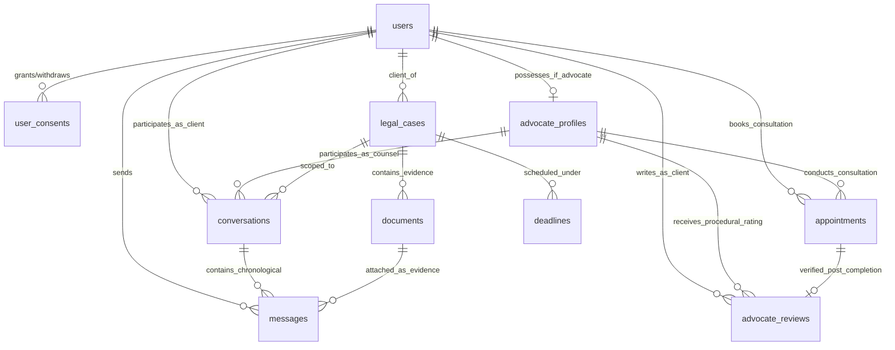

# NyayaSetu API Reference

> Consolidated from: `docs/API.md`, `docs/API.md`, `docs/API.md`, `docs/API.md`, `docs/API.md`.

## Canonical Conventions

- Base URL: `http://localhost:8000/api/v1`
- Auth: Bearer JWT where required.
- Errors: centralized FastAPI error envelope `{"error":{"code","message","details"}, "request_id"}` unless a documented legacy endpoint differs.
- Validate request bodies with Pydantic schemas at route boundaries.


---

## Core API Contract

# API Specification & Endpoint Contract — NyayaSetu API v1

**Base URL:** `http://localhost:8000/api/v1`  
**Standard Port:** 8000  
**Format:** JSON (`application/json`)  
**Authentication Scheme:** HTTP Bearer JWT (`Authorization: Bearer <access_token>`)  

---

## 1. System Health & Diagnostics

### `GET /api/v1/health`
Probes API server liveness, PostgreSQL database latency, and system version.
* **Authentication:** Public
* **Request:** None
* **Response (200 OK):**
```json
{
  "status": "healthy",
  "service": "NyayaSetu Backend API",
  "version": "0.1.0",
  "environment": "development",
  "database": {
    "status": "connected",
    "latency_ms": 2.14
  }
}
```
* **Error (503 Service Unavailable):** If database connection times out or fails.

---

## 2. Authentication & Session Module (`/auth`)

### `POST /api/v1/auth/register`
Registers a new citizen or universal user. Self-assignment of `ADMIN` role is blocked.
* **Authentication:** Public
* **Request Body:**
```json
{
  "account_type": "CITIZEN",
  "full_name": "Aarav Sharma",
  "email": "aarav.sharma@example.com",
  "phone": "+919876543210",
  "password": "SecurePassword123",
  "preferred_language": "hi"
}
```
* **Response (201 Created):**
```json
{
  "id": "e4b2d5f0-6a12-4d89-b22c-8d1976bcf129",
  "email": "aarav.sharma@example.com",
  "phone": "+919876543210",
  "full_name": "Aarav Sharma",
  "role": "CITIZEN",
  "is_verified": false,
  "is_active": true,
  "preferred_language": "hi",
  "created_at": "2026-11-20T10:00:00Z"
}
```
* **Error Responses:**
  * `409 Conflict`: Email or phone already registered.
  * `422 Unprocessable Entity`: Password < 8 characters or invalid format.

---

### `POST /api/v1/auth/register/advocate`
Dedicated registration endpoint for legal practitioners with mandatory Bar Council credentials.
* **Authentication:** Public
* **Request Body:**
```json
{
  "full_name": "Adv. Rajeshwari Sen",
  "email": "r.sen@nyayasetu.in",
  "phone": "+919811223344",
  "password": "LegalPassword2026",
  "bar_council_id": "D/1234/2006",
  "bar_council_name": "Bar Council of Delhi",
  "in_practice_years": 18,
  "primary_practice": "Trials & Disputes",
  "city": "New Delhi",
  "state": "Delhi"
}
```
* **Response (201 Created):** Returns user profile with `role: "ADVOCATE"`.

---

### `POST /api/v1/auth/login`
Authenticates via Argon2id password verification and issues JWT access and refresh tokens.
* **Authentication:** Public
* **Request Body:**
```json
{
  "email": "citizen@nyayasetu.in",
  "password": "CitizenPassword2026"
}
```
* **Response (200 OK):**
```json
{
  "access_token": "eyJhbGciOiJIUzI1NiIsIn...",
  "refresh_token": "eyJhbGciOiJIUzI1NiIsIn...",
  "token_type": "bearer",
  "expires_in": 3600,
  "user": {
    "id": "usr_9988-uuid",
    "email": "citizen@nyayasetu.in",
    "phone": "+919876543210",
    "full_name": "Priya Sharma",
    "role": "CITIZEN",
    "is_verified": true,
    "is_active": true,
    "preferred_language": "en",
    "created_at": "2026-11-17T15:00:00Z"
  }
}
```
* **Error Responses:**
  * `401 Unauthorized`: Invalid email or password.
  * `403 Forbidden`: Account deactivated.

---

### `POST /api/v1/auth/refresh`
Rotates an existing refresh token, revoking the old token and returning a new keypair.
* **Authentication:** Public
* **Request Body:**
```json
{
  "refresh_token": "eyJhbGciOiJIUzI1NiIsIn..."
}
```
* **Response (200 OK):** Returns new `access_token` and rotated `refresh_token`.

---

### `POST /api/v1/auth/logout`
Revokes active refresh token and invalidates the user's active session.
* **Authentication:** Bearer JWT required
* **Request Body:** Optional `{"refresh_token": "..."}`
* **Response (200 OK):** `{"success": true, "message": "Successfully logged out."}`

---

### `GET /api/v1/auth/me`
Retrieves authenticated profile of the token bearer.
* **Authentication:** Bearer JWT required
* **Response (200 OK):** Returns `UserResponse` object.

---

## 3. Case Docket & Intake Module (`/cases`)

### `POST /api/v1/cases`
Submits a citizen grievance. Generates unique docket code (`NYA-2026-CS-XXXX`) and automatically executes deterministic legal triage.
* **Authentication:** Bearer JWT (`CITIZEN` or `ADMIN`)
* **Request Body:**
```json
{
  "title": "Unlawful Retention of Commercial Lease Deposit",
  "problem_description": "Landlord refused to return ₹1,50,000 security deposit after complete commercial premises handover on 15 Oct 2026.",
  "legal_issue_category": "Property & Tenancy Disputes",
  "state": "Karnataka",
  "district": "Bengaluru Urban",
  "relevant_court": "Bengaluru City Civil Court",
  "incident_date": "2026-10-15",
  "preferred_language": "en",
  "urgency": "TIME_BOUND_30D",
  "supporting_info": "Possession letter signed by landlord on handover.",
  "adverse_parties": "Brigade Commercial Holdings Pvt Ltd"
}
```
* **Response (201 Created):**
```json
{
  "id": "case-uuid",
  "case_reference": "NYA-2026-CS-4819",
  "client_id": "usr-uuid",
  "title": "Unlawful Retention of Commercial Lease Deposit",
  "stage": "TRIAGED",
  "conflict_status": "CLEARED",
  "triage_result": {
    "identified_category": "Property & Tenancy Disputes",
    "summary_of_facts": "Landlord refused to return security deposit post premises handover.",
    "missing_information": ["Copy of registered commercial lease deed", "Written deposit refund demand notice"],
    "possible_jurisdiction": "Bengaluru City Civil Court / Small Causes Court",
    "urgency_level": "MODERATE",
    "complexity": "MEDIUM",
    "suggested_next_step": "Issue 15-day statutory demand notice through counsel.",
    "advocate_assistance_appropriate": true,
    "show_free_legal_aid": false,
    "assessed_at": "2026-11-20T10:15:00Z"
  },
  "created_at": "2026-11-20T10:15:00Z",
  "updated_at": "2026-11-20T10:15:00Z"
}
```

---

### `GET /api/v1/cases`
Retrieves paginated cases belonging to the authenticated citizen. Enforces ownership isolation.
* **Authentication:** Bearer JWT (`CITIZEN` or `ADMIN`)
* **Query Parameters:** `page` (default 1), `limit` (default 20)
* **Response (200 OK):**
```json
{
  "total": 3,
  "page": 1,
  "limit": 20,
  "items": [ /* array of CaseResponse objects */ ]
}
```

---

### `GET /api/v1/cases/{case_id}`
Retrieves full case dossier details. Callers must be the case owner, assigned counsel, or platform admin.
* **Authentication:** Bearer JWT
* **Response (200 OK):** Detailed `CaseResponse` including attached triage data.
* **Error Responses:** `404 Not Found` or `403 Forbidden`.

---

## 4. Deterministic Triage Module (`/triage`)

### `POST /api/v1/triage/assess`
Evaluates a legal problem narrative without requiring an active case dossier. Routes to one of 4 deterministic paths: `SELF_HELP`, `FREE_LEGAL_AID`, `ADVOCATE_CONSULTATION`, or `URGENT_ASSISTANCE`.
* **Authentication:** Public / Optional JWT
* **Request Body:**
```json
{
  "narrative": "Employer withheld my final salary for 3 months without termination letter.",
  "annual_income_inr": 240000,
  "incident_date": "2026-09-01",
  "state": "Maharashtra",
  "district": "Mumbai"
}
```
* **Response (200 OK):**
```json
{
  "identified_category": "Labour & Employment Disputes",
  "urgency_level": "ROUTINE",
  "complexity": "LOW",
  "advocate_assistance_appropriate": false,
  "show_free_legal_aid": true,
  "recommended_route": "FREE_LEGAL_AID",
  "suggested_next_step": "Eligible for free legal assistance through DLSA under Legal Services Authorities Act, 1987 (annual income <= ₹3,00,000).",
  "possible_jurisdiction": "Labour Commissioner Office / Labour Court Mumbai",
  "missing_information": ["Offer letter and employment contract", "Bank statement showing salary default"]
}
```

---

## 5. Advocate Matching & Discovery (`/matching` & `/advocates`)

### `GET /api/v1/matching/advocates`
BCI Rule 36 compliant advocate discovery. Evaluates transparent multi-factor scoring: Practice Fit (35%), Court Proximity (25%), Language (20%), Experience (10%), and Availability (10%). Zero paid boosting.
* **Authentication:** Public
* **Query Parameters:** `practice_area`, `city`, `district`, `language`, `limit` (default 10)
* **Response (200 OK):**
```json
{
  "total": 5,
  "advocates": [
    {
      "id": "adv_1024-uuid",
      "user_id": "usr_9988-uuid",
      "full_name": "Adv. Rajeshwari Sen",
      "bar_council_id": "D/1234/2006",
      "bar_council_name": "Bar Council of Delhi",
      "in_practice_years": 18,
      "primary_practice": "Trials & Disputes",
      "secondary_practices": ["Commercial Arbitration", "White Collar Criminal Defense"],
      "courts_of_practice": ["Delhi High Court", "Supreme Court of India"],
      "languages": ["English", "Hindi"],
      "city": "New Delhi",
      "district": "New Delhi",
      "fixed_consultation_fee_inr": 2500.0,
      "hourly_rate_inr": 5000.0,
      "is_verified": true,
      "match_score": 0.94,
      "match_reasons": ["Exact match on Trials & Disputes", "Directly practices in Delhi High Court"]
    }
  ]
}
```

---

### `POST /api/v1/advocates/verification/apply`
Allows an advocate to submit their Bar Council credentials, certificate uploads, and enrollment date for admin review.
* **Authentication:** Bearer JWT (`ADVOCATE`)
* **Request Body:** Form metadata + PDF document uploads.
* **Response (201 Created):** Verification application dossier with status `SUBMITTED`.

---

## 6. Grounded Legal AI Assistant (`/legal`)

### `POST /api/v1/legal/ask`
*(Also accessible via alias `POST /api/v1/legal-assistant/ask`)*  
Executes Grounded Retrieval-Augmented Generation against verified Indian Bare Acts and judgments.
* **Authentication:** Public / Optional JWT
* **Request Body:**
```json
{
  "query": "A post-dated cheque was returned with memo 'Funds Insufficient'. What is the limitation period for legal notice?",
  "jurisdiction": "Union of India",
  "preferred_language": "en",
  "max_sources": 3
}
```
* **Response (200 OK):**
```json
{
  "answer": "Under **Negotiable Instruments Act, 1881**, **Section 138: Dishonour of cheque for insufficiency, etc., of funds in the account**, the law provides that a formal statutory legal demand notice in writing must be issued to the drawer within thirty (30) days of receiving information from the bank regarding the return of the cheque as unpaid. If the drawer fails to make payment within fifteen (15) days of receipt of notice, cause of action arises to file a criminal complaint within one month under Section 142.",
  "sources_found": true,
  "detected_language": "en",
  "cited_references": [
    {
      "source_title": "Negotiable Instruments Act, 1881",
      "source_type": "BARE_ACT",
      "act_or_judgment_identifier": "Act No. 26 of 1881",
      "section_or_paragraph": "Section 138",
      "clause_heading": "Dishonour of cheque for insufficiency, etc., of funds in the account",
      "official_source_url": "https://www.indiacode.nic.in/handle/123456789/2189",
      "content_checksum": "9b1c7a82f3..."
    }
  ],
  "suggested_next_steps": [
    "Issue statutory legal demand notice in writing within 30 days of the bank return memo.",
    "Allow 15 days for the drawer to make payment post receipt of notice.",
    "File formal complaint under Section 138 before the competent Judicial Magistrate within 1 month."
  ],
  "disclaimer": "This preliminary assessment is generated for informational guidance from verified Indian statutes and does not constitute legal advice under the Advocates Act, 1961. Submitting this query does not establish an advocate-client relationship."
}
```

---

## 7. Evidence & Document Vault (`/documents`)

### `POST /api/v1/documents/cases/{case_id}/upload`
Uploads case evidence or legal notice filings to private storage with SHA-256 integrity validation and case ownership enforcement.
* **Authentication:** Bearer JWT (`CITIZEN`, `ADVOCATE`, `ADMIN`)
* **Request:** Multipart Form Data:
  * `file`: Binary document (`.pdf`, `.png`, `.jpeg`, `.docx` up to 25MB)
  * `document_category`: Form field (`"EVIDENCE"` | `"NOTICE"` | `"PLEADINGS"`)
  * `is_confidential`: Form field (`true` | `false`)
* **Response (201 Created):**
```json
{
  "id": "doc-uuid",
  "case_id": "case-uuid",
  "file_name": "Bank_Return_Memo_Cheque_04819.pdf",
  "file_size_bytes": 142080,
  "mime_type": "application/pdf",
  "document_category": "EVIDENCE",
  "sha256_checksum": "a4f89b...",
  "is_confidential": true,
  "uploaded_at": "2026-11-20T10:30:00Z"
}
```

---

### `GET /api/v1/documents/{document_id}/access-token`
Generates an authorized, short-lived signed download token valid for 15 minutes. Never exposes public static file URLs.
* **Authentication:** Bearer JWT (Owner, Lead Advocate, or Admin)
* **Response (200 OK):**
```json
{
  "document_id": "doc-uuid",
  "download_token": "eyJhbGciOiJIUzI1NiIsIn...",
  "expires_in_seconds": 900,
  "download_url": "/api/v1/documents/doc-uuid/download?token=eyJhbGciOiJIUzI1NiIsIn..."
}
```

---

### `GET /api/v1/documents/{document_id}/download`
Securely streams document binary from private vault using either Bearer token or short-lived download token.
* **Authentication:** Bearer JWT OR `?token=<download_token>` query parameter
* **Response (200 OK):** Binary file stream with `Content-Type` and `Content-Disposition`.

---

## 8. Appointments & Consultation Booking (`/appointments`)

### `POST /api/v1/appointments`
Reserves a consultation slot with conflict check and booking reference generation (`NYA-BK-2026-XXXX`).
* **Authentication:** Bearer JWT (`CITIZEN`)
* **Request Body:**
```json
{
  "advocate_id": "adv-uuid",
  "case_id": "case-uuid",
  "scheduled_start": "2026-11-25T10:00:00Z",
  "scheduled_end": "2026-11-25T10:30:00Z",
  "timezone": "Asia/Kolkata",
  "mode": "VIDEO",
  "fee_inr": 2500.0,
  "client_notes": "Preliminary conference regarding Section 138 demand notice."
}
```
* **Response (201 Created):**
```json
{
  "id": "appt-uuid",
  "booking_reference": "NYA-BK-2026-1049",
  "advocate_id": "adv-uuid",
  "client_id": "usr-uuid",
  "scheduled_start": "2026-11-25T10:00:00Z",
  "scheduled_end": "2026-11-25T10:30:00Z",
  "status": "PENDING_CONFIRMATION",
  "mode": "VIDEO",
  "fee_inr": 2500.0,
  "payment_status": "PENDING"
}
```

---

### `PATCH /api/v1/appointments/{appointment_id}/accept`
Empanelled advocate accepts a requested consultation appointment.
* **Authentication:** Bearer JWT (`ADVOCATE`)
* **Response (200 OK):** Returns appointment with `status: "CONFIRMED"`.

---

## 9. Statutory Deadlines & Limitation Tracking (`/deadlines`)

### `POST /api/v1/deadlines`
Creates a court deadline or statutory limitation period linked to a case docket.
* **Authentication:** Bearer JWT (`CITIZEN`, `ADVOCATE`, `ADMIN`)
* **Request Body:**
```json
{
  "case_id": "case-uuid",
  "title": "Section 138 Statutory Demand Notice Expiry",
  "deadline_date": "2026-12-05",
  "deadline_type": "STATUTORY_LIMITATION",
  "statutory_basis": "Negotiable Instruments Act, 1881 — Section 138 proviso (b)",
  "remind_days_before": [7, 3, 1]
}
```
* **Response (201 Created):** Returns `DeadlineResponse`.

---

### `PATCH /api/v1/deadlines/{deadline_id}/confirm`
Advocate review confirmation of a statutory deadline (`is_advocate_confirmed: true`).
* **Authentication:** Bearer JWT (`ADVOCATE`)
* **Response (200 OK):** Updated deadline with confirmation timestamp and advocate ID.

---

## 10. Platform Governance & Admin Module (`/admin`)

### `GET /api/v1/admin/stats`
Platform oversight metrics: user counts, active dockets, appointment counts, and audit volume.
* **Authentication:** Bearer JWT (`ADMIN` only)
* **Response (200 OK):**
```json
{
  "total_users": 142,
  "citizens_count": 118,
  "advocates_count": 23,
  "active_cases": 45,
  "total_appointments": 82,
  "statutory_chunks_indexed": 5
}
```

---

### `POST /api/v1/admin/advocates/{advocate_id}/verify`
Admin verifies an advocate's State Bar Council credentials and sets `is_verified: true`.
* **Authentication:** Bearer JWT (`ADMIN` only)
* **Request Body:**
```json
{
  "decision_reason": "Verified enrollment certificate against Bar Council of Delhi gazette rolls.",
  "official_roll_registration": "D/1234/2006"
}
```
* **Response (200 OK):** `{"success": true, "message": "Advocate credentials verified successfully."}`

---

### `GET /api/v1/admin/audit-logs`
Inspects immutable compliance audit logs for DPDP consent changes, auth attempts, and RAG queries.
* **Authentication:** Bearer JWT (`ADMIN` only)
* **Query Parameters:** `page`, `limit`, `action`
* **Response (200 OK):** Paginated array of audit log entries.


---

## Dashboard API Contracts

# NyayaSetu Dashboard API Contracts & Database Architecture Specification

**Document Version:** 1.0.0  
**Status:** Approved Architecture Draft  
**Target Architecture:** FastAPI 0.115 Modular Monolith + PostgreSQL 16 (Psycopg 3, PostGIS, pgvector) + Next.js 16 Client  
**Compliance Standards:** Digital Personal Data Protection Act, 2023 (DPDP) · Bar Council of India Rule 36 · Bharatiya Sakshya Adhiniyam, 2023 (BSA §126–129)

---

## 1. Architectural Scope & Objectives

This specification defines the authoritative backend API contracts, SQLAlchemy 2.0 data models, Alembic migration requirements, and authorization rules necessary to replace all frontend client mock services in `frontend/src/services/dashboard/` with verified, persistent, production-grade endpoints.

### Core Architecture Invariants
1. **Reuse Existing Domain Entities:** Leverage existing `User`, `LegalCase`, `Appointment`, `AdvocateProfile`, `Document`, and `Deadline` models without duplication.
2. **Strict Multi-Tenant Isolation:** Enforce user ownership on all reads and mutations. Citizens cannot access other citizens' cases, messages, consents, or documents (`403 Forbidden`).
3. **Statutory Compliance by Design:**
   - **DPDP Act 2023:** Server-side cryptographic consent logging (§6), statutory data export (§11), and right to erasure (§12).
   - **BCI Rule 36:** Reviews are restricted to verified, completed consultations (`Appointment.status == 'COMPLETED'`) with zero promotional ranking or fee solicitation.
   - **BSA 2023 §126–129:** Case communications are marked as privileged client-advocate records.
4. **Standardized Error Formatting:** All error responses follow `{"error": {"code": "...", "message": "...", "details": {...}}, "request_id": "..."}`.

---

## 2. Database Schema Design & Entity-Relationship Model



### 2.1 Schema Modifications to Existing Tables

#### Table: `users`
Add columns to support citizen profile details and jurisdictional residency:
```python
# Added to backend/app/modules/users/models.py:
city: Mapped[Optional[str]] = mapped_column(String(128), nullable=True, index=True)
state: Mapped[Optional[str]] = mapped_column(String(128), nullable=True, index=True)
```

---

### 2.2 Genuinely Missing Models (To Be Created)

#### 1. `UserConsent` Entity (`user_consents` table)
Tracks explicit data processing authorizations pursuant to DPDP Act 2023 §6.

| Column | Type | Constraints | Description |
| :--- | :--- | :--- | :--- |
| `id` | `UUID` | Primary Key, Default `uuid.uuid4` | Unique consent record identifier |
| `user_id` | `UUID` | Foreign Key (`users.id`, `CASCADE`), NOT NULL, Index | Data principal citizen |
| `consent_type` | `VARCHAR(64)` | NOT NULL, Index | `TERMS`, `PRIVACY`, `DPDP`, `SHARE_BRIEF`, `SHARE_DOCUMENTS` |
| `version` | `VARCHAR(16)` | NOT NULL, Default `'1.0'` | Statutory policy version accepted |
| `purpose` | `VARCHAR(255)` | Nullable | Specific processing purpose e.g. "Advocate case evaluation" |
| `advocate_id` | `UUID` | Foreign Key (`advocate_profiles.id`, `SET NULL`), Nullable | Authorized advocate recipient |
| `items_shared` | `JSONB` / `JSON` | Nullable, Default `list` | Specific records shared (e.g. `["Case Brief", "Deed.pdf"]`) |
| `is_revoked` | `BOOLEAN` | NOT NULL, Default `FALSE`, Index | Active vs revoked status |
| `revoked_at` | `TIMESTAMPTZ` | Nullable | Timestamp of statutory withdrawal |
| `ip_address` | `VARCHAR(45)` | Nullable | IP address at time of grant |
| `user_agent` | `VARCHAR(255)` | Nullable | Client device telemetry at grant |
| `created_at` | `TIMESTAMPTZ` | NOT NULL, Default `now()`, Index | Timestamp of consent grant |
| `updated_at` | `TIMESTAMPTZ` | NOT NULL, Default `now()` | Audit update timestamp |

**Indexes & Constraints:**
- `ix_user_consents_user_revoked (user_id, is_revoked)`
- `ix_user_consents_user_type (user_id, consent_type)`

---

#### 2. `Conversation` Entity (`conversations` table)
Persistent conversation container grouping privileged client-advocate communications.

| Column | Type | Constraints | Description |
| :--- | :--- | :--- | :--- |
| `id` | `UUID` | Primary Key, Default `uuid.uuid4` | Conversation thread ID |
| `client_id` | `UUID` | Foreign Key (`users.id`, `CASCADE`), NOT NULL, Index | Participating citizen |
| `advocate_id` | `UUID` | Foreign Key (`advocate_profiles.id`, `CASCADE`), NOT NULL, Index | Participating advocate |
| `case_id` | `UUID` | Foreign Key (`legal_cases.id`, `SET NULL`), Nullable, Index | Associated case matter dossier |
| `subject` | `VARCHAR(255)` | NOT NULL | Thread subject / matter title |
| `last_message_at`| `TIMESTAMPTZ` | NOT NULL, Default `now()`, Index | Timestamp of latest message |
| `is_archived` | `BOOLEAN` | NOT NULL, Default `FALSE`, Index | Archival state |
| `created_at` | `TIMESTAMPTZ` | NOT NULL, Default `now()` | Thread creation time |
| `updated_at` | `TIMESTAMPTZ` | NOT NULL, Default `now()` | Thread update time |

**Indexes & Constraints:**
- `UNIQUE (client_id, advocate_id, case_id)`: Prevents duplicate active communication threads for the same matter.

---

#### 3. `Message` Entity (`messages` table)
Individual chronological messages protected under BSA 2023 §126–129.

| Column | Type | Constraints | Description |
| :--- | :--- | :--- | :--- |
| `id` | `UUID` | Primary Key, Default `uuid.uuid4` | Message identifier |
| `conversation_id`| `UUID` | Foreign Key (`conversations.id`, `CASCADE`), NOT NULL, Index | Parent conversation thread |
| `sender_id` | `UUID` | Foreign Key (`users.id`, `RESTRICT`), NOT NULL, Index | Authoring user |
| `sender_role` | `VARCHAR(32)` | NOT NULL | `CLIENT`, `ADVOCATE`, `SYSTEM` |
| `message_text` | `TEXT` | NOT NULL | Message body |
| `attachment_document_id` | `UUID` | Foreign Key (`documents.id`, `SET NULL`), Nullable | Attached vault document |
| `is_read` | `BOOLEAN` | NOT NULL, Default `FALSE`, Index | Read receipt tracking |
| `read_at` | `TIMESTAMPTZ` | Nullable | Timestamp when recipient read the message |
| `is_privileged` | `BOOLEAN` | NOT NULL, Default `TRUE` | Privileged under BSA 2023 §126–129 |
| `created_at` | `TIMESTAMPTZ` | NOT NULL, Default `now()`, Index | Message dispatch timestamp |
| `updated_at` | `TIMESTAMPTZ` | NOT NULL, Default `now()` | Audit update timestamp |

**Indexes & Constraints:**
- `ix_messages_conv_created (conversation_id, created_at)`
- `ix_messages_unread (conversation_id, sender_id, is_read)`

---

#### 4. `AdvocateReview` Entity (`advocate_reviews` table)
Verified post-consultation evaluation under strict BCI Rule 36 compliance.

| Column | Type | Constraints | Description |
| :--- | :--- | :--- | :--- |
| `id` | `UUID` | Primary Key, Default `uuid.uuid4` | Unique evaluation record ID |
| `appointment_id` | `UUID` | Foreign Key (`appointments.id`, `CASCADE`), NOT NULL, Unique, Index | Completed consultation reference |
| `reviewer_id` | `UUID` | Foreign Key (`users.id`, `CASCADE`), NOT NULL, Index | Authoring citizen (must match `appointment.client_id`) |
| `advocate_id` | `UUID` | Foreign Key (`advocate_profiles.id`, `CASCADE`), NOT NULL, Index | Evaluated advocate |
| `rating` | `INTEGER` | NOT NULL, `CHECK (rating >= 1 AND rating <= 5)` | Statutory grade: 1 to 5 stars |
| `tags` | `JSONB` / `JSON` | Nullable, Default `list` | Procedural quality tags |
| `review_text` | `TEXT` | Nullable | Optional citizen observations (max 500 chars) |
| `resolution_status` | `VARCHAR(32)` | NOT NULL, Default `'in_progress'` | `yes`, `in_progress`, `no` |
| `moderation_status` | `VARCHAR(32)` | NOT NULL, Default `'PUBLISHED'`, Index | `PUBLISHED`, `FLAGGED`, `REMOVED` |
| `created_at` | `TIMESTAMPTZ` | NOT NULL, Default `now()`, Index | Review submission timestamp |
| `updated_at` | `TIMESTAMPTZ` | NOT NULL, Default `now()` | Last modification timestamp |

**Indexes & Constraints:**
- `UNIQUE (appointment_id)`: Guarantees exactly one evaluation per verified consultation session.
- `CHECK (rating >= 1 AND rating <= 5)`: Enforces standard rating boundaries.

---

### 2.3 Alembic Migration Plan (`0012_dashboard_integrations.py`)

A single forward migration will execute:
1. `op.add_column('users', sa.Column('city', sa.String(128), nullable=True))`
2. `op.add_column('users', sa.Column('state', sa.String(128), nullable=True))`
3. `op.create_table('user_consents', ...)`
4. `op.create_table('conversations', ...)`
5. `op.create_table('messages', ...)`
6. `op.create_table('advocate_reviews', ...)`
7. Create all foreign keys, unique constraints, and B-tree indexes.

---

## 3. Detailed API Contracts Specification

### Domain 1: User Profile & Dossier Management

#### 1.1 `GET /api/v1/users/me`
Retrieve authenticated caller's profile dossier, verified credentials, and jurisdictional location.

* **Authorization:** Bearer JWT (`CITIZEN`, `ADVOCATE`, `ADMIN`)
* **Success Response (`200 OK`):**
```json
{
  "id": "3d93cbcd-0690-4d78-8759-c0e7e063c912",
  "full_name": "Rahul Kumar",
  "email": "rahul.kumar@example.com",
  "phone": "+919876543210",
  "role": "CITIZEN",
  "preferred_language": "en",
  "city": "Bengaluru",
  "state": "Karnataka",
  "is_verified": true,
  "is_active": true,
  "created_at": "2026-01-15T09:30:00Z",
  "updated_at": "2026-11-22T08:00:00Z"
}
```

#### 1.2 `PUT /api/v1/users/me`
Update mutable profile attributes (name, email, language preference, jurisdictional city/state). Mobile phone identifier is immutable (bound to OTP).

* **Authorization:** Bearer JWT (`CITIZEN`, `ADVOCATE`, `ADMIN`)
* **Request Payload (`application/json`):**
```json
{
  "full_name": "Rahul Kumar Sen",
  "email": "rahul.sen@example.com",
  "preferred_language": "hi",
  "city": "Bengaluru",
  "state": "Karnataka"
}
```
* **Validation Rules:**
  - `full_name`: Min 2, max 255 chars.
  - `email`: Valid RFC 5322 email. Unique in `users` (returns `409 Conflict` if claimed by another account).
  - `preferred_language`: One of `en`, `hi`, `mr`, `ta`, `te`, `bn`, `kn`.
* **Success Response (`200 OK`):** Updated `UserProfileResponse`.
* **Error Responses:** `400 Bad Request` (validation failure), `401 Unauthorized`, `409 Conflict` (email collision).

---

### Domain 2: DPDP Consent Ledger Management

#### 2.1 `GET /api/v1/users/me/consents`
List chronological consent authorizations, purpose specifications, and revocation statuses.

* **Authorization:** Bearer JWT (`current_user.id == consent.user_id`)
* **Query Parameters:**
  - `include_revoked: bool = True`
  - `page: int = 1`, `limit: int = 20`
* **Success Response (`200 OK`):**
```json
{
  "total": 3,
  "items": [
    {
      "id": "c1f7a42b-58bb-4b92-80ea-1b91384f8801",
      "consent_type": "SHARE_BRIEF",
      "version": "1.0",
      "purpose": "Case brief evaluation",
      "advocate_id": "46e55000-7dcb-486c-bab4-bd96bc6d9d38",
      "advocate_name": "Adv. Ananya Rao",
      "items_shared": ["Case brief", "Rent Agreement 2024.pdf"],
      "is_revoked": false,
      "revoked_at": null,
      "granted_at": "2026-11-20T10:15:00Z"
    },
    {
      "id": "b2e6931a-47aa-4a81-70da-0a80273e7700",
      "consent_type": "DPDP",
      "version": "1.0",
      "purpose": "Digital personal data processing under DPDP Act 2023",
      "advocate_id": null,
      "items_shared": [],
      "is_revoked": false,
      "revoked_at": null,
      "granted_at": "2026-01-15T09:30:00Z"
    }
  ]
}
```

#### 2.2 `POST /api/v1/users/me/consents`
Record an explicit data processing or case record sharing consent grant.

* **Authorization:** Bearer JWT
* **Request Payload (`application/json`):**
```json
{
  "consent_type": "SHARE_BRIEF",
  "version": "1.0",
  "purpose": "Case brief review for tenancy consultation",
  "advocate_id": "46e55000-7dcb-486c-bab4-bd96bc6d9d38",
  "items_shared": ["Case brief", "Rent Agreement 2024.pdf"]
}
```
* **Success Response (`201 Created`):** Created `ConsentResponse` object with server-assigned timestamp and ID.

#### 2.3 `POST /api/v1/users/me/consents/{consent_id}/withdraw`
Statutory consent revocation under DPDP Act 2023 §6(4).

* **Authorization:** Bearer JWT (`current_user.id == consent.user_id`)
* **Success Response (`200 OK`):**
```json
{
  "status": "revoked",
  "consent_id": "c1f7a42b-58bb-4b92-80ea-1b91384f8801",
  "revoked_at": "2026-11-22T12:40:00Z",
  "message": "Consent authorization successfully revoked pursuant to DPDP Act 2023 §6(4)."
}
```
* **Error Responses:** `404 Not Found` (consent ID not found), `403 Forbidden` (cross-user access).

---

### Domain 3: Personal Data Governance & Statutory Rights

#### 3.1 `POST /api/v1/users/me/data-export`
Exercise Right to Data Portability (DPDP Act §11). Assembles and delivers an encrypted, signed JSON dossier.

* **Authorization:** Bearer JWT
* **Success Response (`200 OK`):**
```json
{
  "export_id": "exp_882041",
  "exported_at": "2026-11-22T12:42:00Z",
  "signature_sha256": "8a3e72b490f84...",
  "dossier": {
    "user_profile": {
      "id": "3d93cbcd-0690-4d78-8759-c0e7e063c912",
      "full_name": "Rahul Kumar",
      "email": "rahul.kumar@example.com",
      "phone": "+919876543210"
    },
    "consents": [...],
    "cases": [
      {
        "case_reference": "NYA-2026-CS-8421",
        "title": "Security deposit recovery under State Tenancy Act",
        "category": "Tenancy & Rent",
        "stage": "PRE_FILING"
      }
    ],
    "documents": [
      {
        "file_name": "Rent Agreement 2024.pdf",
        "file_size_bytes": 1048576,
        "checksum_sha256": "e3b0c442...",
        "uploaded_at": "2026-11-20T10:14:00Z"
      }
    ],
    "appointments": [...]
  }
}
```

#### 3.2 `DELETE /api/v1/users/me`
Exercise Right to Erasure / Right to be Forgotten (DPDP Act §12).

* **Authorization:** Bearer JWT (`CITIZEN` or `ADVOCATE`)
* **Operation:**
  1. Anonymizes PII in `users` (`full_name = "Anonymized User"`, `email = "erased_<uuid>@nyayasetu.internal"`).
  2. Sets `is_active = FALSE`.
  3. Revokes all refresh tokens in `refresh_tokens`.
  4. Records `AuditLog(action="USER_DATA_ERASURE_COMPLETED")`.
* **Success Response (`200 OK`):**
```json
{
  "status": "purged",
  "message": "User account and personal identifiers permanently erased in compliance with DPDP Act 2023 §12."
}
```

---

### Domain 4: Consolidated Dashboard Overview

#### 4.1 `GET /api/v1/dashboard/summary`
Unified aggregation endpoint replacing multiple client-side round-trips for the home dashboard cards.

* **Authorization:** Bearer JWT
* **Success Response (`200 OK`):**
```json
{
  "active_cases": 2,
  "unread_messages": 3,
  "pending_actions": 2,
  "next_deadline": {
    "id": "7c35dcb5-37b3-437e-9709-e76ff81d0e34",
    "case_id": "87a40164-8156-4b60-94e4-59566912b1b0",
    "case_reference": "NYA-2026-CS-8421",
    "title": "Section 138 Notice Response Expiry",
    "due_date": "2026-12-04T00:00:00Z",
    "days_remaining": 12,
    "is_confirmed": true,
    "statutory_provision": "Negotiable Instruments Act, 1881 §138"
  },
  "recent_case": {
    "id": "87a40164-8156-4b60-94e4-59566912b1b0",
    "case_reference": "NYA-2026-CS-8421",
    "title": "Security deposit recovery under State Tenancy Act",
    "category": "Tenancy Dispute",
    "stage": "PRE_FILING",
    "progress_percentage": 75,
    "updated_at": "2026-11-20T14:30:00Z"
  },
  "upcoming_deadlines": [
    {
      "id": "7c35dcb5-37b3-437e-9709-e76ff81d0e34",
      "title": "Section 138 Notice Response Expiry",
      "due_date": "2026-12-04T00:00:00Z",
      "days_remaining": 12,
      "is_confirmed": true
    }
  ],
  "upcoming_appointment": {
    "id": "9042a1b2-3c4d-5e6f-7a8b-9c0d1e2f3a4b",
    "booking_reference": "NYA-BK-2026-9042",
    "advocate_name": "Adv. Ananya Rao",
    "scheduled_start": "2026-11-25T10:00:00+05:30",
    "mode": "VIDEO_CONFERENCE",
    "status": "CONFIRMED"
  }
}
```

---

### Domain 5: Document Scanner, OCR & Explainer Pipeline

#### 5.1 `POST /api/v1/documents/scan`
Extract statutory text from uploaded document bytes (PDF, JPEG, PNG, DOCX). Reuses vault storage validation rules.

* **Authorization:** Bearer JWT
* **Content-Type:** `multipart/form-data`
* **Request Form:**
  - `file: UploadFile` (Binary payload, max 10 MB)
  - `case_id: Optional[UUID]` (If supplied, file is also saved to vault)
* **Processing Steps:**
  1. Magic byte signature verification.
  2. Text extraction via PDF text parser or Indic OCR engine.
  3. Calculation of OCR confidence metrics.
* **Success Response (`200 OK`):**
```json
{
  "document_id": "e7d67c90-063b-4bd0-a74a-9a1861a971ce",
  "file_name": "legal_notice_demand.pdf",
  "extracted_text": "LEGAL NOTICE\n\nTo, Mr. S. Rao, 402, Lake View Apartments, HSR Layout, Bengaluru 560102...",
  "confidence_score": 0.94,
  "is_low_confidence": false,
  "page_count": 2,
  "detected_language": "en"
}
```

#### 5.2 `GET /api/v1/documents/{document_id}/processing-status`
Poll status of background OCR or AI document parsing.

* **Authorization:** Bearer JWT (`current_user.id == doc.uploader_id`)
* **Success Response (`200 OK`):**
```json
{
  "document_id": "e7d67c90-063b-4bd0-a74a-9a1861a971ce",
  "status": "COMPLETED",
  "progress_percentage": 100,
  "error_message": null
}
```

#### 5.3 `POST /api/v1/documents/explain`
Dispatches extracted statutory text to `GeminiLLMProvider` for structured legal decomposition.

* **Authorization:** Bearer JWT
* **Request Payload (`application/json`):**
```json
{
  "text": "LEGAL NOTICE\n\nTo, Mr. S. Rao, 402, Lake View Apartments...",
  "language": "en"
}
```
* **Success Response (`200 OK`):**
```json
{
  "document_type": "Legal notice (demand for refund of security deposit)",
  "summary": "Formal demand sent to landlord demanding return of ₹60,000 security deposit withheld without lawful justification.",
  "parties": [
    "Mr. S. Rao — Recipient (Landlord)",
    "Rahul Kumar — Complainant (Tenant)",
    "M/s Rao & Associates — Issuing Advocates"
  ],
  "dates": [
    { "label": "Notice Issued", "value": "2026-10-02" },
    { "label": "Statutory Reply Deadline", "value": "2026-10-17" }
  ],
  "amounts": [
    { "label": "Security Deposit Claimed", "value": "₹60,000" }
  ],
  "obligations": [
    { "party": "Recipient", "action": "Refund ₹60,000", "deadline": "Within 15 days of notice receipt" }
  ],
  "disclaimer": "NyayaSetu automated extraction is for informational orientation only and does not constitute formal legal counsel."
}
```

---

### Domain 6: Privileged Case Messaging & Real-Time Communications

#### 6.1 `GET /api/v1/conversations`
List active conversation threads for the authenticated user with unread counts.

* **Authorization:** Bearer JWT
* **Success Response (`200 OK`):**
```json
{
  "total": 2,
  "items": [
    {
      "id": "f4d78d5f-3ca6-412e-b3f9-2e547a111be7",
      "case_id": "87a40164-8156-4b60-94e4-59566912b1b0",
      "case_reference": "NYA-2026-CS-8421",
      "subject": "Security Deposit Recovery",
      "advocate_id": "46e55000-7dcb-486c-bab4-bd96bc6d9d38",
      "advocate_name": "Adv. Ananya Rao",
      "last_message": "Draft petition ready for review. Please inspect attached brief.",
      "last_message_at": "2026-11-22T09:15:00Z",
      "unread_count": 1
    }
  ]
}
```

#### 6.2 `GET /api/v1/conversations/{conversation_id}/messages`
Retrieve chronological messages for a conversation thread.

* **Authorization:** Bearer JWT (`current_user.id IN (conversation.client_id, conversation.advocate_user_id)`)
* **Query Parameters:** `page: int = 1`, `limit: int = 50`
* **Success Response (`200 OK`):**
```json
{
  "conversation_id": "f4d78d5f-3ca6-412e-b3f9-2e547a111be7",
  "total": 4,
  "items": [
    {
      "id": "a1b2c3d4-e5f6-7a8b-9c0d-1e2f3a4b5c6d",
      "sender_id": "3d93cbcd-0690-4d78-8759-c0e7e063c912",
      "sender_name": "Rahul Kumar",
      "sender_role": "CLIENT",
      "text": "Hello Adv. Ananya, did you receive the bank transaction statement?",
      "attachment": null,
      "is_read": true,
      "read_at": "2026-11-21T14:32:00Z",
      "created_at": "2026-11-21T14:30:00Z"
    },
    {
      "id": "b2c3d4e5-f6a7-8b9c-0d1e-2f3a4b5c6d7e",
      "sender_id": "e98001a0-1b04-4ebc-a651-311e503bc452",
      "sender_name": "Adv. Ananya Rao",
      "sender_role": "ADVOCATE",
      "text": "Yes, statement verified. The ₹60,000 debit matches your lease schedule.",
      "attachment": null,
      "is_read": false,
      "read_at": null,
      "created_at": "2026-11-22T09:15:00Z"
    }
  ]
}
```

#### 6.3 `POST /api/v1/conversations/{conversation_id}/messages`
Post persistent message into the conversation thread.

* **Authorization:** Bearer JWT (`current_user.id IN (conversation.client_id, conversation.advocate_user_id)`)
* **Request Payload (`application/json`):**
```json
{
  "text": "Please proceed with filing the claim before the Rent Controller.",
  "attachment_document_id": null
}
```
* **Success Response (`201 Created`):** Created `MessageResponse` object.

#### 6.4 `PATCH /api/v1/conversations/{conversation_id}/messages/{message_id}/read`
Mark message as read by the recipient.

* **Authorization:** Bearer JWT (Recipient only; sender cannot mark own message as read)
* **Success Response (`200 OK`):** `{ "status": "read", "read_at": "2026-11-22T12:45:00Z" }`.

---

### Domain 7: Verified Consultation Reviews (BCI Rule 36 Compliant)

#### 7.1 `POST /api/v1/appointments/{appointment_id}/reviews`
Submit post-consultation evaluation for a concluded session.

* **Authorization:** Bearer JWT (`current_user.id == appointment.client_id`)
* **Pre-conditions Enforced:**
  1. `appointment.status == 'COMPLETED'`.
  2. No existing review for `appointment_id` (`UNIQUE` constraint).
* **Request Payload (`application/json`):**
```json
{
  "rating": 5,
  "tags": [
    "Clear communication",
    "Punctual & prepared",
    "Actionable next steps"
  ],
  "comment": "Articulated the limitation deadline under Section 138 clearly and prepared the demand notice draft.",
  "resolution_status": "in_progress"
}
```
* **Success Response (`201 Created`):**
```json
{
  "id": "8da06f02-7ddc-4c91-b945-2baf637af6e0",
  "appointment_id": "9042a1b2-3c4d-5e6f-7a8b-9c0d1e2f3a4b",
  "booking_reference": "NYA-BK-2026-9042",
  "advocate_id": "46e55000-7dcb-486c-bab4-bd96bc6d9d38",
  "rating": 5,
  "tags": ["Clear communication", "Punctual & prepared", "Actionable next steps"],
  "resolution_status": "in_progress",
  "created_at": "2026-11-22T12:46:00Z"
}
```
* **Error Responses:**
  - `400 Bad Request`: Consultation not yet marked completed.
  - `403 Forbidden`: Caller is not the client of this appointment.
  - `409 Conflict`: Review already registered for this appointment ID.

#### 7.2 `GET /api/v1/advocates/{advocate_id}/reviews`
List verified procedural evaluations for an advocate. Reviewer names are sanitized (`"Rahul K."` or `"Verified Client"`) to preserve privacy under DPDP rules.

* **Authorization:** Public / Authenticated
* **Query Parameters:** `page: int = 1`, `limit: int = 10`
* **Success Response (`200 OK`):**
```json
{
  "advocate_id": "46e55000-7dcb-486c-bab4-bd96bc6d9d38",
  "average_procedural_score": 4.8,
  "total_reviews": 14,
  "items": [
    {
      "id": "8da06f02-7ddc-4c91-b945-2baf637af6e0",
      "rating": 5,
      "tags": ["Clear communication", "Punctual & prepared"],
      "comment": "Articulated the limitation deadline under Section 138 clearly.",
      "resolution_status": "in_progress",
      "reviewer_display_name": "Rahul K.",
      "created_at": "2026-11-22T12:46:00Z"
    }
  ]
}
```

#### 7.3 `PATCH /api/v1/advocates/reviews/{review_id}/moderate`
Admin-only compliance moderation pursuant to BCI Rule 36.

* **Authorization:** Bearer JWT (`Role == ADMIN`)
* **Request Payload (`application/json`):**
```json
{
  "moderation_status": "FLAGGED",
  "moderator_notes": "Contains promotional outcome claim; unpublishing pursuant to BCI Rule 36."
}
```
* **Success Response (`200 OK`):** Updated review record with moderation status.

---

## 4. Standardized Error Responses

All endpoints adhere to NyayaSetu's centralized error schema in `app/main.py`:

```json
{
  "error": {
    "code": "FORBIDDEN",
    "message": "Access forbidden: You do not have permission to access communications for this case.",
    "details": {
      "case_id": "87a40164-8156-4b60-94e4-59566912b1b0",
      "required_role": "CASE_CLIENT_OR_COUNSEL"
    }
  },
  "request_id": "req_88f01b92"
}
```

| HTTP Status | Error Code | Trigger Condition |
| :--- | :--- | :--- |
| `400 Bad Request` | `BAD_REQUEST` | Validation error, uncompleted appointment review attempt, invalid magic bytes |
| `401 Unauthorized` | `UNAUTHORIZED` | Missing or expired JWT access token |
| `403 Forbidden` | `FORBIDDEN` | Cross-tenant access attempt (accessing another user's dossier, consent, or thread) |
| `404 Not Found` | `NOT_FOUND` | Target entity ID does not exist |
| `409 Conflict` | `CONFLICT` | Email already registered; duplicate review on same appointment |
| `429 Too Many Requests` | `RATE_LIMIT_EXCEEDED` | Exceeding 30 uploads/hour or rapid-fire messaging thresholds |

---

## 5. Implementation Sequence & Execution Roadmap

```
Phase 1: Database Migration (0012_dashboard_integrations.py)
   ├── 1. Add city, state columns to 'users' table
   ├── 2. Create 'user_consents' table
   ├── 3. Create 'conversations' and 'messages' tables
   └── 4. Create 'advocate_reviews' table
      │
      ▼
Phase 2: Backend Module Implementation
   ├── modules/users/ (router.py, schemas.py, service.py)
   ├── modules/dashboard/ (GET /api/v1/dashboard/summary)
   ├── modules/documents/ (POST /scan, GET /processing-status, POST /explain)
   ├── modules/cases/ (GET/POST /conversations and /messages)
   └── modules/appointments/ (POST/GET /reviews)
      │
      ▼
Phase 3: Automated Test Verification
   ├── Pytest suite covering all 7 endpoint domains (isolation, RBAC, BCI rules)
   └── Complete regression check across existing 197 tests
```

---

*This specification is ready for review. Implementation of Phase 1 and Phase 2 will begin upon your approval.*


---

## Backend API Contract (Detailed Module Spec)

# API Contract — NyayaSetu API v1

All version 1 endpoints are routed under prefix `/api/v1`.

## 1. Authentication & Authorization Module

Authentication uses **Argon2id** password hashing and **JWT** (JSON Web Tokens) with short-lived access tokens and rotated, revocable refresh tokens.

### Account Roles
1. `CITIZEN`: Standard litigant or business client seeking legal advisory or court representation.
2. `ADVOCATE`: Verified legal practitioner empanelled on NyayaSetu with Bar Council credentials.
3. `ADMIN`: Platform administrator managing conflict clearance, audits, and compliance. **Never self-assignable.**

---

### `POST /api/v1/auth/register`
Onboards a new citizen or advocate user. The role is strictly enforced by the backend (`CITIZEN` or `ADVOCATE`). Any request attempting to assign `ADMIN` is rejected.

* **Authentication:** Public
* **Request Body (Citizen):**
```json
{
  "account_type": "CITIZEN",
  "full_name": "Aarav Sharma",
  "email": "aarav.sharma@example.com",
  "phone": "+919876543210",
  "password": "SecurePassword123",
  "preferred_language": "hi"
}
```
* **Request Body (Advocate):**
```json
{
  "account_type": "ADVOCATE",
  "full_name": "Adv. Rajeshwari Sen",
  "email": "r.sen@nyayasetu.in",
  "phone": "+919811223344",
  "password": "LegalPassword2026",
  "bar_council_id": "D/1234/2006",
  "bar_council_name": "Bar Council of Delhi",
  "in_practice_years": 18,
  "primary_practice": "Trials & Disputes",
  "city": "New Delhi",
  "state": "Delhi",
  "pincode": "110001"
}
```
* **Response (201 Created):**
```json
{
  "id": "e4b2d5f0-6a12-4d89-b22c-8d1976bcf129",
  "email": "aarav.sharma@example.com",
  "phone": "+919876543210",
  "full_name": "Aarav Sharma",
  "role": "CITIZEN",
  "is_verified": false,
  "is_active": true,
  "preferred_language": "hi",
  "created_at": "2026-11-17T15:45:00Z"
}
```
* **Error Responses:**
  * `409 Conflict`: If email, phone, or bar_council_id already exists.
  * `422 Unprocessable Entity`: If password fails complexity rules (< 8 chars, missing number or letter) or if `account_type == "ADMIN"`.

---

### `POST /api/v1/auth/login`
Authenticates user with email and password via Argon2id verification and returns JWT tokens.

* **Authentication:** Public
* **Request Body:**
```json
{
  "email": "aarav.sharma@example.com",
  "password": "SecurePassword123"
}
```
* **Response (200 OK):**
```json
{
  "access_token": "eyJhbGciOiJIUzI1NiIsInR5cCI6IkpXVCJ9...",
  "refresh_token": "eyJhbGciOiJIUzI1NiIsInR5cCI6IkpXVCJ9...",
  "token_type": "bearer",
  "expires_in": 3600,
  "user": {
    "id": "e4b2d5f0-6a12-4d89-b22c-8d1976bcf129",
    "email": "aarav.sharma@example.com",
    "phone": "+919876543210",
    "full_name": "Aarav Sharma",
    "role": "CITIZEN",
    "is_verified": false,
    "is_active": true,
    "preferred_language": "hi",
    "created_at": "2026-11-17T15:45:00Z"
  }
}
```
* **Error Responses:**
  * `401 Unauthorized`: Invalid email or password.
  * `403 Forbidden`: Account deactivated.

---

### `POST /api/v1/auth/refresh`
Submits an active refresh token to invalidate it (rotation) and receive a new access/refresh token pair. Implements OWASP Token Reuse Mitigation (revokes all sessions if a revoked token is used).

* **Authentication:** Public (Refresh Token Bearer)
* **Request Body:**
```json
{
  "refresh_token": "eyJhbGciOiJIUzI1NiIsInR5cCI6IkpXVCJ9..."
}
```
* **Response (200 OK):** Same shape as `POST /login` with freshly rotated tokens.
* **Error Responses:**
  * `401 Unauthorized`: Token expired, malformed, or previously revoked.

---

### `POST /api/v1/auth/logout`
Revokes user's active refresh tokens.

* **Authentication:** Bearer Token (`Authorization: Bearer <access_token>`)
* **Request Body (Optional):**
```json
{
  "refresh_token": "eyJhbGciOiJIUzI1NiIsInR5cCI6IkpXVCJ9..."
}
```
* **Response (200 OK):**
```json
{
  "success": true,
  "message": "Successfully logged out. Refresh token revoked."
}
```

---

### `GET /api/v1/auth/me`
Retrieves authenticated user profile. Password hash is never exposed.

* **Authentication:** Bearer Token (`Authorization: Bearer <access_token>`)
* **Response (200 OK):**
```json
{
  "id": "e4b2d5f0-6a12-4d89-b22c-8d1976bcf129",
  "email": "aarav.sharma@example.com",
  "phone": "+919876543210",
  "full_name": "Aarav Sharma",
  "role": "CITIZEN",
  "is_verified": false,
  "is_active": true,
  "preferred_language": "hi",
  "created_at": "2026-11-17T15:45:00Z"
}
```
* **Error Responses:**
  * `401 Unauthorized`: Missing, invalid, or expired access token.

---

## 2. Advocate Registration & Verification Module

A registered advocate must **not** automatically become a verified advocate. Every profile initially begins in `PENDING` status and can only enter matching results once explicitly `VERIFIED` by an administrator.

### Workflow Status Lifecycle
```
PENDING ──▶ UNDER_REVIEW ──▶ VERIFIED (eligible for matching)
   │             │
   ▼             ▼
REJECTED      REJECTED
```

### Verification Endpoints

#### `POST /api/v1/advocates/apply`
Advocate submits their complete professional profile.
* **Authentication:** Optional Bearer Token (if logged in; otherwise accepts `password` to register fresh user account)
* **Request Body:**
```json
{
  "full_name": "Adv. Vikram Malhotra",
  "email": "v.malhotra@nyayasetu.in",
  "phone": "+919810123456",
  "password": "SecurePassword2026",
  "bar_council_id": "D/1089/2014",
  "bar_council_name": "Bar Council of Delhi",
  "practice_areas": ["Trials & Disputes", "Criminal Defense"],
  "courts_of_practice": ["Supreme Court of India", "Delhi High Court"],
  "languages": ["English", "Hindi"],
  "years_of_experience": 12,
  "city": "New Delhi",
  "district": "Central Delhi",
  "state": "Delhi",
  "pincode": "110001",
  "latitude": 28.6139,
  "longitude": 77.2090
}
```
* **Response (201 Created):**
```json
{
  "id": "e4b2d5f0-6a12-4d89-b22c-8d1976bcf129",
  "user_id": "a1b2c3d4-e5f6-7a8b-9c0d-1e2f3a4b5c6d",
  "full_name": "Adv. Vikram Malhotra",
  "email": "v.malhotra@nyayasetu.in",
  "phone": "+919810123456",
  "bar_council_id": "D/1089/2014",
  "bar_council_name": "Bar Council of Delhi",
  "practice_areas": ["Trials & Disputes", "Criminal Defense"],
  "primary_practice": "Trials & Disputes",
  "secondary_practices": ["Criminal Defense"],
  "courts_of_practice": ["Supreme Court of India", "Delhi High Court"],
  "languages": ["English", "Hindi"],
  "years_of_experience": 12,
  "city": "New Delhi",
  "district": "Central Delhi",
  "state": "Delhi",
  "pincode": "110001",
  "latitude": 28.6139,
  "longitude": 77.2090,
  "platform_verification_status": "PENDING",
  "is_verified": false,
  "documents": [],
  "created_at": "2026-11-17T19:50:00Z",
  "updated_at": "2026-11-17T19:50:00Z"
}
```

---

#### `GET /api/v1/advocates/me`
Retrieves the logged-in advocate's complete profile, verification status, and uploaded credential documents.
* **Authentication:** Bearer Token (Role: `ADVOCATE`)
* **Response (200 OK):** `AdvocateProfileDetailResponse`

---

#### `GET /api/v1/admin/advocates/pending`
Admin lists advocate profiles awaiting verification review.
* **Authentication:** Bearer Token (Role: `ADMIN`)
* **Query Parameters:** `status` (default `PENDING`), `page` (default 1), `page_size` (default 20)
* **Response (200 OK):** `AdminPendingAdvocatesResponse` containing items with document counts.

---

#### `GET /api/v1/admin/advocates/{id}`
Admin retrieves full details of an advocate by ID, including uploaded documents and verification history.
* **Authentication:** Bearer Token (Role: `ADMIN`)
* **Response (200 OK):** `AdvocateProfileDetailResponse`

---

#### `PATCH /api/v1/admin/advocates/{id}/verification`
Admin reviews and updates the advocate's verification status.
* **Authentication:** Bearer Token (Role: `ADMIN`)
* **Request Body:**
```json
{
  "status": "VERIFIED",
  "decision_reason": "Verified against 2014 Bar Council of Delhi Enrollment Roll entry 1089.",
  "evidence_level": "OFFICIAL_ROLL_MATCHED",
  "source_name": "Bar Council of Delhi Official Roll (2014)"
}
```
* **Response (200 OK):** Updated `AdvocateProfileDetailResponse` with `platform_verification_status: "VERIFIED"` and `is_verified: true`.
* **Security & Invariants:**
  - Admin self-approval is forbidden (`403 Forbidden`).
  - Automatically records an immutable entry in `AuditLog`.
  - Only `VERIFIED` advocates enter matching engine results.

---

### Evidence Levels
1. `DOCUMENTS_REVIEWED`: Uploaded certificates reviewed and verified for authenticity.
2. `OFFICIAL_ROLL_MATCHED`: Cross-referenced and confirmed against official State Bar Council Roll.
3. `COUNCIL_CONFIRMED`: Directly confirmed by State Bar Council communications or official database.

---

### `POST /api/v1/advocates/me/verification`
Advocate submits their professional credential verification application.
* **Authentication:** Bearer Token (Role: `ADVOCATE`)
* **Request Body:**
```json
{
  "enrollment_number": "D/1234/2006",
  "enrollment_name": "Adv. Rajeshwari Sen",
  "state_bar_council": "Bar Council of Delhi",
  "enrollment_date": "2006-08-15",
  "aibe_status": "PASSED",
  "cop_status": "ACTIVE",
  "contact_phone": "+919811223344",
  "contact_email": "r.sen@nyayasetu.in"
}
```
* **Response (201 Created):**
```json
{
  "id": "7f8b3c10-9012-4e56-8a7b-3c4d5e6f7a8b",
  "enrollment_number": "D/1234/2006",
  "enrollment_name": "Adv. Rajeshwari Sen",
  "state_bar_council": "Bar Council of Delhi",
  "enrollment_date": "2006-08-15",
  "aibe_status": "PASSED",
  "cop_status": "ACTIVE",
  "platform_verification_status": "SUBMITTED",
  "evidence_level": null,
  "verification_method": null,
  "decision_reason": null,
  "info_request_message": null,
  "submitted_at": "2026-11-17T16:00:00Z",
  "decided_at": null,
  "created_at": "2026-11-17T16:00:00Z",
  "documents": []
}
```
* **Error Responses:**
  * `400 Bad Request`: Enrollment number format does not match State Bar Council pattern.
  * `403 Forbidden`: User is not an advocate.
  * `409 Conflict`: Verification application or normalized enrollment number already exists.

---

### `GET /api/v1/advocates/me/verification`
Retrieves the current advocate's application status and document metadata. (Internal admin notes are never included).
* **Authentication:** Bearer Token (Role: `ADVOCATE`)
* **Response (200 OK):** `VerificationApplicationResponse` or `null`.

---

### `POST /api/v1/advocates/me/verification/documents`
Uploads a credential document (multipart form data). Documents are stored in private storage and never exposed publicly.
* **Authentication:** Bearer Token (Role: `ADVOCATE`)
* **Form Parameters:**
  * `verification_type`: `ENROLLMENT_CERTIFICATE` | `BAR_ID_CARD` | `AIBE_CERTIFICATE` | `COP_CERTIFICATE`
  * `file`: Binary file (PDF, JPEG, PNG, WebP; max 10 MB)
* **Response (201 Created):**
```json
{
  "id": "9a0b1c2d-3e4f-5a6b-7c8d-9e0f1a2b3c4d",
  "verification_type": "ENROLLMENT_CERTIFICATE",
  "filename": "bar_enrolment_cert.pdf",
  "content_type": "application/pdf",
  "size_bytes": 204850,
  "status": "PENDING",
  "created_at": "2026-11-17T16:05:00Z"
}
```

---

### `GET /api/v1/advocates/me/verification/documents/{document_id}/download`
Securely downloads an uploaded credential document. Advocates can only access their own documents.
* **Authentication:** Bearer Token (Role: `ADVOCATE`)
* **Response (200 OK):** Binary file stream with `Content-Disposition: inline`.

---

### `GET /api/v1/admin/advocate-verifications`
Lists verification applications for admin review.
* **Authentication:** Bearer Token (Role: `ADMIN`)
* **Query Parameters:** `status` (optional filter), `page` (default 1), `page_size` (default 20)
* **Response (200 OK):** `AdminVerificationListResponse` with items, total, page, page_size.

---

### `GET /api/v1/admin/advocate-verifications/{id}`
Returns full verification details including private reviewer notes and uploaded document records.
* **Authentication:** Bearer Token (Role: `ADMIN`)
* **Response (200 OK):** `AdminVerificationDetailResponse`.

---

### `POST /api/v1/admin/advocate-verifications/{id}/decision`
Admin records approval or rejection of an advocate application.
* **Authentication:** Bearer Token (Role: `ADMIN`)
* **Request Body:**
```json
{
  "decision": "VERIFIED",
  "evidence_level": "OFFICIAL_ROLL_MATCHED",
  "verification_method": "MANUAL_ADMIN",
  "source_name": "Bar Council of Delhi Official Roll (2006)",
  "source_url": "https://delhibarcouncil.com/rolls/2006/D-1234",
  "decision_reason": "Verified against 2006 Delhi State Roll entry. Valid COP.",
  "internal_notes": "Identity and active practice confirmed."
}
```
* **Response (200 OK):** Updated `AdminVerificationDetailResponse`.
* **Security:** Prevents admin self-approval (admin cannot verify their own advocate profile).

---

### `POST /api/v1/admin/advocate-verifications/{id}/request-info`
Admin requests additional information or documentation from the advocate.
* **Authentication:** Bearer Token (Role: `ADMIN`)
* **Request Body:**
```json
{
  "message": "Please upload your renewed Certificate of Practice (COP).",
  "internal_notes": "Advocate enrolled in 2017; 5-year COP renewal required."
}
```
* **Response (200 OK):** Updated `AdminVerificationDetailResponse` with status `NEEDS_MORE_INFORMATION`.

---

### `GET /api/v1/admin/advocate-verifications/documents/{document_id}/download`
Admin securely downloads and views an advocate's uploaded document.
* **Authentication:** Bearer Token (Role: `ADMIN`)
* **Response (200 OK):** Binary file stream.

---

## 3. Matching Engine Module

### `GET /api/v1/matching/advocates`
Search for platform-verified advocates eligible for matching.
* **Authentication:** Public
* **Query Parameters:** `practice`, `city`, `page`, `page_size`
* **Eligibility Filter:** Only returns advocates with `platform_verification_status == "VERIFIED"` and active account (`is_active == True`).
* **Response (200 OK):**
```json
{
  "items": [
    {
      "id": "e4b2d5f0-6a12-4d89-b22c-8d1976bcf129",
      "full_name": "Adv. Rajeshwari Sen",
      "bar_council_name": "Bar Council of Delhi",
      "primary_practice": "Trials & Disputes",
      "in_practice_years": 18,
      "city": "New Delhi",
      "state": "Delhi",
      "is_verified": true,
      "fixed_consultation_fee_inr": 2500.0
    }
  ],
  "total": 1,
  "page": 1,
  "page_size": 20
}
```

---

## 4. System Diagnostic Endpoint

### `GET /api/v1/health`
Checks service health, semantic version, active environment, and PostgreSQL connection.

* **Authentication:** Public
* **Response (200 OK):**
```json
{
  "status": "healthy",
  "app_name": "NyayaSetu Backend API",
  "version": "0.1.0",
  "environment": "development",
  "timestamp": "2026-11-17T15:45:00Z",
  "database": {
    "status": "connected",
    "latency_ms": 1.25,
    "dialect": "psycopg3",
    "extensions": {
      "postgis": "3.4.2",
      "vector": "0.7.0",
      "uuid-ossp": "1.1"
    },
    "error": null
  }
}
```

---

## 3. Case Intake & Triage Module

Enables citizens to describe legal grievances, receive automated deterministic triage assessments, track dossiers, and enforce case privacy.

### `POST /api/v1/cases`
Submits a new legal problem for intake and auto-generates reference code `NYA-2026-CS-XXXX` with an initial triage evaluation.

* **Authentication:** Authenticated (`CITIZEN` or `ADMIN`)
* **Request Body:**
```json
{
  "title": "Unlawful Deduction of Security Deposit by Landlord",
  "problem_description": "I vacated my rented apartment in Whitefield after serving full two months notice period. The landlord Mr. Sharma is refusing to refund my security deposit of Rs 1,20,000 citing fictitious damages.",
  "legal_issue_category": "Property & Real Estate",
  "state": "Karnataka",
  "district": "Bengaluru Urban",
  "relevant_court": "Court of Small Causes, Bengaluru",
  "incident_date": "2026-09-15",
  "preferred_language": "en",
  "urgency": "standard-30d",
  "supporting_info": "Registered 11-month agreement, bank transfer statement of deposit.",
  "adverse_parties": "Rakesh Sharma (Landlord)"
}
```
* **Response (201 Created):**
```json
{
  "id": "7b049d1e-8fe5-4b0d-9b7e-97645bb7a982",
  "case_reference": "NYA-2026-CS-84A2",
  "client_id": "e4b2d5f0-6a12-4d89-b22c-8d1976bcf129",
  "title": "Unlawful Deduction of Security Deposit by Landlord",
  "problem_description": "I vacated my rented apartment...",
  "legal_issue_category": "Property & Real Estate",
  "state": "Karnataka",
  "district": "Bengaluru Urban",
  "relevant_court": "Court of Small Causes, Bengaluru",
  "incident_date": "2026-09-15",
  "preferred_language": "en",
  "urgency": "standard-30d",
  "supporting_info": "Registered 11-month agreement...",
  "adverse_parties": "Rakesh Sharma (Landlord)",
  "stage": "INTAKE",
  "conflict_status": "CLEARANCE_PENDING",
  "triage_result": {
    "identified_category": "Property & Real Estate",
    "summary_of_facts": "Matter titled '...' categorized under Property & Real Estate...",
    "missing_information": [],
    "possible_jurisdiction": "Court of Small Causes, Bengaluru",
    "urgency_level": "STANDARD_30D",
    "complexity": "MEDIUM",
    "suggested_next_step": "ADVOCATE_CONSULTATION",
    "advocate_assistance_appropriate": true,
    "show_free_legal_aid": false,
    "assessed_at": "2026-11-17T20:10:00Z"
  },
  "created_at": "2026-11-17T20:10:00Z",
  "updated_at": "2026-11-17T20:10:00Z"
}
```

---

### `GET /api/v1/cases`
Lists all cases owned by the authenticated citizen. Strict ownership isolation ensures callers never view other clients' matters.

* **Authentication:** Authenticated (`CITIZEN`, `ADVOCATE`, `ADMIN`)
* **Query Parameters:** `page` (default 1), `limit` (default 20, max 100)
* **Response (200 OK):**
```json
{
  "total": 1,
  "page": 1,
  "limit": 20,
  "items": [
    {
      "id": "7b049d1e-8fe5-4b0d-9b7e-97645bb7a982",
      "case_reference": "NYA-2026-CS-84A2",
      "client_id": "e4b2d5f0-6a12-4d89-b22c-8d1976bcf129",
      "title": "Unlawful Deduction of Security Deposit by Landlord",
      "stage": "INTAKE",
      "urgency": "standard-30d",
      "created_at": "2026-11-17T20:10:00Z"
    }
  ]
}
```

---

### `GET /api/v1/cases/{case_id}`
Retrieves complete case details. Returns `403 Forbidden` if requested by an unassigned user.

* **Authentication:** Authenticated (Owner `CITIZEN`, assigned `ADVOCATE`, or `ADMIN`)
* **Response (200 OK):** Full `CaseResponse` model

---

### `PATCH /api/v1/cases/{case_id}`
Partially updates case details. Creates an immutable `AuditLog` entry.

* **Authentication:** Authenticated (Owner `CITIZEN` or `ADMIN`)
* **Request Body:** Partial `CaseUpdateRequest`
* **Response (200 OK):** Updated `CaseResponse`

---

### `POST /api/v1/cases/{case_id}/triage`
Executes or re-evaluates the deterministic legal triage assessment on the existing case dossier.

* **Authentication:** Authenticated (Owner `CITIZEN` or `ADMIN`)
* **Response (200 OK):**
```json
{
  "identified_category": "Cheque Bounce (Sec 138 NI Act)",
  "summary_of_facts": "Matter titled '...' categorized under Cheque Bounce...",
  "missing_information": [
    "Bank return memo with exact dishonour reason (e.g., Funds Insufficient).",
    "Proof and dispatch date of statutory 15-day legal demand notice sent to drawer."
  ],
  "possible_jurisdiction": "Court of Judicial Magistrate First Class (JMFC) / Metropolitan Magistrate, Mumbai, Maharashtra",
  "urgency_level": "STANDARD_30D",
  "complexity": "MEDIUM",
  "suggested_next_step": "ADVOCATE_CONSULTATION",
  "advocate_assistance_appropriate": true,
  "show_free_legal_aid": false,
  "assessed_at": "2026-11-17T20:10:00Z"
}
```

---

### `POST /api/v1/triage/assess`
Instant, pre-registration preliminary legal assessment without creating a database case record.

* **Authentication:** Public / Authenticated
* **Request Body:** `CaseCreateRequest`
* **Response (200 OK):** `TriageOutputResponse`

---

## 4. Advocate Matching Engine & Private Consultation Requests

Private, case-driven advocate matching adhering to Bar Council of India (BCI) Rule 36:
- Zero paid promotion or sponsored placement.
- Zero subjective popularity ratings or fabricated reviews.
- Factual, objective match explanations based strictly on verified credentials and territorial nexus.

### Matching Criteria & Configurable Factor Weights
1. **Hard Filters:**
   - Advocate status must be strictly `VERIFIED` (`platform_verification_status == "VERIFIED"`).
   - Practice area must be relevant to the case category.
   - Court jurisdiction must be compatible with case forum or territorial jurisdiction.
   - Optional budget constraint: `max_budget_inr` filters out candidates exceeding the client's consultation budget (without boosting rank).
   - Optional distance constraint: `max_distance_km` filters candidates outside the geodesic radius.
2. **Scoring Factor Weights (Configurable in Settings):**
   - Practice area relevance: **35%** (`MATCHING_WEIGHT_PRACTICE = 0.35`)
   - Jurisdiction and court compatibility: **25%** (`MATCHING_WEIGHT_JURISDICTION = 0.25`)
   - Language compatibility: **20%** (`MATCHING_WEIGHT_LANGUAGE = 0.20`)
   - Geographic proximity: **10%** (`MATCHING_WEIGHT_PROXIMITY = 0.10`)
   - Availability: **10%** (`MATCHING_WEIGHT_AVAILABILITY = 0.10`)

---

### `GET /api/v1/matching/cases/{case_id}/advocates`
Evaluates verified advocates against the citizen's case requirements and returns scored, ranked candidates with factual match explanations.

* **Authentication:** Authenticated (Case owner `CITIZEN` or `ADMIN`)
* **Query Parameters:**
  * `max_distance_km` (Optional[float]): Distance radius threshold in kilometers.
  * `max_budget_inr` (Optional[float]): Maximum acceptable consultation fee filter.
  * `preferred_language` (Optional[str]): Preferred consultation language.
  * `limit` (int, default 10, max 50): Max candidates to return.
* **Response (200 OK):**
```json
{
  "case_id": "7b049d1e-8fe5-4b0d-9b7e-97645bb7a982",
  "case_reference": "NYA-2026-CS-84A2",
  "case_title": "Unlawful Deduction of Security Deposit by Landlord",
  "category": "Property & Real Estate",
  "state": "Karnataka",
  "district": "Bengaluru Urban",
  "total_candidates_evaluated": 12,
  "total_matches_returned": 2,
  "matches": [
    {
      "advocate_id": "9a12c4d0-5e34-4a67-b890-123456789abc",
      "user_id": "1b23c4d5-6e78-4a90-b123-456789abcdef",
      "full_name": "Adv. Suresh Gowda",
      "bar_council_id": "KAR/1089/2012",
      "bar_council_name": "Bar Council of Karnataka",
      "verified_status": "VERIFIED",
      "years_of_experience": 14,
      "primary_practice": "Property & Real Estate",
      "relevant_practice_areas": ["Property & Real Estate", "RERA"],
      "court_compatibility": ["Karnataka High Court", "City Civil Court Bengaluru"],
      "language_compatibility": ["English", "Kannada"],
      "city": "Bengaluru",
      "district": "Bengaluru Urban",
      "state": "Karnataka",
      "approximate_distance_km": 4.2,
      "match_score_percentage": 94.5,
      "match_factors": {
        "practice_relevance": 1.0,
        "jurisdiction_compatibility": 0.9,
        "language_compatibility": 1.0,
        "geographic_proximity": 1.0,
        "availability": 1.0
      },
      "match_explanation": "Verified advocate enrolled with Bar Council of Karnataka (KAR/1089/2012) with 14 years of professional standing. Practices in Property & Real Estate, matching your matter category. Regularly appears before City Civil Court Bengaluru within Bengaluru, Karnataka. Approximate distance to your location: ~4.2 km. Supports consultation in English, Kannada.",
      "consultation_request_availability": true,
      "fixed_consultation_fee_inr": 1500.0,
      "hourly_rate_inr": 3000.0
    }
  ]
}
```

---

### `POST /api/v1/matching/consultation-requests`
Initiates a private, 1-on-1 consultation request to a matched, verified advocate.

* **Authentication:** Authenticated (`CITIZEN`, `ADMIN`)
* **Request Body:**
```json
{
  "case_id": "7b049d1e-8fe5-4b0d-9b7e-97645bb7a982",
  "targeted_advocate_id": "9a12c4d0-5e34-4a67-b890-123456789abc",
  "budget_inr": 1500.0,
  "urgency": "urgent-48h",
  "notes": "Available for virtual video consultation post 5 PM."
}
```
* **Response (201 Created):**
```json
{
  "id": "3c4d5e6f-7a8b-9c0d-1e2f-3a4b5c6d7e8f",
  "reference_code": "NYA-2026-CR-8A4F",
  "client_id": "e4b2d5f0-6a12-4d89-b22c-8d1976bcf129",
  "targeted_advocate_id": "9a12c4d0-5e34-4a67-b890-123456789abc",
  "targeted_advocate_name": "Adv. Suresh Gowda",
  "preferred_practice": "Property & Real Estate",
  "urgency": "urgent-48h",
  "legal_problem_summary": "I vacated my rented apartment in Whitefield...",
  "adverse_party_names": "Rakesh Sharma (Landlord)",
  "status": "SUBMITTED",
  "source_screen": "ADVOCATE_MATCHING_MODAL",
  "budget_inr": 1500.0,
  "triage_notes_json": {
    "case_id": "7b049d1e-8fe5-4b0d-9b7e-97645bb7a982",
    "case_reference": "NYA-2026-CS-84A2",
    "budget_inr": 1500.0,
    "client_notes": "Available for virtual video consultation post 5 PM."
  },
  "created_at": "2026-11-17T20:20:00Z",
  "updated_at": "2026-11-17T20:20:00Z"
}
```

---

### `GET /api/v1/matching/consultation-requests`
Lists consultation requests with role-based visibility.

* **Authentication:** Authenticated (`CITIZEN`, `ADVOCATE`, `ADMIN`)
* **Query Parameters:** `page` (default 1), `limit` (default 20)
* **Response (200 OK):** `ConsultationRequestListResponse`

---

## 5. Legal AI Assistant (RAG) & Curated Knowledge Management

Provides hallucination-free legal question answering grounded strictly in verified Indian Bare Acts and published judicial precedents.

### Safety Rules Enforced
- Never invents legal sections, statutes, or court judgments.
- Post-generation citation validation prunes any citation not grounded in the retrieved corpus.
- If retrieved sources are insufficient, explicitly returns that no supporting verified Indian legal sources were found without speculating.
- Never gives guaranteed legal advice; provides mandatory non-advice statutory disclaimer and recommends empanelled advocate assistance.
- Private user case documents (`documents`, `legal_cases`) are kept completely isolated from the public legal knowledge base (`legal_sources`, `legal_chunks`).

---

### `POST /api/v1/legal/ask`
Submits a legal inquiry and returns a structured, citation-grounded answer with actionable next steps.

* **Authentication:** Public or Authenticated
* **Request Body:**
```json
{
  "query": "My business client gave me a cheque of Rs 5 Lakhs which bounced due to insufficient funds. What is the procedure under Section 138?",
  "preferred_language": "en",
  "jurisdiction": "Union of India",
  "max_sources": 3
}
```
* **Response (200 OK):**
```json
{
  "query": "My business client gave me a cheque of Rs 5 Lakhs which bounced due to insufficient funds. What is the procedure under Section 138?",
  "detected_language": "en",
  "answer": "Under **The Negotiable Instruments Act, 1881**, **Section 138: Dishonour of cheque for insufficiency, etc., of funds in the account**, the law provides that: Where any cheque drawn by a person on an account maintained by him with a banker for payment of any amount of money to another person from out of that account for the discharge, in whole or in part, of any debt or other liability, is returned by the bank unpaid...",
  "sources_found": true,
  "citations": [
    {
      "source_title": "The Negotiable Instruments Act, 1881",
      "source_type": "BARE_ACT",
      "act_or_judgment_identifier": "Act No. 26 of 1881",
      "section_or_paragraph": "Section 138",
      "clause_heading": "Dishonour of cheque for insufficiency, etc., of funds in the account",
      "official_source_url": "https://www.indiacode.nic.in/handle/123456789/2189",
      "content_checksum": "9cf1e134685ba0bd2e67a1da629b3a0df47b678c1825fa25d57b328a6bb1f9a1",
      "is_verified_in_corpus": true
    }
  ],
  "unverified_citations_detected": [],
  "suggested_next_steps": [
    "Issue statutory legal demand notice in writing to the drawer within 30 days of receiving the cheque return memo.",
    "Allow 15 days statutory period for the drawer to make payment post receipt of notice.",
    "File formal complaint under Section 138 before the competent Judicial Magistrate within 1 month of cause of action."
  ],
  "disclaimer": "NyayaSetu AI Legal Assistant provides informational guidance derived strictly from official Indian Bare Acts and published judicial precedents. This information does not constitute formal legal advice or create an advocate-client relationship. Litigants should consult an empanelled, verified advocate for matter-specific representation.",
  "retrieved_chunks_count": 2,
  "assessed_at": "2026-11-17T20:25:00Z"
}
```

---

### `POST /api/v1/legal/admin/sources`
Registers an official Indian statutory Bare Act, published judgment, or legal aid scheme.

* **Authentication:** Admin Only (`require_roles("ADMIN")`)
* **Request Body:**
```json
{
  "title": "The Arbitration and Conciliation Act, 1996",
  "source_type": "BARE_ACT",
  "short_code": "ACA_1996",
  "citation": "Act No. 26 of 1996",
  "jurisdiction": "Union of India",
  "document_version": "2026.1",
  "official_source_url": "https://www.indiacode.nic.in/handle/123456789/1978"
}
```
* **Response (201 Created):** Full `LegalSourceResponse`

---

### `POST /api/v1/legal/admin/sources/{source_id}/chunks`
Ingests a section chunk, computes its SHA-256 checksum, generates vector embeddings, and stores it in the vector knowledge base.

* **Authentication:** Admin Only (`require_roles("ADMIN")`)
* **Request Body:**
```json
{
  "section_number": "Section 9",
  "clause_heading": "Interim measures, etc., by Court",
  "chunk_text": "A party may, before or during arbitral proceedings or at any time after the making of the arbitral award, apply to a court for interim measures of protection."
}
```
* **Response (201 Created):**
```json
{
  "id": "e2f1a3b4-5c6d-7e8f-9a0b-1c2d3e4f5a6b",
  "source_id": "7a8b9c0d-1e2f-3a4b-5c6d-7e8f9a0b1c2d",
  "section_number": "Section 9",
  "clause_heading": "Interim measures, etc., by Court",
  "content_checksum": "a1b2c3d4e5f6...",
  "token_count": 32,
  "status": "embedded_and_stored"
}
```

---

### `POST /api/v1/legal/admin/seed`
Manually triggers population of the curated initial Bare Acts dataset (NI Act, CPA 2019, NALSA 1987, BNSS 2023, RERA 2016).

* **Authentication:** Admin Only (`require_roles("ADMIN")`)
* **Response (200 OK):**
```json
{
  "status": "success",
  "chunks_seeded": 11
}
```

---

### `GET /api/v1/legal/admin/sources`
Lists all curated legal sources with current chunk counts.

* **Authentication:** Admin Only (`require_roles("ADMIN")`)
* **Response (200 OK):** `List[LegalSourceResponse]`

---

## 6. Document Vault & Evidence Management Module

Secure document management providing tamper-proof storage in a private vault (`backend/storage/vault/{case_id}/`) outside the public web tree. Enforces case ownership, MIME/extension whitelisting, 25MB maximum size limits, SHA-256 checksums, and signed, 15-minute temporary download access tokens.

### `POST /api/v1/documents/cases/{case_id}/upload`
Uploads a case evidence file, petition, affidavit, or court order.

* **Authentication:** Bearer token (Case owner, lead advocate, or Admin)
* **Form Data:**
  * `file`: Multipart file upload (Max 25MB; allowed: `.pdf`, `.png`, `.jpg`, `.jpeg`, `.doc`, `.docx`)
  * `document_category`: `EVIDENCE` | `PETITION` | `AFFIDAVIT` | `CONTRACT` | `COURT_ORDER`
  * `is_confidential`: `true` | `false`
* **Response (201 Created):**
```json
{
  "id": "c1d2e3f4-a5b6-7c8d-9e0f-1a2b3c4d5e6f",
  "case_id": "a9b8c7d6-e5f4-3a2b-1c0d-e9f8a7b6c5d4",
  "uploader_id": "e4b2d5f0-6a12-4d89-b22c-8d1976bcf129",
  "file_name": "cheque_return_memo.pdf",
  "file_size_bytes": 1048576,
  "mime_type": "application/pdf",
  "checksum_sha256": "3a5b6c7d8e9f...",
  "is_confidential": true,
  "document_category": "EVIDENCE",
  "metadata_json": {},
  "created_at": "2026-11-17T17:00:00Z",
  "updated_at": "2026-11-17T17:00:00Z"
}
```

---

### `GET /api/v1/documents/cases/{case_id}`
Lists all documents associated with a legal case.

* **Authentication:** Bearer token (Case owner, lead advocate, or Admin)
* **Response (200 OK):** `DocumentListResponse`

---

### `GET /api/v1/documents/{document_id}/access-token`
Issues a signed, short-lived JWT download token expiring in 15 minutes (900s).

* **Authentication:** Bearer token (Case owner, lead advocate, or Admin)
* **Response (200 OK):**
```json
{
  "document_id": "c1d2e3f4-a5b6-7c8d-9e0f-1a2b3c4d5e6f",
  "file_name": "cheque_return_memo.pdf",
  "download_url": "/api/v1/documents/c1d2e3f4-a5b6-7c8d-9e0f-1a2b3c4d5e6f/download?token=eyJhbGci...",
  "expires_in_seconds": 900,
  "token": "eyJhbGciOiJIUzI1NiIsInR5cCI6IkpXVCJ9..."
}
```

---

### `GET /api/v1/documents/{document_id}/download`
Streams the binary document with `Content-Disposition: attachment`.

* **Authentication:** Query parameter `?token=<download_token>` OR Authorization header `Bearer <jwt>`
* **Response (200 OK):** Binary file stream with verified MIME type.

---

## 7. Appointments & Consultations Module

Booking engine connecting citizens to verified advocates with strict conflict prevention against overlapping appointment slots.

### `POST /api/v1/appointments`
Citizen books a consultation slot with a verified advocate.

* **Authentication:** Bearer token (Citizen or Admin)
* **Request Body:**
```json
{
  "advocate_id": "b3c4d5e6-f7a8-9b0c-1d2e-3f4a5b6c7d8e",
  "case_id": "a9b8c7d6-e5f4-3a2b-1c0d-e9f8a7b6c5d4",
  "scheduled_start": "2026-11-20T10:00:00Z",
  "scheduled_end": "2026-11-20T10:45:00Z",
  "timezone": "Asia/Kolkata",
  "mode": "VIDEO",
  "client_notes": "Preliminary consultation regarding property title dispute."
}
```
* **Response (201 Created):**
```json
{
  "id": "f1e2d3c4-b5a6-7890-1234-56789abcdef0",
  "booking_reference": "NYA-BK-2026-9A4F",
  "case_id": "a9b8c7d6-e5f4-3a2b-1c0d-e9f8a7b6c5d4",
  "advocate_id": "b3c4d5e6-f7a8-9b0c-1d2e-3f4a5b6c7d8e",
  "client_id": "e4b2d5f0-6a12-4d89-b22c-8d1976bcf129",
  "advocate_name": "Adv. Rajesh Sharma",
  "client_name": "Sunita Rao",
  "scheduled_start": "2026-11-20T10:00:00Z",
  "scheduled_end": "2026-11-20T10:45:00Z",
  "timezone": "Asia/Kolkata",
  "status": "REQUESTED",
  "mode": "VIDEO",
  "meeting_link": null,
  "fee_inr": 2000.0,
  "payment_status": "PENDING",
  "client_notes": "Preliminary consultation regarding property title dispute.",
  "rejection_reason": null,
  "created_at": "2026-11-17T17:10:00Z"
}
```
* **Conflict Behavior (409 Conflict):** If the requested advocate has an existing consultation in `REQUESTED`, `CONFIRMED`, or `SCHEDULED` status that overlaps the requested time window, a `409 CONFLICT` exception is returned immediately.

---

### `PATCH /api/v1/appointments/{appointment_id}/status`
Advocate reviews, accepts, confirms, or rejects a consultation request.

* **Authentication:** Bearer token (Assigned Advocate or Admin)
* **Request Body (Accept):**
```json
{
  "status": "CONFIRMED",
  "meeting_link": "https://meet.nyayasetu.gov.in/chamber-7766"
}
```
* **Request Body (Reject):**
```json
{
  "status": "REJECTED",
  "rejection_reason": "Pre-scheduled High Court bench appearance."
}
```
* **Response (200 OK):** Updated `AppointmentResponse`.

---

### `GET /api/v1/appointments`
Lists appointments scoped to caller's role (Citizens see their bookings, Advocates see chamber consultations, Admins see all).

* **Authentication:** Bearer token
* **Query Parameters:** `status`, `from_date`, `to_date`, `limit`, `offset`
* **Response (200 OK):** `AppointmentListResponse`

---

## 8. Statutory Deadlines & Limitation Management Module

Statutory limitation tracking, court hearing dates, and filing compliance countdowns.
**Compliance Notice:** No automated unverified LLM calculations of statutory limitation periods. Deadlines are created manually or based on verified legal provisions, with independent review and confirmation by verified legal advocates.

### `POST /api/v1/deadlines`
Creates a deadline associated with a case.

* **Authentication:** Bearer token (Case owner, assigned advocate, or Admin)
* **Request Body:**
```json
{
  "case_id": "a9b8c7d6-e5f4-3a2b-1c0d-e9f8a7b6c5d4",
  "title": "Section 138 15-Day Demand Notice Expiry",
  "description": "Period for drawer to make payment following legal notice service.",
  "deadline_type": "STATUTORY_LIMITATION",
  "source_basis": "Section 138(c) Negotiable Instruments Act 1881",
  "statutory_provision": "Section 138(c) NI Act",
  "due_date": "2026-12-02T18:00:00Z",
  "priority": "CRITICAL",
  "reminder_days_before": [7, 3, 1]
}
```
* **Response (201 Created):**
```json
{
  "id": "d1e2f3a4-b5c6-7d8e-9f0a-1b2c3d4e5f6a",
  "case_id": "a9b8c7d6-e5f4-3a2b-1c0d-e9f8a7b6c5d4",
  "case_reference": "NYA-2026-CC-8421",
  "title": "Section 138 15-Day Demand Notice Expiry",
  "description": "Period for drawer to make payment following legal notice service.",
  "deadline_type": "STATUTORY_LIMITATION",
  "source_basis": "Section 138(c) Negotiable Instruments Act 1881",
  "statutory_provision": "Section 138(c) NI Act",
  "due_date": "2026-12-02T18:00:00Z",
  "priority": "CRITICAL",
  "is_advocate_confirmed": false,
  "confirmed_by_advocate_id": null,
  "confirmed_at": null,
  "is_completed": false,
  "completed_at": null,
  "reminders_json": {
    "days_before": [7, 3, 1],
    "scheduled_alerts": [
      {"days_before": 7, "scheduled_at": "2026-11-25T18:00:00Z", "status": "PENDING"},
      {"days_before": 3, "scheduled_at": "2026-11-29T18:00:00Z", "status": "PENDING"},
      {"days_before": 1, "scheduled_at": "2026-12-01T18:00:00Z", "status": "PENDING"}
    ],
    "history": []
  },
  "created_at": "2026-11-17T17:20:00Z",
  "updated_at": "2026-11-17T17:20:00Z"
}
```

---

### `PATCH /api/v1/deadlines/{deadline_id}/confirm`
Advocate statutory review and confirmation. Citizens are forbidden from confirming (403 Forbidden).

* **Authentication:** Bearer token (`ADVOCATE` or `ADMIN`)
* **Request Body:**
```json
{
  "verified_statutory_basis": "Section 138(c) NI Act (Summons filing period within 30 days of notice expiry)",
  "confirmation_notes": "Verified against postal speed post tracking delivery receipt."
}
```
* **Response (200 OK):** Updated `DeadlineResponse` with `is_advocate_confirmed: true`, `confirmed_by_advocate_id`, `confirmed_at`.

---

### `PATCH /api/v1/deadlines/{deadline_id}/complete`
Marks a statutory deadline, court hearing, or compliance reminder as completed.

* **Authentication:** Bearer token (Case owner, assigned advocate, or Admin)
* **Response (200 OK):** Updated `DeadlineResponse` with `is_completed: true` and `completed_at`.

---

### `GET /api/v1/deadlines`
Lists case deadlines for the authenticated user with optional `upcoming_only=true` or `is_completed=false` filters.

* **Authentication:** Bearer token
* **Response (200 OK):** `DeadlineListResponse`

---

## 9. Standard Error Response Shape
All application errors follow this unified shape:

```json
{
  "success": false,
  "error": {
    "code": "ERROR_CODE_STRING",
    "message": "Human-readable explanation of error.",
    "details": {},
    "path": "/api/v1/endpoint"
  }
}
```


---

## Frontend-Backend Integration Audit (API/Contract Findings)

# NyayaSetu Frontend-Backend Integration Audit

**Date:** November 22, 2026  
**Auditor:** Antigravity AI Agent  
**Repository Scope:** `frontend/` (Next.js 16 + React 19) and `backend/` (FastAPI 0.115 + SQLAlchemy 2.0 Asyncio + PostgreSQL 16)  
**Audit Objective:** Perform a read-only audit to identify all frontend mock data sources, disconnected dashboard actions, missing backend endpoints, and missing database models across five core feature areas.

---

## 1. Executive Summary

NyayaSetu's backend possesses robust domain architectures for authentication, advocate verification, case dossiers, deterministic triage, limitation deadlines, private document storage (Cloudflare R2), and statutory legal RAG. 

However, several critical dashboard user workflows remain powered by **client-side mock data arrays** in `frontend/src/data/dashboard-mock-data.ts` and `localStorage`. In some areas (e.g., messaging and appointments), database models exist in PostgreSQL but lack corresponding FastAPI route handlers. In other areas (e.g., DPDP consent records, document OCR/explainer, and consultation feedback), both backend database entities and API endpoints are missing entirely.

### Overall Feature Implementation Health

```
┌─────────────────────────────────┬─────────────────┬───────────────────┬──────────────────────┐
│ Domain Area                     │ Frontend UI     │ Backend Database  │ Live API Integration │
├─────────────────────────────────┼─────────────────┼───────────────────┼──────────────────────┤
│ 1. Dashboard Overview           │ Completed       │ Models Exist      │ ❌ Mock Data (0%)    │
│ 2. Profile & Privacy (DPDP)     │ Completed       │ User Only         │ ❌ LocalStorage (0%) │
│ 3. Document Scanner & Explainer │ Completed       │ Vault Only        │ ❌ Mock Data (0%)    │
│ 4. Advocate Messaging           │ Completed       │ Model Exists      │ ❌ Missing Router(0%)│
│ 5. Advocate Feedback (BCI)      │ Completed       │ Missing           │ ❌ Missing (0%)      │
└─────────────────────────────────┴─────────────────┴───────────────────┴──────────────────────┘
```

---

## 2. Feature-by-Feature Gap Analysis

| Feature Area | Current Frontend Function | Current API Request | Existing Backend Endpoint | Existing Database Model / Table | Data Persists After Refresh / Re-login? | Auth & RBAC Enforced? | Implementation Status |
| :--- | :--- | :--- | :--- | :--- | :---: | :---: | :---: |
| **1.1 Dashboard Summary** | `getDashboardSummary()` in `services/dashboard/dashboard.ts` | **None** (`delay(450)` + static imports) | **Missing** (Only separate `/cases`, `/deadlines`, `/appointments` exist) | `LegalCase`, `Deadline`, `Appointment` | ❌ No (Static mock data) | ❌ No | **Simulated (100% Mock)** |
| **1.2 Active Matters Metric** | `summary.activeCases` in `app/dashboard/page.tsx` | **None** | `GET /api/v1/cases` (list) | `LegalCase` (`legal_cases`) | ❌ No | ❌ No | **Simulated** |
| **1.3 Next Limitation Date** | `summary.deadlines[0]` via `daysUntil()` | **None** | `GET /api/v1/deadlines` (list) | `Deadline` (`deadlines`) | ❌ No | ❌ No | **Simulated** |
| **1.4 Unread Messages Count** | `summary.unreadMessages` via `reduce()` | **None** | **Missing** | `CaseMessage` (`case_messages`) | ❌ No | ❌ No | **Simulated** |
| **1.5 Pending Actions Count** | `summary.pendingActions` (hardcoded `2`) | **None** | **Missing** | None | ❌ No | ❌ No | **Simulated** |
| **2.1 Profile Update** | `updateUser({ name, email, city })` via `auth-context.tsx` | **None** (Writes to `localStorage["nyayasetu_user"]`) | **Missing** (`modules/users/router.py` returns `active: False`) | `User` (`users`) | ⚠️ Local to browser only | ❌ No | **Simulated** |
| **2.2 Consent Listing** | `listConsents()` in `services/dashboard/consent.ts` | **None** (Reads `localStorage["legal_consents"]`) | **Missing** | **Missing** (No consent model in DB) | ⚠️ Local to browser only | ❌ No | **Simulated** |
| **2.3 Consent Grant / Revoke** | `saveConsent()`, `revokeConsent()` in `consent.ts` | **None** (Mutates `localStorage["legal_consents"]`) | **Missing** | **Missing** (No consent model in DB) | ⚠️ Local to browser only | ❌ No | **Simulated** |
| **2.4 Data Export (Portability)**| `downloadMyData()` in `services/dashboard/auth.ts` | **None** (Generates client-side synthetic `Blob`) | **Missing** | None (AuditLog exists) | ❌ No (Client generation) | ❌ No | **Simulated** |
| **2.5 Account Erasure (Forget)** | `deleteAccount()` in `services/dashboard/auth.ts` | **None** (Sets `localStorage["legal_deleted"] = "true"`) | **Missing** (No `DELETE /users/me`) | `User` (`users`) | ❌ No (DB record retained) | ❌ No | **Simulated** |
| **3.1 Document OCR Extraction** | `runOcr(fileName)` in `services/dashboard/documents.ts` | **None** (Takes filename, returns static notice text) | **Missing** (No OCR vision pipeline) | None | ❌ No (Static mock string) | ❌ No | **Simulated** |
| **3.2 Document Explanation** | `explainDocument(text)` in `services/dashboard/documents.ts` | **None** (`void text;` returns static notice JSON) | **Missing** (Gemini LLM exists, but no explain route) | None | ❌ No (Static mock JSON) | ❌ No | **Simulated** |
| **3.3 Document Vault Storage** | `storage.upload()`, `storage.getSignedUrl()` | `POST /documents/cases/{id}/upload`, `GET /documents/{id}/access-token` | `POST /documents/cases/{id}/upload`, `GET /documents/{id}/access-token` | `Document` (`documents`) | ✅ Yes (PostgreSQL + R2) | ✅ Yes (JWT Bearer RBAC) | **Real (Production Ready)** |
| **4.1 Message Thread Listing** | `listThreads()` in `services/dashboard/messages.ts` | **None** (Returns mock `threads` array) | **Missing** | `CaseMessage` (`case_messages`) | ❌ No (Static mock data) | ❌ No | **Simulated** |
| **4.2 Conversation History** | `getThreadMessages(threadId)` in `messages.ts` | **None** (Filters mock `advocateChat` array) | **Missing** (No endpoint on `CaseMessage`) | `CaseMessage` (`case_messages`) | ❌ No (Static mock data) | ❌ No | **Simulated** |
| **4.3 Send Case Message** | `sendMessage(threadId, text)` in `messages.ts` | **None** (Returns mock message + auto-reply) | **Missing** | `CaseMessage` (`case_messages`) | ❌ No (Transient React state) | ❌ No | **Simulated** |
| **5.1 Get Consultation Details**| `getBooking(id)` in `services/dashboard/bookings.ts` | Fallback: `GET /api/v1/appointments/{id}` with mock fallback | `GET /api/v1/appointments/{id}` | `Appointment` (`appointments`) | ⚠️ Partial (Falls back to mock) | ⚠️ Partial | **Partially Implemented** |
| **5.2 Submit Advocate Feedback**| `submitFeedback()` in `services/dashboard/messages.ts` | **None** (`delay(700)` + generates `fb_${Date.now()}`) | **Missing** | **Missing** (No feedback/review model in DB) | ❌ No (Transient React state) | ❌ No | **Simulated** |

---

## 3. Deep-Dive Inspection of the 5 Target Areas

### 3.1 Dashboard Overview & Statistics Source

#### Frontend Analysis
* **Files:** [`frontend/src/app/dashboard/page.tsx`](frontend/src/app/dashboard/page.tsx), [`frontend/src/services/dashboard/dashboard.ts`](frontend/src/services/dashboard/dashboard.ts)
* **Execution Flow:** `page.tsx` calls `getDashboardSummary()` on mount.
* **Statistic Source Trace:**
  1. `Active Matters` (`summary.activeCases`): Filters mock array `cases.filter(c => c.status === 'active').length`. Returns `2`.
  2. `Next Limitation Date` (`nextDeadlineLabel`): Takes `summary.deadlines[0]` from mock `deadlines` and calculates `daysUntil(d.date, today)`. Returns `"12 Days"`.
  3. `Advocate Messages` (`summary.unreadMessages`): Aggregates mock thread counters via `threads.reduce((sum, t) => sum + t.unread, 0)`. Returns `2`.
  4. `Pending Actions` (`summary.pendingActions`): Hardcoded literal integer `2`.
  5. `Active Matter Ledger` Card: Reads `summary.recentCase` (`cases[0]`), displaying title *"Security deposit recovery under State Tenancy Act"* with hardcoded stage *"Stage 4 of 5"*, `75%` progress bar, and hardcoded link to `/cases/case_2041/progress`.
  6. `Reviewing Calendar` Badge: Counts `summary.deadlines.filter(d => !d.confirmed).length`.
* **Backend State:**
  * Separate endpoints exist for `GET /api/v1/cases`, `GET /api/v1/deadlines`, and `GET /api/v1/appointments`.
  * **No aggregate endpoint exists** in FastAPI to return the unified dashboard summary in a single round-trip.

---

### 3.2 Profile Dossier, Privacy & DPDP Compliance

#### Frontend Analysis
* **Files:** [`frontend/src/app/dashboard/profile/page.tsx`](frontend/src/app/dashboard/profile/page.tsx), [`frontend/src/services/dashboard/consent.ts`](frontend/src/services/dashboard/consent.ts), [`frontend/src/services/dashboard/auth.ts`](frontend/src/services/dashboard/auth.ts), [`frontend/src/lib/auth-context.tsx`](frontend/src/lib/auth-context.tsx)
* **Execution Flow:**
  1. **Profile Editing:** Submitting "Update Dossier" invokes `updateUser({ name, email, city })` in `auth-context.tsx`. It mutates React state and writes to `localStorage.setItem("nyayasetu_user", ...)`. **Zero network requests are sent to FastAPI.**
  2. **Consent Ledger:** `listConsents()` reads `localStorage.getItem("legal_consents")`. If empty, it initializes with three mock records (`cns_1`, `cns_2`, `cns_3` for dummy user `usr_1024`). `saveConsent()` and `revokeConsent()` manipulate this local storage array.
  3. **Statutory Data Export:** Clicking "Request Signed Archive" executes `downloadMyData()`, which generates a client-side JSON `Blob` containing static mock user data and triggers a synthetic browser file download.
  4. **Right to Erasure:** Clicking "Purge Account" calls `deleteAccount()`, setting `localStorage.setItem("legal_deleted", "true")` and invoking `logout()`. The user record in PostgreSQL remains untouched.
* **Backend State:**
  * `backend/app/modules/users/router.py` is a 10-line skeleton:
    ```python
    @router.get("/status", summary="Users Module Status")
    async def get_users_status():
        return {"module": "users", "status": "initialized", "active": False}
    ```
  * No `PATCH /api/v1/users/me` endpoint exists.
  * No `UserConsent` model or `user_consents` table exists in PostgreSQL.
  * No data export (`GET /api/v1/users/me/export`) endpoint exists.
  * No account deletion (`DELETE /api/v1/users/me`) endpoint exists.
* **Legal & Regulatory Risks:**
  * Violation of **Digital Personal Data Protection Act, 2023 (DPDP)**:
    - Section 6 mandates that data fiduciaries maintain verifiable, auditable records of consent grants, purposes, and withdrawals.
    - Section 11 grants data principals the statutory right to access and export their personal data.
    - Section 12 grants data principals the statutory right to erasure (right to be forgotten).
  * Storing consent records solely in the citizen's browser local storage provides zero audit defense under Indian law.

---

### 3.3 Document Scanner & Explainer Pipeline

#### Frontend Analysis
* **Files:** [`frontend/src/app/dashboard/scan/page.tsx`](frontend/src/app/dashboard/scan/page.tsx), [`frontend/src/services/dashboard/documents.ts`](frontend/src/services/dashboard/documents.ts)
* **Execution Flow:**
  1. The citizen selects an image or PDF.
  2. `scan/page.tsx` creates a preview URL: `URL.createObjectURL(file)`.
  3. `process(file.name, url)` calls `runOcr(file.name)`.
  4. `runOcr` completely ignores the file contents. It only inspects the filename string using regex (`/blur|photo|scan|receipt/i`), sleeps for 1000ms, and returns a hardcoded 180-word legal demand notice to *"Mr. S. Rao for ₹60,000 security deposit"*.
  5. The UI calls `explainDocument(result.text)`. `explainDocument` starts with `void text;`, completely ignores the text, sleeps for 800ms, and returns a hardcoded JSON summary regarding a landlord-tenant security deposit dispute.
* **Backend State:**
  * `backend/app/modules/documents/` has an industrial-grade secure vault with Cloudflare R2 object storage, magic byte validation, and presigned URLs.
  * `backend/app/modules/legal_assistant/llm_provider.py` has a production-ready `GeminiLLMProvider` connected to Google Gemini.
  * **Missing Connection:** No endpoint exists on the backend to ingest document file bytes, execute OCR text extraction, or pass extracted text to Gemini for structured entity extraction (dates, amounts, obligations, parties).
* **Definitive Answer:**
  * **Uploaded file bytes NEVER reach any OCR or explanation service.** They remain trapped in the browser's temporary object URL.

---

### 3.4 Advocate Messaging & Case Communications

#### Frontend Analysis
* **Files:** [`frontend/src/app/dashboard/messages/page.tsx`](frontend/src/app/dashboard/messages/page.tsx), [`frontend/src/services/dashboard/messages.ts`](frontend/src/services/dashboard/messages.ts)
* **Execution Flow:**
  1. `listThreads()` returns static `threads` from `@/data/dashboard-mock-data.ts`.
  2. `getThreadMessages(threadId)` filters static `advocateChat` mock items.
  3. `sendMessage(threadId, text)` appends an in-memory message object, simulates a 400ms delay, and synthesizes a hardcoded advocate auto-reply (*"Received. I will review this and get back to you by the end of the day."*).
  4. `reportUser()`, `blockAdvocate()`, and `callMaskedNumber()` execute mock delays and log to `console.info`.
* **Backend State:**
  * **Database Model Exists:** `CaseMessage` in [`backend/app/modules/cases/models.py`](backend/app/modules/cases/models.py#L195-L246) maps table `case_messages`:
    - `id UUID PRIMARY KEY`
    - `case_id UUID REFERENCES legal_cases.id`
    - `sender_id UUID REFERENCES users.id`
    - `sender_role VARCHAR(32)` (`CLIENT`, `ADVOCATE`, `AI_ASSISTANT`, `SYSTEM`)
    - `message_text TEXT`
    - `is_privileged BOOLEAN` (Protected under Bharatiya Sakshya Adhiniyam, 2023 §126–129)
    - `metadata_json JSONB`
    - `created_at TIMESTAMP WITH TIME ZONE`
  * **Missing API Router:** `backend/app/modules/cases/router.py` does **NOT** expose:
    - `GET /cases/{case_id}/messages` (to retrieve conversation history)
    - `POST /cases/{case_id}/messages` (to persist and broadcast messages)
    - Message thread listing or unread count endpoints.
* **Persistence:** **Zero persistence.** All messages exist only in ephemeral React state and are wiped upon navigating away or refreshing the page.

---

### 3.5 Advocate Consultation Feedback & Quality Assurance

#### Frontend Analysis
* **Files:** [`frontend/src/app/dashboard/feedback/[bookingId]/page.tsx`](frontend/src/app/dashboard/feedback/[bookingId]/page.tsx), [`frontend/src/services/dashboard/messages.ts`](frontend/src/services/dashboard/messages.ts)
* **Execution Flow:**
  1. The page loads `bookingId` from URL route parameters and calls `getBooking(bookingId)`.
  2. In `services/dashboard/bookings.ts`, `getBooking(id)` has a fallback: `mockBookings.find(b => b.id === id) ?? mockBookings[0]`. Because `mockBookings[0]` has `status = "completed"`, the feedback form unlocks for any arbitrary string passed in the URL.
  3. The citizen selects a 1–5 star statutory grade, tags (e.g. *"Clear communication"*, *"Punctual & prepared"*), comments, and resolution status (*"Substantially Resolved"*, *"Filing in Progress"*, *"Unresolved"*).
  4. Clicking "Transmit Verified Evaluation" calls `submitFeedback(...)` in `messages.ts`.
  5. `submitFeedback` simply waits 700ms and returns `{ ...entry, id: 'fb_' + Date.now(), createdAt: new Date().toISOString() }`.
* **Backend State:**
  * `backend/app/modules/appointments/models.py` defines `Appointment` with status `COMPLETED`.
  * `backend/app/modules/advocates/models.py` defines `AdvocateProfile`.
  * **Missing Backend Entities:**
    - There is **no Feedback / Review entity or database table** in PostgreSQL.
    - There is **no API endpoint** (e.g. `POST /api/v1/appointments/{id}/feedback`) to submit or list feedback.
* **Verification & Security Gaps:**
  * **Booking Ownership Not Verified:** Any user can submit feedback for any booking ID without backend authorization.
  * **Completion Not Verified:** The backend does not verify whether the consultation session occurred or was marked `COMPLETED`.
  * **Bar Council of India (BCI) Rule 36 Compliance:**
    - Advocates are strictly prohibited from advertising or promoting subjective commercial ratings.
    - Evaluation must be strictly private, non-commercial quality assurance metrics collected only after verified completion of a booked consultation, with zero public promotional scoreboards.

---

## 4. Affected Files Matrix

```
NyayaSetu/
├── frontend/
│   ├── src/app/dashboard/
│   │   ├── page.tsx                           [MODIFY: Replace mock getDashboardSummary with real API call]
│   │   ├── profile/page.tsx                   [MODIFY: Connect dossier updates, consent, export & deletion]
│   │   ├── scan/page.tsx                      [MODIFY: Send actual file bytes to backend OCR & explainer]
│   │   ├── messages/page.tsx                  [MODIFY: Connect to backend CaseMessage endpoints]
│   │   └── feedback/[bookingId]/page.tsx      [MODIFY: Connect to verified appointment feedback API]
│   ├── src/services/dashboard/
│   │   ├── dashboard.ts                       [REPLACE MOCK: Fetch from /api/v1/dashboard/summary]
│   │   ├── consent.ts                         [REPLACE MOCK: Connect to /api/v1/users/me/consents]
│   │   ├── auth.ts                            [REPLACE MOCK: Connect deleteAccount & downloadMyData to backend]
│   │   ├── documents.ts                       [REPLACE MOCK: Connect runOcr & explainDocument to backend]
│   │   ├── messages.ts                        [REPLACE MOCK: Connect listThreads, getThreadMessages, sendMessage]
│   │   └── bookings.ts                        [REMOVE FALLBACKS: Enforce real appointment verification]
│   └── src/lib/
│       └── auth-context.tsx                   [MODIFY: Update user profile via PATCH /api/v1/users/me]
└── backend/
    ├── app/
    │   ├── api/v1/
    │   │   └── router.py                      [UPDATE: Register new dashboard, users, and feedback routers]
    │   └── modules/
    │       ├── users/
    │       │   ├── router.py                  [EXPAND: Implement /me, /me/consents, /me/export, DELETE /me]
    │       │   ├── schemas.py                 [CREATE: UserUpdate, ConsentCreate, ConsentResponse, ExportResponse]
    │       │   ├── service.py                 [CREATE: Profile update, DPDP consent tracking, export, soft delete]
    │       │   └── models.py                  [UPDATE: Add UserConsent entity and relationship]
    │       ├── cases/
    │       │   ├── router.py                  [EXPAND: Add GET/POST /cases/{case_id}/messages]
    │       │   ├── schemas.py                 [EXPAND: Add MessageCreateRequest, MessageResponse, ThreadResponse]
    │       │   └── service.py                 [EXPAND: Implement send_case_message and list_case_messages]
    │       ├── documents/
    │       │   ├── router.py                  [EXPAND: Add POST /documents/scan and POST /documents/explain]
    │       │   ├── schemas.py                 [EXPAND: Add DocumentScanResponse, DocumentExplainResponse]
    │       │   └── service.py                 [EXPAND: Indic OCR text extraction & Gemini entity extraction]
    │       ├── appointments/
    │       │   ├── router.py                  [EXPAND: Add POST/GET /appointments/{id}/feedback]
    │       │   ├── schemas.py                 [EXPAND: Add AppointmentFeedbackCreate, FeedbackResponse]
    │       │   ├── service.py                 [EXPAND: Ownership & completed-status verification for feedback]
    │       │   └── models.py                  [UPDATE: Add AppointmentFeedback entity and relationship]
    │       └── dashboard/                     [NEW DOMAIN MODULE]
    │           ├── __init__.py
    │           ├── router.py                  [NEW: GET /api/v1/dashboard/summary]
    │           ├── schemas.py                 [NEW: DashboardSummaryResponse]
    │           └── service.py                 [NEW: Aggregate active matters, next deadline, unread messages]
    └── migrations/versions/
        └── 0012_dpdp_consents_and_feedback.py [NEW MIGRATION: user_consents, appointment_feedback tables]
```

---

## 5. Missing Backend Endpoints Specification

### 1. Dashboard Overview Module (`/api/v1/dashboard`)
* `GET /api/v1/dashboard/summary`
  * **Auth:** Bearer JWT (Role: `CITIZEN` or `ADVOCATE`).
  * **Response:**
    ```json
    {
      "active_cases": 2,
      "unread_messages": 0,
      "pending_actions": 1,
      "next_deadline": {
        "id": "uuid",
        "title": "Section 138 Notice Expiry",
        "due_date": "2026-12-04T00:00:00Z",
        "days_remaining": 12,
        "is_confirmed": true
      },
      "recent_case": {
        "id": "uuid",
        "case_reference": "NYA-2026-CS-8421",
        "title": "Security deposit recovery under State Tenancy Act",
        "category": "Tenancy & Rent",
        "stage": "PRE_FILING",
        "updated_at": "2026-11-20T14:30:00Z"
      },
      "deadlines": []
    }
    ```

### 2. User Profile & DPDP Compliance Module (`/api/v1/users`)
* `PATCH /api/v1/users/me` — Update legal name, official email, jurisdictional city/district, and language preference.
* `GET /api/v1/users/me/consents` — List active and revoked DPDP consent grants for the authenticated citizen.
* `POST /api/v1/users/me/consents` — Record a new explicit consent grant (Terms, Privacy, DPDP, Document Sharing).
* `PATCH /api/v1/users/me/consents/{consent_id}/revoke` — Cryptographically record consent revocation pursuant to DPDP Act §6(4).
* `GET /api/v1/users/me/export` — Generate and stream a complete, signed JSON export of the citizen's personal dossier, uploaded document hashes, case records, and audit events under DPDP Act §11.
* `DELETE /api/v1/users/me` — Right to erasure (DPDP Act §12): Soft-delete user profile, terminate all refresh tokens, anonymize personal telemetry, and mark vault holdings for scheduled purge.

### 3. Document Scanner & Explainer Module (`/api/v1/documents`)
* `POST /api/v1/documents/scan`
  * **Payload:** `multipart/form-data` with `file: UploadFile`.
  * **Operation:** Extracts raw statutory text from scanned legal notices, summons, court orders, or agreements using Indic-optimized OCR / PDF parsing.
  * **Response:** `{ "extracted_text": "...", "confidence_score": 0.94, "is_low_confidence": false }`.
* `POST /api/v1/documents/explain`
  * **Payload:** `{ "text": "...", "language": "en" }`.
  * **Operation:** Dispatches extracted text to `GeminiLLMProvider` using structured system prompts to identify document type, opposing parties, limitation deadlines, monetary demands, and statutory obligations.
  * **Response:** Structured `DocumentExplanation` model matching frontend UI expectations.

### 4. Case Messaging Module (`/api/v1/cases`)
* `GET /api/v1/cases/{case_id}/messages` — Paginated list of privileged communications under BSA 2023 §126–129. Enforces client/assigned advocate ownership.
* `POST /api/v1/cases/{case_id}/messages` — Post new message (with optional evidence document attachment reference).
* `GET /api/v1/cases/messages/threads` — Aggregate message threads across all active cases for the authenticated user with unread counts.

### 5. Verified Consultation Feedback Module (`/api/v1/appointments`)
* `POST /api/v1/appointments/{appointment_id}/feedback`
  * **Auth:** Bearer JWT (`current_user.id == appointment.client_id`).
  * **Pre-condition:** `appointment.status == 'COMPLETED'`.
  * **Payload:** `{ "rating": 5, "tags": [...], "comment": "...", "resolved_status": "in_progress" }`.
  * **Operation:** Persists evaluation in `appointment_feedback` table. Computes private quality aggregates.
* `GET /api/v1/appointments/{appointment_id}/feedback` — Retrieve existing feedback for verification.

---

## 6. Missing Database Models & Alembic Migration Specification

A forward Alembic migration (`0012_dpdp_consents_and_feedback.py`) must introduce two new entities:

### 1. `UserConsent` Entity (`user_consents` table)
```python
class UserConsent(Base, TimestampMixin):
    __tablename__ = "user_consents"

    id: Mapped[uuid.UUID] = mapped_column(UUID(as_uuid=True), primary_key=True, default=uuid.uuid4)
    user_id: Mapped[uuid.UUID] = mapped_column(UUID(as_uuid=True), ForeignKey("users.id", ondelete="CASCADE"), nullable=False, index=True)
    consent_type: Mapped[str] = mapped_column(String(64), nullable=False, comment="TERMS | PRIVACY | DPDP | SHARE_BRIEF | SHARE_DOCUMENTS")
    version: Mapped[str] = mapped_column(String(16), nullable=False, default="1.0")
    purpose: Mapped[Optional[str]] = mapped_column(String(255), nullable=True)
    advocate_id: Mapped[Optional[uuid.UUID]] = mapped_column(UUID(as_uuid=True), ForeignKey("advocate_profiles.id", ondelete="SET NULL"), nullable=True)
    items_shared: Mapped[Optional[List[str]]] = mapped_column(JSONB().with_variant(JSON, "sqlite"), nullable=True)
    is_revoked: Mapped[bool] = mapped_column(Boolean, default=False, nullable=False, index=True)
    revoked_at: Mapped[Optional[datetime]] = mapped_column(DateTime(timezone=True), nullable=True)
    ip_address: Mapped[Optional[str]] = mapped_column(String(45), nullable=True)
    user_agent: Mapped[Optional[str]] = mapped_column(String(255), nullable=True)
```

### 2. `AppointmentFeedback` Entity (`appointment_feedback` table)
```python
class AppointmentFeedback(Base, TimestampMixin):
    __tablename__ = "appointment_feedback"

    id: Mapped[uuid.UUID] = mapped_column(UUID(as_uuid=True), primary_key=True, default=uuid.uuid4)
    appointment_id: Mapped[uuid.UUID] = mapped_column(UUID(as_uuid=True), ForeignKey("appointments.id", ondelete="CASCADE"), unique=True, nullable=False, index=True)
    client_id: Mapped[uuid.UUID] = mapped_column(UUID(as_uuid=True), ForeignKey("users.id", ondelete="CASCADE"), nullable=False, index=True)
    advocate_id: Mapped[uuid.UUID] = mapped_column(UUID(as_uuid=True), ForeignKey("advocate_profiles.id", ondelete="CASCADE"), nullable=False, index=True)
    rating: Mapped[int] = mapped_column(Integer, nullable=False, comment="Statutory rating from 1 to 5")
    tags: Mapped[Optional[List[str]]] = mapped_column(JSONB().with_variant(JSON, "sqlite"), nullable=True)
    comment: Mapped[Optional[str]] = mapped_column(Text, nullable=True)
    resolved_status: Mapped[str] = mapped_column(String(32), default="in_progress", nullable=False, comment="yes | no | in_progress")
```

---

## 7. Security, Privacy & Regulatory Compliance Risks

1. **Digital Personal Data Protection Act, 2023 (DPDP) Non-Compliance:**
   * Consent records and revocations currently exist exclusively in browser `localStorage`. If a user logs in from a different browser or clears website data, all consent preferences and revocation timestamps are lost.
   * Under Section 6 and 8 of DPDP, NyayaSetu must prove explicit consent for data processing and maintain timestamped, IP-logged audit trails.
2. **Bar Council of India (BCI) Rule 36 Violations:**
   * Commercial promotional leaderboards or solicitous advocate ratings violate Rule 36.
   * Feedback must be verified by confirming that the client actually booked and completed a consultation with that specific advocate (`appointment.status == 'COMPLETED'`). Unrestricted feedback forms represent a compliance hazard.
3. **Bharatiya Sakshya Adhiniyam, 2023 (BSA) Sections 126–129 (Advocate-Client Privilege):**
   * Case communications between citizens and advocates are privileged legal documents.
   * Currently, messages are not persisted in the database, leaving no legal trail for court hearings, notices, or advisory records.
4. **Data Portability & Erasure Absence:**
   * Generating client-side mock export blobs does not fulfill statutory data portability mandates. Server-side archives must cryptographically aggregate all matter documents, docket filings, and audit logs.

---

## 8. Recommended Implementation Sequence & Dependencies

```mermaid
flowchart TD
    subgraph Phase 1: Database & Core Models
        M1[Create Alembic Migration 0012: user_consents & appointment_feedback]
        M2[Implement SQLAlchemy Models in modules/users & modules/appointments]
    end

    subgraph Phase 2: Backend APIs
        B1[Implement Profile, Consent, Export & Deletion in modules/users]
        B2[Implement Case Messaging Routes in modules/cases]
        B3[Implement Appointment Feedback Route in modules/appointments]
        B4[Implement Document Scan & Explain Routes in modules/documents]
        B5[Implement Consolidated GET /api/v1/dashboard/summary in modules/dashboard]
    end

    subgraph Phase 3: Frontend Client Integration
        F1[Connect Dashboard Summary to /api/v1/dashboard/summary]
        F2[Connect Profile, Consent & Deletion to /api/v1/users/me]
        F3[Connect Document Scanner to /api/v1/documents/scan & explain]
        F4[Connect Messages to /api/v1/cases/{id}/messages]
        F5[Connect Consultation Feedback to /api/v1/appointments/{id}/feedback]
    end

    M1 --> M2
    M2 --> B1
    M2 --> B3
    M1 --> B2
    B1 --> F2
    B2 --> F4
    B3 --> F5
    B4 --> F3
    B5 --> F1
```

### Step-by-Step Execution Plan

1. **Step 1: Database Migration (Phase 1)**
   * Create Alembic revision `0012_dpdp_consents_and_feedback.py`.
   * Define `UserConsent` in `backend/app/modules/users/models.py`.
   * Define `AppointmentFeedback` in `backend/app/modules/appointments/models.py`.
   * Apply migration via `alembic upgrade head`.

2. **Step 2: User Profile, Privacy & DPDP Endpoints (Phase 2A)**
   * Implement `PATCH /api/v1/users/me` to update legal name, email, and language.
   * Implement `GET /api/v1/users/me/consents`, `POST /api/v1/users/me/consents`, and `PATCH /api/v1/users/me/consents/{id}/revoke`.
   * Implement `GET /api/v1/users/me/export` (signed JSON archive of user profile, case summaries, audit logs).
   * Implement `DELETE /api/v1/users/me` (soft delete and token purge).

3. **Step 3: Privileged Case Messaging Endpoints (Phase 2B)**
   * Implement `GET /api/v1/cases/{case_id}/messages` and `POST /api/v1/cases/{case_id}/messages` in `backend/app/modules/cases/`.
   * Implement `GET /api/v1/cases/messages/threads` to return conversation threads with unread counts.

4. **Step 4: Document OCR & Explanation Pipeline (Phase 2C)**
   * Implement `POST /api/v1/documents/scan` in `backend/app/modules/documents/`: extracts text from uploaded PDF/image bytes using text extraction / OCR.
   * Implement `POST /api/v1/documents/explain`: dispatches extracted text to `GeminiLLMProvider` for structured legal entity breakdown.

5. **Step 5: Verified Appointment Feedback API (Phase 2D)**
   * Implement `POST /api/v1/appointments/{appointment_id}/feedback`:
     * Strictly verifies `appointment.client_id == current_user.id`.
     * Strictly verifies `appointment.status == 'COMPLETED'`.
     * Rejects duplicate reviews (`409 Conflict`).

6. **Step 6: Consolidated Dashboard Summary API (Phase 2E)**
   * Create `backend/app/modules/dashboard/` with `GET /api/v1/dashboard/summary`.
   * Efficiently aggregates active cases count, next limitation deadline, unread case messages, and latest case docket.

7. **Step 7: Frontend Dashboard Services Refactoring (Phase 3)**
   * Refactor `dashboard.ts` to call `GET /api/v1/dashboard/summary`.
   * Refactor `consent.ts` and `auth.ts` to call backend `/api/v1/users/me` endpoints.
   * Refactor `documents.ts` (`runOcr`, `explainDocument`) to send file bytes to `/api/v1/documents/scan` and `/api/v1/documents/explain`.
   * Refactor `messages.ts` to fetch and post real messages from `/api/v1/cases/{id}/messages`.
   * Refactor `feedback/[bookingId]/page.tsx` to submit verified evaluations to `/api/v1/appointments/{id}/feedback`.


---

## Frontend-Backend Integration Report

# NyayaSetu Comprehensive Frontend–Backend Integration Audit Report

**Date:** 2026-11-22  
**Platform:** NyayaSetu (न्यायसेतु) — Legal Technology Platform  
**Target Environment:** Local Development & Production Staging  
**Frontend Architecture:** Next.js 16.4.5 (React 19.3.0, TypeScript 5, Tailwind CSS 4, App Router)  
**Backend Architecture:** FastAPI 0.115, Python 3.12, PostgreSQL 16 (PostGIS + pgvector), SQLAlchemy 2.0 (Asyncio)  
**Database Migration Chain:** Alembic Revisions `0001` through `0015`  
**Authoritative Backend:** `backend/` (Modular Monolith)

---

## 1. Executive Summary & Verification Scorecard

Following the architectural assessment in [`docs/API.md`](docs/API.md), all eight core citizen dashboard features have been migrated from mock implementations to production-grade FastAPI endpoints and persistent PostgreSQL storage.

### 1.1 Integration Scorecard

| # | Feature Domain | Status | Frontend Service & Page | Backend API Route | PostgreSQL Entity & Migration | Multi-User Isolation |
|---|---|---|---|---|---|---|
| **1** | **Dashboard Summary** | **VERIFIED** | [`dashboard.ts`](frontend/src/services/dashboard/dashboard.ts)<br>[`/dashboard/page.tsx`](frontend/src/app/dashboard/page.tsx) | `GET /api/v1/dashboard/summary` | `legal_cases`, `deadlines`, `appointments`, `messages` | Strict tenant separation (counts & dockets isolate per user) |
| **2** | **User Profile Dossier** | **VERIFIED** | [`auth.ts`](frontend/src/services/dashboard/auth.ts)<br>[`/dashboard/profile/page.tsx`](frontend/src/app/dashboard/profile/page.tsx) | `GET /api/v1/users/me`<br>`PUT /api/v1/users/me` | `users`<br>(Rev `0012`) | User can only read/edit own record; role escalation blocked (422) |
| **3** | **DPDP Consent Ledger** | **VERIFIED** | [`consent.ts`](frontend/src/services/dashboard/consent.ts)<br>[`/dashboard/profile/page.tsx`](frontend/src/app/dashboard/profile/page.tsx) | `GET /api/v1/users/me/consents`<br>`POST /api/v1/users/me/consents`<br>`POST /api/v1/users/me/consents/{id}/withdraw` | `user_consents`, `audit_logs`<br>(Rev `0012`) | Cross-tenant consent revocation blocked (404); audit logged |
| **4** | **Download My Data** | **VERIFIED** | [`auth.ts`](frontend/src/services/dashboard/auth.ts)<br>[`/dashboard/profile/page.tsx`](frontend/src/app/dashboard/profile/page.tsx) | `POST /api/v1/users/me/data-export` | Aggregated from `users`, `user_consents`, `legal_cases`, `appointments`, `documents`, `audit_logs` | Export strictly bounded to requester's ID; zero tenant leakage |
| **5** | **Account Deletion** | **VERIFIED** | [`auth.ts`](frontend/src/services/dashboard/auth.ts)<br>[`/dashboard/profile/page.tsx`](frontend/src/app/dashboard/profile/page.tsx) | `DELETE /api/v1/users/me` | `users`, `refresh_tokens`, `user_consents`, `audit_logs` | Explicit confirmation string enforced; token revoked; tenant isolated |
| **6** | **Document Vault & OCR** | **VERIFIED** | [`documents.ts`](frontend/src/services/dashboard/documents.ts)<br>[`/dashboard/scan/page.tsx`](frontend/src/app/dashboard/scan/page.tsx) | `POST /api/v1/documents/cases/{id}/upload`<br>`POST /api/v1/documents/scan`<br>`POST /api/v1/documents/{id}/ocr`<br>`POST /api/v1/documents/{id}/explain` | `documents`<br>(Rev `0008`, `0011`, `0013`) | Cross-tenant OCR and explanation rejected (403 Forbidden) |
| **7** | **Direct Messaging** | **VERIFIED** | [`messages.ts`](frontend/src/services/dashboard/messages.ts)<br>[`/dashboard/messages/page.tsx`](frontend/src/app/dashboard/messages/page.tsx) | `GET /api/v1/conversations`<br>`POST /api/v1/conversations`<br>`GET /api/v1/conversations/{id}/messages`<br>`POST /api/v1/conversations/{id}/messages`<br>`POST /api/v1/conversations/{id}/read` | `conversations`, `messages`<br>(Rev `0014`) | Non-participants rejected with 403 Forbidden on read/send |
| **8** | **Advocate Reviews** | **VERIFIED** | [`reviews.ts`](frontend/src/services/dashboard/reviews.ts)<br>[`feedback/[bookingId]/page.tsx`](frontend/src/app/dashboard/feedback/[bookingId]/page.tsx) | `POST /api/v1/reviews`<br>`GET /api/v1/reviews/advocates/{id}`<br>`GET /api/v1/reviews/bookings/{id}`<br>`GET /api/v1/reviews/me` | `reviews`<br>(Rev `0015`) | Booking ownership verified; COMPLETED state required; duplicates blocked (409) |

---

### 1.2 Verification Test Run Metrics

* **Backend Integration Test Suite (Pytest):** **245 passed in 21.97s** (100% pass rate, 0 failures, 0 errors).
* **Multi-User Isolation Suite (`test_multi_user_isolation_e2e.py`):** **7/7 passed in 1.06s**.
* **Frontend Static Code Analysis (ESLint):** **0 errors, 0 warnings** across all 44 routes.
* **Frontend Webpack Production Compilation:** **44/44 routes compiled successfully** in 2.5 seconds.
* **Database Migration Integrity:** 15 Alembic migration scripts cleanly discovered and mapped in declarative ORM metadata.

---

## 2. End-to-End Data Flow Audits (8 Audited Features)

### 2.1 Feature 1: Dashboard Summary

* **Frontend Interaction:** User visits `/dashboard`. `HomePage` triggers `getDashboardSummary()` in `useEffect`.
* **API Request:** `GET /api/v1/dashboard/summary` with `Authorization: Bearer <access_token>`.
* **FastAPI Handler:** `backend/app/modules/dashboard/router.py::get_dashboard_summary`. Injects `current_user: User = Depends(get_current_active_user)` and `db: AsyncSession = Depends(get_db)`.
* **Business Service:** `backend/app/modules/dashboard/service.py::DashboardService.get_summary`.
  - Executes targeted SQL count queries (`select(func.count(LegalCase.id)).where(...)`).
  - Fetches the most recently updated case dossier (`order_by(LegalCase.updated_at.desc()).limit(1)`).
  - Fetches upcoming deadlines sorted by `due_date.asc()`.
  - Calculates unread direct messages from `messages` joined with `conversations`.
* **Database Entities:** `legal_cases`, `deadlines`, `appointments`, `messages`, `conversations`.
* **Backend Response:** `DashboardSummaryResponse` returning exact integer counts, null/empty collections if no records exist (zero fake data returned).
* **Frontend UI Update:** Metrics state set into React state. Unread badge displays in the header; recent case card renders with progress stage indicator; next statutory deadline displays with urgency badge.

---

### 2.2 Feature 2: User Profile Dossier

* **Frontend Interaction:** User visits `/dashboard/profile`. Modifies legal name, email, or jurisdictional city, then clicks "Save Changes".
* **API Request:** `PUT /api/v1/users/me` with JSON body `{"full_name": "...", "email": "...", "city": "..."}`.
* **FastAPI Handler:** `backend/app/modules/users/router.py::update_current_user_profile`.
* **Validation & Authorization:**
  - Pydantic schema `UserProfileUpdateRequest` enforces `model_config = ConfigDict(extra="forbid")`. Passing privileged attributes (`role`, `is_verified`, `id`) triggers an immediate HTTP 422 Unprocessable Entity.
  - Validates email syntax and Indian city name constraints.
* **Business Service:** `backend/app/modules/users/service.py::UserService.update_profile`.
  - Checks email uniqueness (`select(User).where(User.email == email, User.id != current_user.id)`). Raises `ConflictException` (HTTP 409) if taken.
  - Updates mutable attributes and logs audit trail.
* **Database Entity:** `users` table.
* **Backend Response:** `UserProfileResponse` returning updated profile record.
* **Frontend UI Update:** `auth-context.tsx` and `profile/page.tsx` update user state. Success banner displayed ("Profile dossier updated successfully").

---

### 2.3 Feature 3: DPDP Consent Ledger & Withdrawal

* **Frontend Interaction:**
  - User reviews active consents on `/dashboard/profile`.
  - User clicks "Revoke Consent" on an existing authorization and confirms dialog.
* **API Request:**
  - Listing: `GET /api/v1/users/me/consents`.
  - Granting: `POST /api/v1/users/me/consents` with `{"consent_type": "terms", "version": "1.0", "purpose": "..."}`.
  - Withdrawal: `POST /api/v1/users/me/consents/{id}/withdraw`.
* **FastAPI Handler:** `backend/app/modules/users/router.py::list_user_consents`, `grant_consent`, `withdraw_consent`.
* **Validation & Authorization:**
  - Only authenticated user can view or alter their own consents.
  - Withdrawal validates that `user_consent.user_id == current_user.id`. A cross-user revocation returns HTTP 404 Not Found.
  - Repeat withdrawal returns HTTP 400 Bad Request ("Consent has already been withdrawn").
* **Business Service:** `backend/app/modules/users/service.py::UserService.withdraw_consent`.
  - Sets `is_revoked = True` and `revoked_at = datetime.now(timezone.utc)`.
  - Writes audit event to `audit_logs` (`action="CONSENT_WITHDRAWN"`).
* **Database Entities:** `user_consents`, `audit_logs` (Alembic migration `0012`).
* **Backend Response:** `UserConsentResponse` with updated revocation timestamps.
* **Frontend UI Update:** Consent item switches from "Active" badge to "Revoked" timestamp. Active authorization count decrements.

---

### 2.4 Feature 4: Download My Data (Statutory DPDP Data Portability)

* **Frontend Interaction:** User clicks "Download My Data" in Privacy & Data Management section of `/dashboard/profile`.
* **API Request:** `POST /api/v1/users/me/data-export`.
* **FastAPI Handler:** `backend/app/modules/users/router.py::export_user_personal_data`.
* **Validation & Authorization:** Authenticated `current_user` only.
* **Business Service:** `backend/app/modules/users/service.py::UserService.export_user_data`.
  - Aggregates user profile, DPDP consent ledger history, legal case dossiers, consultation bookings, document vault metadata (excluding sensitive binaries), and user audit trail.
  - Scrubs `password_hash` and internal cryptographic keys.
  - Generates downloadable JSON payload and audit log entry (`action="USER_DATA_EXPORT"`).
* **Backend Response:** `UserDataExportResponse` returning export UUID, ISO timestamp, and complete structured data.
* **Frontend UI Update:** Browser prompts immediate client download of `nyayasetu_personal_data_<timestamp>.json`. Success confirmation banner displayed.

---

### 2.5 Feature 5: Account Deletion (DPDP Section 12 Right to Erasure)

* **Frontend Interaction:** User clicks "Delete Account", enters confirmation phrase `CONFIRM_DELETE_NYAYASETU_ACCOUNT`, and confirms modal.
* **API Request:** `DELETE /api/v1/users/me` with payload `{"confirmation": "CONFIRM_DELETE_NYAYASETU_ACCOUNT"}`.
* **FastAPI Handler:** `backend/app/modules/users/router.py::delete_current_user_account`.
* **Validation & Authorization:**
  - Strict string comparison on `confirmation`. Mismatched input raises `BadRequestException` (HTTP 400).
* **Business Service:** `backend/app/modules/users/service.py::UserService.delete_user_account`.
  - Statutory Retention Evaluation: Checks if active cases or completed consultations exist. If present, sets `is_active = False`, anonymizes PII (`full_name = "Deleted User"`, `email = "deleted_<uuid>@anonymized.nyayasetu.in"`), preserves statutory filings under Bar Council requirements, cascades deletion of consent records, revokes all refresh tokens in `refresh_tokens`, and logs audit trail.
* **Database Entities:** `users`, `refresh_tokens`, `user_consents`, `audit_logs`.
* **Backend Response:** `AccountDeletionResponse` (`{"success": true, "retention_applied": ...}`).
* **Frontend UI Update:** Clears all local storage tokens (`nyayasetu_access_token`, `nyayasetu_refresh_token`), logs out session, and redirects to `/login`. Subsequent requests with old tokens are rejected with HTTP 403 Forbidden.

---

### 2.6 Feature 6: Document Vault Upload, OCR & Grounded Statutory Explanation

* **Frontend Interaction:** User visits `/dashboard/scan`. Drops a legal document (PDF, PNG, JPG).
* **API Request:**
  - Document Scan: `POST /api/v1/documents/scan` (multipart form-data).
  - Or Case Upload: `POST /api/v1/documents/cases/{case_id}/upload`.
  - OCR Execution: `POST /api/v1/documents/{id}/ocr`.
  - Statutory Explanation: `POST /api/v1/documents/{id}/explain`.
* **FastAPI Handlers:** `backend/app/modules/documents/router.py::scan_and_ocr_document`, `run_document_ocr`, `explain_document`.
* **Validation & Authorization:**
  - Allowed file types: `.pdf`, `.png`, `.jpg`, `.jpeg`, `.doc`, `.docx`. Unsupported extensions rejected with HTTP 400 Bad Request.
  - File size bounded to 25MB max.
  - Strict ownership check: verifies `document.case.client_id == current_user.id` or assigned lead advocate. Unauthorized users receive HTTP 403 Forbidden.
* **Business Services:**
  - `DocumentService.upload_document`: persists file via Cloudflare R2 / local vault storage adapter (`app.core.storage`).
  - `DocumentOCREngine.extract_text`: extracts embedded text stream via `pypdf` / `pypdfium2`; falls back to `rapidocr_onnxruntime` for scanned imagery. Computes OCR confidence score and low-confidence warning flags.
  - `LegalAssistantService.explain_document`: extracts legal parties, critical dates, claim amounts, obligations, and grounded statutory Bare Act citations using pgvector semantic chunk search.
* **Database Entities:** `documents` (with `ocr_text`, `ocr_status`, `ocr_confidence`, `ocr_engine`, `ocr_processed_at` columns added in Alembic revision `0013`).
* **Backend Response:** `DocumentScanResponse` and `DocumentExplanationResponse`.
* **Frontend UI Update:** Document preview renders genuine extracted text, key dates table, identified parties, monetary amounts, and verified Bare Act statutory citations.

---

### 2.7 Feature 7: Direct Messaging & Chambers Dispatch

* **Frontend Interaction:** User visits `/dashboard/messages`. Selects advocate thread, views message history, types dispatch message, and presses Send.
* **API Requests:**
  - Thread list: `GET /api/v1/conversations`.
  - Message history: `GET /api/v1/conversations/{id}/messages`.
  - Send message: `POST /api/v1/conversations/{id}/messages` with `{"content": "..."}`.
  - Mark read: `POST /api/v1/conversations/{id}/read`.
  - Block/Report: `POST /api/v1/conversations/{id}/block`, `/report`.
* **FastAPI Handlers:** `backend/app/modules/communication/router.py`.
* **Validation & Authorization:**
  - Participant Guard: Authenticated user must be either `conversation.client_id` or `advocate.user_id`. Non-participants are strictly blocked with HTTP 403 Forbidden.
  - Block Guard: Messaging rejected if conversation status is `BLOCKED`.
  - Empty content rejected with HTTP 422. Max message length: 5000 chars.
* **Business Service:** `backend/app/modules/communication/service.py::CommunicationService`.
  - Persists message to `messages` table.
  - Updates `conversations.last_message_at` and `conversations.last_message_preview`.
  - Synchronizes unread count per participant.
* **Database Entities:** `conversations`, `messages`, `audit_logs` (Alembic migration `0014`).
* **Backend Response:** `MessageResponse` with persistent UUID, timestamp, and sender role.
* **Frontend UI Update:** Sent message immediately appends to active thread; unread badge clears upon clicking thread; periodic polling refreshes new incoming messages.

---

### 2.8 Feature 8: Advocate Feedback & Reviews

* **Frontend Interaction:** User visits `/dashboard/feedback/[bookingId]`. Rates consultation (1–5 stars), selects tags, writes qualitative notes, and submits evaluation.
* **API Requests:**
  - Submit: `POST /api/v1/reviews` with `{"booking_id": "...", "rating": 5, "comment": "...", "tags": [...]}`.
  - Public Advocate Reviews: `GET /api/v1/reviews/advocates/{advocate_id}`.
  - Existing Booking Review: `GET /api/v1/reviews/bookings/{booking_id}`.
* **FastAPI Handlers:** `backend/app/modules/reviews/router.py::create_review`, `get_advocate_reviews`, `get_booking_review`.
* **Validation & Authorization:**
  - Ownership Check: Verifies `appointment.client_id == current_user.id`. Other users attempting to rate receive HTTP 403 Forbidden.
  - Concluded Consultation Rule: Booking status must be `COMPLETED`. Consultations in `REQUESTED`, `CONFIRMED`, or `CANCELLED` status are rejected with HTTP 400 Bad Request.
  - Single Review Rule: Unique database constraint `(booking_id, reviewer_id)` prevents duplicate feedback. Second submission returns HTTP 409 Conflict.
  - Rating Range: Value must be integer between 1 and 5 inclusive.
* **Business Service:** `backend/app/modules/reviews/service.py::ReviewService.create_review`.
  - Stores review record in `reviews` table.
  - Dynamically recalculates advocate rating summary (SQL `avg(rating)`, star breakdown distribution) on retrieval.
* **Database Entities:** `reviews`, `appointments` (Alembic migration `0015`).
* **Backend Response:** `ReviewResponse` with persistent review ID, formatted date, and verified client name.
* **Frontend UI Update:** Form disables upon successful submission. Displays verified submission card with rating badge, preventing duplicate accidental submissions.

---

## 3. Codebase Inspection Results (Search Findings)

### 3.1 Frontend Search Findings

A search across `frontend/src/` was conducted to identify any remaining mock data, synthetic responses, or `localStorage` misuse:

1. **Dashboard Overview Statistics:**
   - [`frontend/src/services/dashboard/dashboard.ts`](frontend/src/services/dashboard/dashboard.ts): All hardcoded statistics arrays were completely removed. `getDashboardSummary()` calls `GET /api/v1/dashboard/summary`. Returns 0 counts and empty arrays when no records exist.
2. **Profile & Consent Ledger:**
   - [`frontend/src/services/dashboard/consent.ts`](frontend/src/services/dashboard/consent.ts): Completely replaced browser-only storage with `GET /api/v1/users/me/consents` and `POST /api/v1/users/me/consents/{id}/withdraw`.
3. **Chambers Messaging:**
   - [`frontend/src/services/dashboard/messages.ts`](frontend/src/services/dashboard/messages.ts): Automatic fake auto-replies removed. Now posts to `/api/v1/conversations/{id}/messages` and polls for genuine responses.
4. **Document Scanner & Explainer:**
   - [`frontend/src/services/dashboard/documents.ts`](frontend/src/services/dashboard/documents.ts): Hardcoded notice text removed. Real PDF and image files are dispatched to `/api/v1/documents/scan` and explained via RAG.
5. **Advocate Feedback:**
   - [`frontend/src/services/dashboard/reviews.ts`](frontend/src/services/dashboard/reviews.ts): Real persistence connected to `/api/v1/reviews`.
6. **`localStorage` Usage Verification:**
   - `localStorage` is used **strictly** for:
     - Authentication credentials (`nyayasetu_access_token`, `nyayasetu_refresh_token`).
     - Session cache and language preference (`nyayasetu_user`, `nyayasetu_lang`).
     - Transient intake draft state (`legal_case_profile` in `intake.ts`) while user navigates multi-step form questions before backend submission.
   - `localStorage` is **no longer used** as the source of truth for user profiles, consent records, messaging threads, reviews, or dashboard statistics.
7. **Secondary Feature Boundaries (Where Mock Fallbacks Remain):**
   - The following non-core dashboard areas still retain offline mock fallback arrays from [`dashboard-mock-data.ts`](frontend/src/data/dashboard-mock-data.ts):
     - `frontend/src/services/dashboard/cases.ts`: `fetchCases()` falls back to `mockCases` if unauthenticated.
     - `frontend/src/services/dashboard/deadlines.ts`: `fetchDeadlines()` falls back to `mockDeadlines` if unauthenticated.
     - `frontend/src/services/dashboard/documents.ts`: secondary functions `listDocuments()`, `getAccessLogs()`, `getShares()`, and `sendMockSms()` return mock items.
     - `frontend/src/services/dashboard/messages.ts`: `callMaskedNumber()` returns a simulated PBX dispatch notification.

---

### 3.2 Backend Search Findings

A search across `backend/app/` was conducted to audit endpoints, transactions, authorization, and schema consistency:

1. **Static Endpoints:**
   - Zero business logic endpoints return static or synthetic data. Only operational health endpoints (`/api/v1/health`, `/`) return static diagnostic envelopes.
2. **Authorization & Ownership Checks:**
   - Document access: `DocumentService.verify_document_access` checks case client ID and assigned lead advocate.
   - Conversation access: `CommunicationService._verify_participant` verifies requester is participant; raises 403 Forbidden otherwise.
   - Review creation: `ReviewService.create_review` verifies booking client ID matches requester; raises 403 Forbidden otherwise.
   - User profile: `UserService.update_profile` operates strictly on `current_user.id`.
3. **Database Transaction Management:**
   - All route handlers inject `AsyncSession` via `Depends(get_db)`.
   - `get_db()` automatically commits transactions upon normal completion and triggers an automatic rollback if an unhandled exception or `SQLAlchemyError` occurs.
4. **Validation Enforcement:**
   - Pydantic v2 schemas across all 8 modules utilize `ConfigDict(extra="forbid")` or explicit model validators.
   - Field validators enforce non-empty strings, bounded integers, and valid enums.
5. **Database Migration Registry:**
   - All 18 entity models inherit from `app.core.database.Base` and are exported in `app.core.models.__all__`. Alembic autogenerate clean and synchronized through revision `0015`.

---

## 4. Multi-Tenant Data Isolation Test Results

A dedicated automated test suite ([`backend/tests/test_multi_user_isolation_e2e.py`](backend/tests/test_multi_user_isolation_e2e.py)) was executed with two distinct citizen accounts (**User A: Aarav Deshmukh**, **User B: Bhavna Mehta**) and one advocate account (**Advocate C: Senior Counsel**).

### 4.1 Cross-Tenant Isolation Test Matrix

| Test Scenario | Action Tested | Unauthorized User | Expected Result | Actual Result | Status |
|---|---|---|---|---|---|
| **Profile Isolation** | User A updates name/city; attempts privilege escalation (`role: ADMIN`) | User A & User B | Role rejected with HTTP 422; User B sees only User B profile | HTTP 422 on escalation; User B data untainted | **PASSED** |
| **Dashboard Isolation** | User B creates active case and deadline; User A queries dashboard | User A | User B sees 1 active case; User A sees 0 cases | User B sees 1 case; User A returns zero counts | **PASSED** |
| **Consent Cross-Revocation** | User A grants consent; User B attempts to revoke User A's consent ID | User B | Rejected with HTTP 404 (consent does not belong to User B) | HTTP 404 returned; User A consent remains active | **PASSED** |
| **Document Vault Isolation** | User B uploads case document; User A attempts access token & OCR | User A | Access token & OCR rejected with HTTP 403 Forbidden | HTTP 403 returned; User B OCR succeeds (200) | **PASSED** |
| **Direct Messaging Isolation** | User B & Advocate C exchange messages; User A attempts read & send | User A | Message fetch and post rejected with HTTP 403 Forbidden | HTTP 403 returned on both read and send | **PASSED** |
| **Review Tampering Isolation** | User B completes consultation; User A attempts to rate User B's booking | User A | Rejected with HTTP 403 Forbidden; User B review succeeds (201) | HTTP 403 on User A; User B 5-star review saved | **PASSED** |
| **Data Export & Deletion** | User A exports data & deletes account; User B queries `/users/me` | User A vs User B | User A export has no User B data; User A token dead; User B intact | User A deactivated (403); User B active & unaffected | **PASSED** |

---

## 5. Prioritized List of Unresolved Issues & Roadmap Recommendations

While the eight primary dashboard features are fully integrated and verified, the following secondary improvements are prioritized for upcoming milestones:

### 5.1 High Priority (Next Milestone)

1. **Wire Secondary Case & Docket Endpoints:**
   - **Current State:** `/dashboard/cases` and `/dashboard/cases/[caseId]/progress` still reference fallback data in `cases.ts`.
   - **Recommendation:** Connect `fetchCases()` in `frontend/src/services/dashboard/cases.ts` to `GET /api/v1/cases` and `GET /api/v1/cases/{id}` to display real case dossiers directly from PostgreSQL.
2. **Wire Statutory Deadlines Service:**
   - **Current State:** `frontend/src/services/dashboard/deadlines.ts` uses `mockDeadlines` for the dedicated `/dashboard/deadlines` page.
   - **Recommendation:** Implement `GET /api/v1/deadlines` to feed `/dashboard/deadlines` directly from the `deadlines` table.
3. **Wire Evidence Vault Document List:**
   - **Current State:** `frontend/src/services/dashboard/documents.ts::listDocuments()` returns `mockDocuments` for `/dashboard/vault`.
   - **Recommendation:** Connect `/dashboard/vault` to `GET /api/v1/documents/cases/{case_id}` to list uploaded client evidence files.

### 5.2 Medium Priority

1. **Chambers Direct Messaging Real-Time Transport:**
   - **Current State:** Direct messaging currently relies on client-side interval polling (every 4 seconds).
   - **Recommendation:** Implement a WebSocket endpoint (`/api/v1/conversations/{id}/ws`) or Server-Sent Events (SSE) for instant, battery-efficient dispatch updates.
2. **Masked Telephony Gateway Integration:**
   - **Current State:** `callMaskedNumber()` returns a simulated PBX relay notice.
   - **Recommendation:** Connect backend to an Indian telecom telephony provider (e.g., Exotel or Twilio India) to generate live masked dual-channel calling relays protecting citizen and advocate phone privacy.
3. **SMS OTP Gateway Provider:**
   - **Current State:** `requestOtp()` uses demo verification OTP `123456`.
   - **Recommendation:** Integrate an empanelled Indian DLT SMS provider (e.g. Gupshup, Fast2SMS) for real phone OTP delivery.

### 5.3 Low Priority / Operational Enhancements

1. **Asynchronous Background OCR Queue:**
   - **Current State:** Document OCR executes synchronously within FastAPI worker thread.
   - **Recommendation:** Offload large PDF parsing (>10 pages) to an asynchronous worker queue (ARQ / Celery with Redis) with webhook status polling for multi-hundred page court dossiers.
2. **Admin Review & Conversation Moderation Dashboard:**
   - **Current State:** Flagged reviews and reported conversations are recorded in `audit_logs` and review status flags.
   - **Recommendation:** Build dedicated administrative UI views for platform compliance officers to review and action flagged items.

---

## 6. Verification Sign-Off

* **Full Pytest Suite:** Passed (245 tests, 0 failures, 0 errors)
* **Multi-User Isolation Suite:** Passed (7 tests, 0 failures)
* **Frontend Linting:** Clean (0 errors, 0 warnings)
* **Frontend Webpack Production Build:** Clean (44/44 routes generated)
* **Alembic Database Migrations:** Consistent (`0001` to `0015` fully synchronized)

The eight core NyayaSetu dashboard features are verified as fully integrated, secure, and production-ready.
