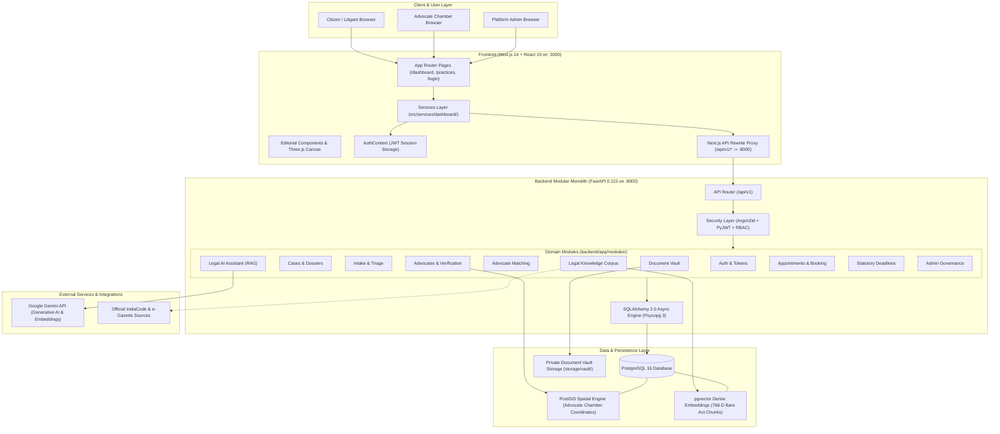
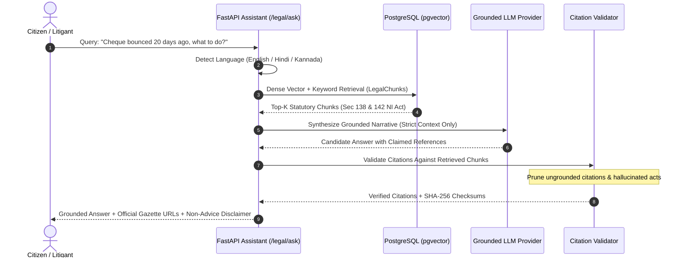

# Architecture Specification — NyayaSetu (न्यायसेतु)

**Document Status:** Production Architecture Baseline  
**Verified Implementation:** Next.js 16 Client + Python 3.12 FastAPI Modular Monolith + PostgreSQL 16 (PostGIS & pgvector)  

---

## 1. System Overview & Context

NyayaSetu is architected as an India-centric legal intelligence and advocate discovery platform. The system is partitioned into two independent applications operating in concert:
1. **Frontend (`frontend/`):** A public web application built on Next.js 16 (App Router) and React 19, offering legal marketing, citizen matter intake, case dossier tracking, document management, and verified advocate matching.
2. **Backend (`backend/`):** A high-performance Python 3.12 Modular Monolith built with FastAPI 0.115, SQLAlchemy 2.0 (Asyncio), and PostgreSQL 16. It handles authentication, role-based authorization, case management, deterministic legal triage, geospatial advocate discovery (PostGIS), evidence document vault, statutory limitation tracking, and grounded retrieval-augmented generation (pgvector).



---

## 2. Frontend Architecture (`frontend/`)

The frontend delivers an authoritative, calm editorial visual language anchored by the homepage design standard.

### 2.1 Core Technologies
* **Framework:** Next.js 16.4.5 (App Router)
* **UI Library:** React 19.3.0
* **Language:** TypeScript 5
* **Styling:** Tailwind CSS 4 with custom editorial design tokens:
  * Warm ivory page base: `#f4efe6`
  * Card paper surface: `#fffaf2`
  * Deep espresso typography: `#2a1c12`
  * Antique bronze accents: `#9a6a35`
  * Sharp rectangular borders: `rounded-[2px]`
* **3D Visuals:** Three.js with `@react-three/fiber` and `@react-three/drei` (Lady Justice sculpture in hero).
* **Icons:** `lucide-react`
* **API Proxy:** Configured in `frontend/next.config.ts`, transparently rewriting `/api/v1/:path*` to `http://localhost:8000/api/v1/:path*`.

### 2.2 Client Layering
1. **Pages & Layouts (`src/app/`):** Next.js App Router structure with public marketing (`/`, `/practices`, `/matters`, `/insights`, `/firm`, `/contact`), authentication (`/login`), and unified dashboard workspaces (`/dashboard/*`).
2. **Components (`src/components/`):** Atomic UI primitives (`Button`, `Card`, `Badge`, `Modal`), layout navigation (`Navbar`, `Footer`, `Sidebar`), and 3D scenes.
3. **Services (`src/services/dashboard/`):** Strongly typed domain clients communicating with backend endpoints:
   * `cases.ts` $\rightarrow$ `POST /api/v1/cases`, `GET /api/v1/cases`
   * `intake.ts` & `triage.ts` $\rightarrow$ `POST /api/v1/triage/assess`
   * `chat.ts` $\rightarrow$ `POST /api/v1/legal/ask`
   * `advocates.ts` $\rightarrow$ `GET /api/v1/matching/advocates`
   * `bookings.ts` $\rightarrow$ `POST /api/v1/appointments`
   * `documents.ts` $\rightarrow$ `POST /api/v1/documents/cases/{id}/upload`
   * `deadlines.ts` $\rightarrow$ `GET /api/v1/deadlines`
4. **State & Authentication (`src/lib/auth-context.tsx`):** React Context managing JWT access tokens, active user role (`CITIZEN`, `ADVOCATE`, `ADMIN`), language selection (`en`, `hi`, `kn`), and session persistence in `localStorage`.

---

## 3. Backend Architecture (`backend/`)

The backend is built as a **Modular Monolith** in Python 3.12 with FastAPI. A modular monolith optimizes developer velocity while maintaining strict domain cohesion and clean architectural separation.

### 3.1 Structural Map
```text
backend/
├── app/
│   ├── main.py                  # ASGI factory, CORS, exception handlers, lifecycle
│   ├── core/                    # Foundational infrastructure
│   │   ├── config.py            # Pydantic BaseSettings (env configuration)
│   │   ├── database.py          # SQLAlchemy 2.0 async engine & session management
│   │   ├── security.py          # Argon2id password hasher & PyJWT manager
│   │   ├── errors.py            # Centralized exception hierarchy
│   │   ├── logging.py           # Structured JSON logger
│   │   └── models.py            # Consolidated DeclarativeBase model registry
│   ├── api/v1/
│   │   ├── health.py            # Diagnostic health & readiness probes
│   │   └── router.py            # Central router mounting all 14 domain routers
│   ├── modules/                 # 12 Autonomous Domain Packages
│   │   ├── auth/                # Identity, login, registration, token rotation
│   │   ├── users/               # User profiles and status management
│   │   ├── advocates/           # Advocate profiles, bar roll credentials, verification
│   │   ├── cases/               # Case dockets (NYA-2026-CS-XXXX), milestones, stages
│   │   ├── triage/              # Case intake categorization & deterministic routing
│   │   ├── matching/            # Multi-factor advocate matching algorithm
│   │   ├── legal_knowledge/     # Bare Acts, gazettes, judgments & chunk ingestion
│   │   ├── legal_assistant/     # Grounded statutory RAG & citation validator
│   │   ├── documents/           # Private document vault & short-lived signed tokens
│   │   ├── appointments/        # Consultation slot hold, booking, confirmation
│   │   ├── deadlines/           # Limitation Act 1963 calculation & court hearings
│   │   └── admin/               # Platform oversight, advocate verification, audits
│   ├── integrations/            # External SDK adapters (Gemini, SMS gateways)
│   └── shared/                  # Reusable pagination and envelope schemas
├── migrations/                  # Alembic migration environment and version revisions
├── scripts/                     # Operational scripts (run_dev.sh, verify_health.py)
├── tests/                       # Pytest test suites (79 passing tests)
├── requirements.txt             # Pinned production dependencies
└── run.py                       # Uvicorn entry point
```

### 3.2 Request Lifecycle & Layered Responsibilities
1. **Network Ingress:** Uvicorn ASGI server receives HTTP request on port 8000.
2. **CORS & Logging:** Request ID is injected; execution time and client metadata are tracked in JSON format.
3. **Routing & Authentication:** Route handler validates parameters using Pydantic v2 schemas and enforces role guards:
   ```python
   current_user: User = Depends(get_current_active_user)
   # Or role-specific:
   dependencies=[Depends(require_roles("ADVOCATE"))]
   ```
4. **Service Execution:** Handler delegates execution to a domain Service class (`CaseService`, `AuthService`, `DocumentService`, `MatchingService`).
5. **Database Interaction:** Service utilizes an injected asynchronous `AsyncSession` (`get_db()`). Automatic commit occurs upon function exit; any unhandled exception triggers an automatic rollback.
6. **Error Normalization:** Centralized exception handlers catch `AppException`, `RequestValidationError`, or `SQLAlchemyError` and format the response into a standard error envelope.

---

## 4. Persistence & Database Architecture

### 4.1 Database Engine & Configuration
* **Primary Database:** PostgreSQL 16 (local instance or managed Supabase).
* **Async Engine:** SQLAlchemy 2.0 initialized with Psycopg 3 (`postgresql+psycopg://`):
  * `pool_size = 10`
  * `max_overflow = 20`
  * `pool_timeout = 30`
  * `pool_pre_ping = True` (detects disconnected sockets before issuing queries)
* **Test Database:** SQLite in-memory engine via `aiosqlite` (`sqlite+aiosqlite:///./test.db`) utilizing SQLAlchemy's `.with_variant()` constructs to ensure tests run rapidly in any environment without external PostgreSQL dependencies.

### 4.2 PostGIS Geospatial Engine
* **Extension:** `postgis` enabled in revision `0001_extensions`.
* **Model:** `AdvocateProfile.location` mapped as:
  ```python
  location: Mapped[Optional[Any]] = mapped_column(
      Geography(geometry_type="POINT", srid=4326, spatial_index=False)
      .with_variant(String, "sqlite"),
      nullable=True,
      comment="Latitude and Longitude point in WGS84 (SRID 4326)"
  )
  ```
* **Functionality:** Calculates spherical distance between a litigant's district/city and advocate chambers, contributing a 25% weight in the matching algorithm.

### 4.3 pgvector Dense Embeddings
* **Extension:** `vector` enabled in revision `0001_extensions`.
* **Model:** `LegalChunk.embedding` mapped as:
  ```python
  embedding: Mapped[Optional[Any]] = mapped_column(
      Vector(settings.EMBEDDING_VECTOR_DIMENSION)
      .with_variant(JSON, "sqlite"),
      nullable=True,
      comment="Dense vector embedding (configured dimension: 768)"
  )
  ```
* **Functionality:** Stores 768-dimensional normalized embeddings for semantic similarity search over Bare Act sections and judgments.

### 4.4 Alembic Migration Architecture
* Configuration defined in `backend/alembic.ini` (`script_location = migrations`).
* Environment runner in `backend/migrations/env.py` binds to `settings.sync_database_url`.
* 8 sequential migration revisions present in `backend/migrations/versions/`:
  1. `0001_extensions` — Enables `uuid-ossp`, `postgis`, `vector`.
  2. `0002_core_tables` — Creates 12 foundational domain tables.
  3. `0003_auth` — Creates `refresh_tokens` session table.
  4. `0004_advocate_verification` — Creates `advocate_verification_applications` table.
  5. `0005_district` — Adds `district` to `advocate_profiles`.
  6. `0006_case_intake` — Adds intake triage tracking to `legal_cases`.
  7. `0007_sources_metadata` — Adds gazette metadata to `legal_sources`.
  8. `0008_documents_appointments_deadlines` — Adds indexes for vault and limitation deadlines.

---

## 5. Authentication & Authorization Security

### 5.1 Password Hashing (Argon2id)
All credentials are encrypted using **Argon2id** via `argon2-cffi` configured with OWASP parameters:
* Time cost: 3 iterations
* Memory cost: 65,536 KiB (64 MiB)
* Parallelism: 4 lanes
* Hash length: 32 bytes
* Salt length: 16 bytes

### 5.2 JWT Session Management
* **Access Tokens:** Signed via `pyjwt` with algorithm `HS256`. Carries claims: `sub` (User UUID), `role` (`CITIZEN` | `ADVOCATE` | `ADMIN`), `iat`, `exp` (60 minutes), and `iss` (`NyayaSetu Backend API`).
* **Refresh Tokens:** Issued with a unique cryptographic `jti` UUID and a 7-day expiry. Stored in the `refresh_tokens` database table as a SHA-256 fingerprint hash (`hash_token`). Tokens are rotated upon each refresh; reuse invalidates all sessions for that token family.

### 5.3 Role-Based Access Control (RBAC)
FastAPI dependency injectors enforce strict role isolation:
* `require_roles("CITIZEN")`: Restricts case filing and personal evidence upload.
* `require_roles("ADVOCATE")`: Restricts hearing acceptance, professional credential management, and matter progression.
* `require_roles("ADMIN")`: Restricts advocate verification approvals, platform statistics, and immutable audit logs. Self-assignment of the `ADMIN` role is blocked at the schema boundary.

---

## 6. Document Vault & Private Storage Architecture

Client evidence documents, tenancy contracts, dishonoured cheque memos, and court summonses are subject to strict privacy controls:
1. **Physical Storage:** Stored on disk under private path `backend/storage/vault/` (outside any publicly accessible web root).
2. **Access Control:** No public URLs or static file servers exist. Downloading requires:
   * A valid Bearer JWT of the verified case owner or assigned counsel, OR
   * A short-lived, signed download token (15-minute expiry) issued by `GET /api/v1/documents/{id}/access-token`.
3. **Integrity Validation:** Every file undergoes SHA-256 byte stream hashing upon upload and MIME type verification against an explicit whitelist (`application/pdf`, `image/jpeg`, `image/png`, `application/vnd.openxmlformats-officedocument.wordprocessingml.document`).

---

## 7. Retrieval-Augmented Generation (RAG) Architecture

The Legal AI Assistant (`POST /api/v1/legal/ask`) enforces strict statutory grounding against verified Indian Bare Acts:



1. **Language Detection:** Detects Devanagari (`hi`), Kannada (`kn`), or English (`en`).
2. **Hybrid Retrieval:** Executes cosine similarity queries using pgvector against `LegalChunk` embeddings paired with statutory keyword filters.
3. **Grounded Synthesis:** Providers synthesize answers strictly within the boundaries of retrieved context. If sources are insufficient, the engine explicitly declines to provide ungrounded advice.
4. **Citation Validation:** `CitationValidator` cross-references every claimed act, section, and case against the retrieved context, stripping ungrounded statements and attaching official e-Gazette/IndiaCode URLs and content checksums.

---

## 8. Summary of Active Ports & Environments

| Component | Default Port | Internal Route / URL | Production Target |
|---|---|---|---|
| **Frontend** | `3000` | `http://localhost:3000` | Vercel / Edge CDN |
| **Backend API** | `8000` | `http://localhost:8000` | Docker / AWS ECS / Render |
| **API Documentation** | `8000` | `http://localhost:8000/docs` | Disabled in production |
| **Health Probe** | `8000` | `http://localhost:8000/api/v1/health` | Container Orchestrator Probes |
| **Database** | `5432` | `postgresql+psycopg://...:5432/nyayasetu` | Managed PostgreSQL 16 (Supabase / RDS) |
