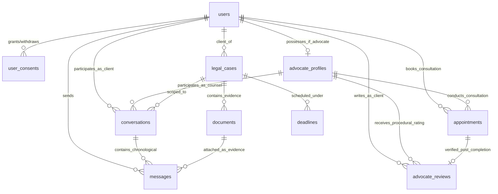

# NyayaSetu Dashboard API Contracts & Database Architecture Specification

**Document Version:** 1.0.0  
**Status:** Approved Architecture Draft  
**Target Architecture:** FastAPI 0.115 Modular Monolith + PostgreSQL 16 (Psycopg 3, PostGIS, pgvector) + Next.js 16 Client  
**Compliance Standards:** Digital Personal Data Protection Act, 2023 (DPDP) · Bar Council of India Rule 36 · Bharatiya Sakshya Adhiniyam, 2023 (BSA §126–129)

---

## 1. Architectural Scope & Objectives

This specification defines the authoritative backend API contracts, SQLAlchemy 2.0 data models, Alembic migration requirements, and authorization rules necessary to replace all frontend client mock services in `frontend/src/services/dashboard/` with verified, persistent, production-grade endpoints.

### Core Architecture Invariants
1. **Reuse Existing Domain Entities:** Leverage existing `User`, `LegalCase`, `Appointment`, `AdvocateProfile`, `Document`, and `Deadline` models without duplication.
2. **Strict Multi-Tenant Isolation:** Enforce user ownership on all reads and mutations. Citizens cannot access other citizens' cases, messages, consents, or documents (`403 Forbidden`).
3. **Statutory Compliance by Design:**
   - **DPDP Act 2023:** Server-side cryptographic consent logging (§6), statutory data export (§11), and right to erasure (§12).
   - **BCI Rule 36:** Reviews are restricted to verified, completed consultations (`Appointment.status == 'COMPLETED'`) with zero promotional ranking or fee solicitation.
   - **BSA 2023 §126–129:** Case communications are marked as privileged client-advocate records.
4. **Standardized Error Formatting:** All error responses follow `{"error": {"code": "...", "message": "...", "details": {...}}, "request_id": "..."}`.

---

## 2. Database Schema Design & Entity-Relationship Model



### 2.1 Schema Modifications to Existing Tables

#### Table: `users`
Add columns to support citizen profile details and jurisdictional residency:
```python
# Added to backend/app/modules/users/models.py:
city: Mapped[Optional[str]] = mapped_column(String(128), nullable=True, index=True)
state: Mapped[Optional[str]] = mapped_column(String(128), nullable=True, index=True)
```

---

### 2.2 Genuinely Missing Models (To Be Created)

#### 1. `UserConsent` Entity (`user_consents` table)
Tracks explicit data processing authorizations pursuant to DPDP Act 2023 §6.

| Column | Type | Constraints | Description |
| :--- | :--- | :--- | :--- |
| `id` | `UUID` | Primary Key, Default `uuid.uuid4` | Unique consent record identifier |
| `user_id` | `UUID` | Foreign Key (`users.id`, `CASCADE`), NOT NULL, Index | Data principal citizen |
| `consent_type` | `VARCHAR(64)` | NOT NULL, Index | `TERMS`, `PRIVACY`, `DPDP`, `SHARE_BRIEF`, `SHARE_DOCUMENTS` |
| `version` | `VARCHAR(16)` | NOT NULL, Default `'1.0'` | Statutory policy version accepted |
| `purpose` | `VARCHAR(255)` | Nullable | Specific processing purpose e.g. "Advocate case evaluation" |
| `advocate_id` | `UUID` | Foreign Key (`advocate_profiles.id`, `SET NULL`), Nullable | Authorized advocate recipient |
| `items_shared` | `JSONB` / `JSON` | Nullable, Default `list` | Specific records shared (e.g. `["Case Brief", "Deed.pdf"]`) |
| `is_revoked` | `BOOLEAN` | NOT NULL, Default `FALSE`, Index | Active vs revoked status |
| `revoked_at` | `TIMESTAMPTZ` | Nullable | Timestamp of statutory withdrawal |
| `ip_address` | `VARCHAR(45)` | Nullable | IP address at time of grant |
| `user_agent` | `VARCHAR(255)` | Nullable | Client device telemetry at grant |
| `created_at` | `TIMESTAMPTZ` | NOT NULL, Default `now()`, Index | Timestamp of consent grant |
| `updated_at` | `TIMESTAMPTZ` | NOT NULL, Default `now()` | Audit update timestamp |

**Indexes & Constraints:**
- `ix_user_consents_user_revoked (user_id, is_revoked)`
- `ix_user_consents_user_type (user_id, consent_type)`

---

#### 2. `Conversation` Entity (`conversations` table)
Persistent conversation container grouping privileged client-advocate communications.

| Column | Type | Constraints | Description |
| :--- | :--- | :--- | :--- |
| `id` | `UUID` | Primary Key, Default `uuid.uuid4` | Conversation thread ID |
| `client_id` | `UUID` | Foreign Key (`users.id`, `CASCADE`), NOT NULL, Index | Participating citizen |
| `advocate_id` | `UUID` | Foreign Key (`advocate_profiles.id`, `CASCADE`), NOT NULL, Index | Participating advocate |
| `case_id` | `UUID` | Foreign Key (`legal_cases.id`, `SET NULL`), Nullable, Index | Associated case matter dossier |
| `subject` | `VARCHAR(255)` | NOT NULL | Thread subject / matter title |
| `last_message_at`| `TIMESTAMPTZ` | NOT NULL, Default `now()`, Index | Timestamp of latest message |
| `is_archived` | `BOOLEAN` | NOT NULL, Default `FALSE`, Index | Archival state |
| `created_at` | `TIMESTAMPTZ` | NOT NULL, Default `now()` | Thread creation time |
| `updated_at` | `TIMESTAMPTZ` | NOT NULL, Default `now()` | Thread update time |

**Indexes & Constraints:**
- `UNIQUE (client_id, advocate_id, case_id)`: Prevents duplicate active communication threads for the same matter.

---

#### 3. `Message` Entity (`messages` table)
Individual chronological messages protected under BSA 2023 §126–129.

| Column | Type | Constraints | Description |
| :--- | :--- | :--- | :--- |
| `id` | `UUID` | Primary Key, Default `uuid.uuid4` | Message identifier |
| `conversation_id`| `UUID` | Foreign Key (`conversations.id`, `CASCADE`), NOT NULL, Index | Parent conversation thread |
| `sender_id` | `UUID` | Foreign Key (`users.id`, `RESTRICT`), NOT NULL, Index | Authoring user |
| `sender_role` | `VARCHAR(32)` | NOT NULL | `CLIENT`, `ADVOCATE`, `SYSTEM` |
| `message_text` | `TEXT` | NOT NULL | Message body |
| `attachment_document_id` | `UUID` | Foreign Key (`documents.id`, `SET NULL`), Nullable | Attached vault document |
| `is_read` | `BOOLEAN` | NOT NULL, Default `FALSE`, Index | Read receipt tracking |
| `read_at` | `TIMESTAMPTZ` | Nullable | Timestamp when recipient read the message |
| `is_privileged` | `BOOLEAN` | NOT NULL, Default `TRUE` | Privileged under BSA 2023 §126–129 |
| `created_at` | `TIMESTAMPTZ` | NOT NULL, Default `now()`, Index | Message dispatch timestamp |
| `updated_at` | `TIMESTAMPTZ` | NOT NULL, Default `now()` | Audit update timestamp |

**Indexes & Constraints:**
- `ix_messages_conv_created (conversation_id, created_at)`
- `ix_messages_unread (conversation_id, sender_id, is_read)`

---

#### 4. `AdvocateReview` Entity (`advocate_reviews` table)
Verified post-consultation evaluation under strict BCI Rule 36 compliance.

| Column | Type | Constraints | Description |
| :--- | :--- | :--- | :--- |
| `id` | `UUID` | Primary Key, Default `uuid.uuid4` | Unique evaluation record ID |
| `appointment_id` | `UUID` | Foreign Key (`appointments.id`, `CASCADE`), NOT NULL, Unique, Index | Completed consultation reference |
| `reviewer_id` | `UUID` | Foreign Key (`users.id`, `CASCADE`), NOT NULL, Index | Authoring citizen (must match `appointment.client_id`) |
| `advocate_id` | `UUID` | Foreign Key (`advocate_profiles.id`, `CASCADE`), NOT NULL, Index | Evaluated advocate |
| `rating` | `INTEGER` | NOT NULL, `CHECK (rating >= 1 AND rating <= 5)` | Statutory grade: 1 to 5 stars |
| `tags` | `JSONB` / `JSON` | Nullable, Default `list` | Procedural quality tags |
| `review_text` | `TEXT` | Nullable | Optional citizen observations (max 500 chars) |
| `resolution_status` | `VARCHAR(32)` | NOT NULL, Default `'in_progress'` | `yes`, `in_progress`, `no` |
| `moderation_status` | `VARCHAR(32)` | NOT NULL, Default `'PUBLISHED'`, Index | `PUBLISHED`, `FLAGGED`, `REMOVED` |
| `created_at` | `TIMESTAMPTZ` | NOT NULL, Default `now()`, Index | Review submission timestamp |
| `updated_at` | `TIMESTAMPTZ` | NOT NULL, Default `now()` | Last modification timestamp |

**Indexes & Constraints:**
- `UNIQUE (appointment_id)`: Guarantees exactly one evaluation per verified consultation session.
- `CHECK (rating >= 1 AND rating <= 5)`: Enforces standard rating boundaries.

---

### 2.3 Alembic Migration Plan (`0012_dashboard_integrations.py`)

A single forward migration will execute:
1. `op.add_column('users', sa.Column('city', sa.String(128), nullable=True))`
2. `op.add_column('users', sa.Column('state', sa.String(128), nullable=True))`
3. `op.create_table('user_consents', ...)`
4. `op.create_table('conversations', ...)`
5. `op.create_table('messages', ...)`
6. `op.create_table('advocate_reviews', ...)`
7. Create all foreign keys, unique constraints, and B-tree indexes.

---

## 3. Detailed API Contracts Specification

### Domain 1: User Profile & Dossier Management

#### 1.1 `GET /api/v1/users/me`
Retrieve authenticated caller's profile dossier, verified credentials, and jurisdictional location.

* **Authorization:** Bearer JWT (`CITIZEN`, `ADVOCATE`, `ADMIN`)
* **Success Response (`200 OK`):**
```json
{
  "id": "3d93cbcd-0690-4d78-8759-c0e7e063c912",
  "full_name": "Rahul Kumar",
  "email": "rahul.kumar@example.com",
  "phone": "+919876543210",
  "role": "CITIZEN",
  "preferred_language": "en",
  "city": "Bengaluru",
  "state": "Karnataka",
  "is_verified": true,
  "is_active": true,
  "created_at": "2026-01-15T09:30:00Z",
  "updated_at": "2026-11-22T08:00:00Z"
}
```

#### 1.2 `PUT /api/v1/users/me`
Update mutable profile attributes (name, email, language preference, jurisdictional city/state). Mobile phone identifier is immutable (bound to OTP).

* **Authorization:** Bearer JWT (`CITIZEN`, `ADVOCATE`, `ADMIN`)
* **Request Payload (`application/json`):**
```json
{
  "full_name": "Rahul Kumar Sen",
  "email": "rahul.sen@example.com",
  "preferred_language": "hi",
  "city": "Bengaluru",
  "state": "Karnataka"
}
```
* **Validation Rules:**
  - `full_name`: Min 2, max 255 chars.
  - `email`: Valid RFC 5322 email. Unique in `users` (returns `409 Conflict` if claimed by another account).
  - `preferred_language`: One of `en`, `hi`, `mr`, `ta`, `te`, `bn`, `kn`.
* **Success Response (`200 OK`):** Updated `UserProfileResponse`.
* **Error Responses:** `400 Bad Request` (validation failure), `401 Unauthorized`, `409 Conflict` (email collision).

---

### Domain 2: DPDP Consent Ledger Management

#### 2.1 `GET /api/v1/users/me/consents`
List chronological consent authorizations, purpose specifications, and revocation statuses.

* **Authorization:** Bearer JWT (`current_user.id == consent.user_id`)
* **Query Parameters:**
  - `include_revoked: bool = True`
  - `page: int = 1`, `limit: int = 20`
* **Success Response (`200 OK`):**
```json
{
  "total": 3,
  "items": [
    {
      "id": "c1f7a42b-58bb-4b92-80ea-1b91384f8801",
      "consent_type": "SHARE_BRIEF",
      "version": "1.0",
      "purpose": "Case brief evaluation",
      "advocate_id": "46e55000-7dcb-486c-bab4-bd96bc6d9d38",
      "advocate_name": "Adv. Ananya Rao",
      "items_shared": ["Case brief", "Rent Agreement 2024.pdf"],
      "is_revoked": false,
      "revoked_at": null,
      "granted_at": "2026-11-20T10:15:00Z"
    },
    {
      "id": "b2e6931a-47aa-4a81-70da-0a80273e7700",
      "consent_type": "DPDP",
      "version": "1.0",
      "purpose": "Digital personal data processing under DPDP Act 2023",
      "advocate_id": null,
      "items_shared": [],
      "is_revoked": false,
      "revoked_at": null,
      "granted_at": "2026-01-15T09:30:00Z"
    }
  ]
}
```

#### 2.2 `POST /api/v1/users/me/consents`
Record an explicit data processing or case record sharing consent grant.

* **Authorization:** Bearer JWT
* **Request Payload (`application/json`):**
```json
{
  "consent_type": "SHARE_BRIEF",
  "version": "1.0",
  "purpose": "Case brief review for tenancy consultation",
  "advocate_id": "46e55000-7dcb-486c-bab4-bd96bc6d9d38",
  "items_shared": ["Case brief", "Rent Agreement 2024.pdf"]
}
```
* **Success Response (`201 Created`):** Created `ConsentResponse` object with server-assigned timestamp and ID.

#### 2.3 `POST /api/v1/users/me/consents/{consent_id}/withdraw`
Statutory consent revocation under DPDP Act 2023 §6(4).

* **Authorization:** Bearer JWT (`current_user.id == consent.user_id`)
* **Success Response (`200 OK`):**
```json
{
  "status": "revoked",
  "consent_id": "c1f7a42b-58bb-4b92-80ea-1b91384f8801",
  "revoked_at": "2026-11-22T12:40:00Z",
  "message": "Consent authorization successfully revoked pursuant to DPDP Act 2023 §6(4)."
}
```
* **Error Responses:** `404 Not Found` (consent ID not found), `403 Forbidden` (cross-user access).

---

### Domain 3: Personal Data Governance & Statutory Rights

#### 3.1 `POST /api/v1/users/me/data-export`
Exercise Right to Data Portability (DPDP Act §11). Assembles and delivers an encrypted, signed JSON dossier.

* **Authorization:** Bearer JWT
* **Success Response (`200 OK`):**
```json
{
  "export_id": "exp_882041",
  "exported_at": "2026-11-22T12:42:00Z",
  "signature_sha256": "8a3e72b490f84...",
  "dossier": {
    "user_profile": {
      "id": "3d93cbcd-0690-4d78-8759-c0e7e063c912",
      "full_name": "Rahul Kumar",
      "email": "rahul.kumar@example.com",
      "phone": "+919876543210"
    },
    "consents": [...],
    "cases": [
      {
        "case_reference": "NYA-2026-CS-8421",
        "title": "Security deposit recovery under State Tenancy Act",
        "category": "Tenancy & Rent",
        "stage": "PRE_FILING"
      }
    ],
    "documents": [
      {
        "file_name": "Rent Agreement 2024.pdf",
        "file_size_bytes": 1048576,
        "checksum_sha256": "e3b0c442...",
        "uploaded_at": "2026-11-20T10:14:00Z"
      }
    ],
    "appointments": [...]
  }
}
```

#### 3.2 `DELETE /api/v1/users/me`
Exercise Right to Erasure / Right to be Forgotten (DPDP Act §12).

* **Authorization:** Bearer JWT (`CITIZEN` or `ADVOCATE`)
* **Operation:**
  1. Anonymizes PII in `users` (`full_name = "Anonymized User"`, `email = "erased_<uuid>@nyayasetu.internal"`).
  2. Sets `is_active = FALSE`.
  3. Revokes all refresh tokens in `refresh_tokens`.
  4. Records `AuditLog(action="USER_DATA_ERASURE_COMPLETED")`.
* **Success Response (`200 OK`):**
```json
{
  "status": "purged",
  "message": "User account and personal identifiers permanently erased in compliance with DPDP Act 2023 §12."
}
```

---

### Domain 4: Consolidated Dashboard Overview

#### 4.1 `GET /api/v1/dashboard/summary`
Unified aggregation endpoint replacing multiple client-side round-trips for the home dashboard cards.

* **Authorization:** Bearer JWT
* **Success Response (`200 OK`):**
```json
{
  "active_cases": 2,
  "unread_messages": 3,
  "pending_actions": 2,
  "next_deadline": {
    "id": "7c35dcb5-37b3-437e-9709-e76ff81d0e34",
    "case_id": "87a40164-8156-4b60-94e4-59566912b1b0",
    "case_reference": "NYA-2026-CS-8421",
    "title": "Section 138 Notice Response Expiry",
    "due_date": "2026-12-04T00:00:00Z",
    "days_remaining": 12,
    "is_confirmed": true,
    "statutory_provision": "Negotiable Instruments Act, 1881 §138"
  },
  "recent_case": {
    "id": "87a40164-8156-4b60-94e4-59566912b1b0",
    "case_reference": "NYA-2026-CS-8421",
    "title": "Security deposit recovery under State Tenancy Act",
    "category": "Tenancy Dispute",
    "stage": "PRE_FILING",
    "progress_percentage": 75,
    "updated_at": "2026-11-20T14:30:00Z"
  },
  "upcoming_deadlines": [
    {
      "id": "7c35dcb5-37b3-437e-9709-e76ff81d0e34",
      "title": "Section 138 Notice Response Expiry",
      "due_date": "2026-12-04T00:00:00Z",
      "days_remaining": 12,
      "is_confirmed": true
    }
  ],
  "upcoming_appointment": {
    "id": "9042a1b2-3c4d-5e6f-7a8b-9c0d1e2f3a4b",
    "booking_reference": "NYA-BK-2026-9042",
    "advocate_name": "Adv. Ananya Rao",
    "scheduled_start": "2026-11-25T10:00:00+05:30",
    "mode": "VIDEO_CONFERENCE",
    "status": "CONFIRMED"
  }
}
```

---

### Domain 5: Document Scanner, OCR & Explainer Pipeline

#### 5.1 `POST /api/v1/documents/scan`
Extract statutory text from uploaded document bytes (PDF, JPEG, PNG, DOCX). Reuses vault storage validation rules.

* **Authorization:** Bearer JWT
* **Content-Type:** `multipart/form-data`
* **Request Form:**
  - `file: UploadFile` (Binary payload, max 10 MB)
  - `case_id: Optional[UUID]` (If supplied, file is also saved to vault)
* **Processing Steps:**
  1. Magic byte signature verification.
  2. Text extraction via PDF text parser or Indic OCR engine.
  3. Calculation of OCR confidence metrics.
* **Success Response (`200 OK`):**
```json
{
  "document_id": "e7d67c90-063b-4bd0-a74a-9a1861a971ce",
  "file_name": "legal_notice_demand.pdf",
  "extracted_text": "LEGAL NOTICE\n\nTo, Mr. S. Rao, 402, Lake View Apartments, HSR Layout, Bengaluru 560102...",
  "confidence_score": 0.94,
  "is_low_confidence": false,
  "page_count": 2,
  "detected_language": "en"
}
```

#### 5.2 `GET /api/v1/documents/{document_id}/processing-status`
Poll status of background OCR or AI document parsing.

* **Authorization:** Bearer JWT (`current_user.id == doc.uploader_id`)
* **Success Response (`200 OK`):**
```json
{
  "document_id": "e7d67c90-063b-4bd0-a74a-9a1861a971ce",
  "status": "COMPLETED",
  "progress_percentage": 100,
  "error_message": null
}
```

#### 5.3 `POST /api/v1/documents/explain`
Dispatches extracted statutory text to `GeminiLLMProvider` for structured legal decomposition.

* **Authorization:** Bearer JWT
* **Request Payload (`application/json`):**
```json
{
  "text": "LEGAL NOTICE\n\nTo, Mr. S. Rao, 402, Lake View Apartments...",
  "language": "en"
}
```
* **Success Response (`200 OK`):**
```json
{
  "document_type": "Legal notice (demand for refund of security deposit)",
  "summary": "Formal demand sent to landlord demanding return of ₹60,000 security deposit withheld without lawful justification.",
  "parties": [
    "Mr. S. Rao — Recipient (Landlord)",
    "Rahul Kumar — Complainant (Tenant)",
    "M/s Rao & Associates — Issuing Advocates"
  ],
  "dates": [
    { "label": "Notice Issued", "value": "2026-10-02" },
    { "label": "Statutory Reply Deadline", "value": "2026-10-17" }
  ],
  "amounts": [
    { "label": "Security Deposit Claimed", "value": "₹60,000" }
  ],
  "obligations": [
    { "party": "Recipient", "action": "Refund ₹60,000", "deadline": "Within 15 days of notice receipt" }
  ],
  "disclaimer": "NyayaSetu automated extraction is for informational orientation only and does not constitute formal legal counsel."
}
```

---

### Domain 6: Privileged Case Messaging & Real-Time Communications

#### 6.1 `GET /api/v1/conversations`
List active conversation threads for the authenticated user with unread counts.

* **Authorization:** Bearer JWT
* **Success Response (`200 OK`):**
```json
{
  "total": 2,
  "items": [
    {
      "id": "f4d78d5f-3ca6-412e-b3f9-2e547a111be7",
      "case_id": "87a40164-8156-4b60-94e4-59566912b1b0",
      "case_reference": "NYA-2026-CS-8421",
      "subject": "Security Deposit Recovery",
      "advocate_id": "46e55000-7dcb-486c-bab4-bd96bc6d9d38",
      "advocate_name": "Adv. Ananya Rao",
      "last_message": "Draft petition ready for review. Please inspect attached brief.",
      "last_message_at": "2026-11-22T09:15:00Z",
      "unread_count": 1
    }
  ]
}
```

#### 6.2 `GET /api/v1/conversations/{conversation_id}/messages`
Retrieve chronological messages for a conversation thread.

* **Authorization:** Bearer JWT (`current_user.id IN (conversation.client_id, conversation.advocate_user_id)`)
* **Query Parameters:** `page: int = 1`, `limit: int = 50`
* **Success Response (`200 OK`):**
```json
{
  "conversation_id": "f4d78d5f-3ca6-412e-b3f9-2e547a111be7",
  "total": 4,
  "items": [
    {
      "id": "a1b2c3d4-e5f6-7a8b-9c0d-1e2f3a4b5c6d",
      "sender_id": "3d93cbcd-0690-4d78-8759-c0e7e063c912",
      "sender_name": "Rahul Kumar",
      "sender_role": "CLIENT",
      "text": "Hello Adv. Ananya, did you receive the bank transaction statement?",
      "attachment": null,
      "is_read": true,
      "read_at": "2026-11-21T14:32:00Z",
      "created_at": "2026-11-21T14:30:00Z"
    },
    {
      "id": "b2c3d4e5-f6a7-8b9c-0d1e-2f3a4b5c6d7e",
      "sender_id": "e98001a0-1b04-4ebc-a651-311e503bc452",
      "sender_name": "Adv. Ananya Rao",
      "sender_role": "ADVOCATE",
      "text": "Yes, statement verified. The ₹60,000 debit matches your lease schedule.",
      "attachment": null,
      "is_read": false,
      "read_at": null,
      "created_at": "2026-11-22T09:15:00Z"
    }
  ]
}
```

#### 6.3 `POST /api/v1/conversations/{conversation_id}/messages`
Post persistent message into the conversation thread.

* **Authorization:** Bearer JWT (`current_user.id IN (conversation.client_id, conversation.advocate_user_id)`)
* **Request Payload (`application/json`):**
```json
{
  "text": "Please proceed with filing the claim before the Rent Controller.",
  "attachment_document_id": null
}
```
* **Success Response (`201 Created`):** Created `MessageResponse` object.

#### 6.4 `PATCH /api/v1/conversations/{conversation_id}/messages/{message_id}/read`
Mark message as read by the recipient.

* **Authorization:** Bearer JWT (Recipient only; sender cannot mark own message as read)
* **Success Response (`200 OK`):** `{ "status": "read", "read_at": "2026-11-22T12:45:00Z" }`.

---

### Domain 7: Verified Consultation Reviews (BCI Rule 36 Compliant)

#### 7.1 `POST /api/v1/appointments/{appointment_id}/reviews`
Submit post-consultation evaluation for a concluded session.

* **Authorization:** Bearer JWT (`current_user.id == appointment.client_id`)
* **Pre-conditions Enforced:**
  1. `appointment.status == 'COMPLETED'`.
  2. No existing review for `appointment_id` (`UNIQUE` constraint).
* **Request Payload (`application/json`):**
```json
{
  "rating": 5,
  "tags": [
    "Clear communication",
    "Punctual & prepared",
    "Actionable next steps"
  ],
  "comment": "Articulated the limitation deadline under Section 138 clearly and prepared the demand notice draft.",
  "resolution_status": "in_progress"
}
```
* **Success Response (`201 Created`):**
```json
{
  "id": "8da06f02-7ddc-4c91-b945-2baf637af6e0",
  "appointment_id": "9042a1b2-3c4d-5e6f-7a8b-9c0d1e2f3a4b",
  "booking_reference": "NYA-BK-2026-9042",
  "advocate_id": "46e55000-7dcb-486c-bab4-bd96bc6d9d38",
  "rating": 5,
  "tags": ["Clear communication", "Punctual & prepared", "Actionable next steps"],
  "resolution_status": "in_progress",
  "created_at": "2026-11-22T12:46:00Z"
}
```
* **Error Responses:**
  - `400 Bad Request`: Consultation not yet marked completed.
  - `403 Forbidden`: Caller is not the client of this appointment.
  - `409 Conflict`: Review already registered for this appointment ID.

#### 7.2 `GET /api/v1/advocates/{advocate_id}/reviews`
List verified procedural evaluations for an advocate. Reviewer names are sanitized (`"Rahul K."` or `"Verified Client"`) to preserve privacy under DPDP rules.

* **Authorization:** Public / Authenticated
* **Query Parameters:** `page: int = 1`, `limit: int = 10`
* **Success Response (`200 OK`):**
```json
{
  "advocate_id": "46e55000-7dcb-486c-bab4-bd96bc6d9d38",
  "average_procedural_score": 4.8,
  "total_reviews": 14,
  "items": [
    {
      "id": "8da06f02-7ddc-4c91-b945-2baf637af6e0",
      "rating": 5,
      "tags": ["Clear communication", "Punctual & prepared"],
      "comment": "Articulated the limitation deadline under Section 138 clearly.",
      "resolution_status": "in_progress",
      "reviewer_display_name": "Rahul K.",
      "created_at": "2026-11-22T12:46:00Z"
    }
  ]
}
```

#### 7.3 `PATCH /api/v1/advocates/reviews/{review_id}/moderate`
Admin-only compliance moderation pursuant to BCI Rule 36.

* **Authorization:** Bearer JWT (`Role == ADMIN`)
* **Request Payload (`application/json`):**
```json
{
  "moderation_status": "FLAGGED",
  "moderator_notes": "Contains promotional outcome claim; unpublishing pursuant to BCI Rule 36."
}
```
* **Success Response (`200 OK`):** Updated review record with moderation status.

---

## 4. Standardized Error Responses

All endpoints adhere to NyayaSetu's centralized error schema in `app/main.py`:

```json
{
  "error": {
    "code": "FORBIDDEN",
    "message": "Access forbidden: You do not have permission to access communications for this case.",
    "details": {
      "case_id": "87a40164-8156-4b60-94e4-59566912b1b0",
      "required_role": "CASE_CLIENT_OR_COUNSEL"
    }
  },
  "request_id": "req_88f01b92"
}
```

| HTTP Status | Error Code | Trigger Condition |
| :--- | :--- | :--- |
| `400 Bad Request` | `BAD_REQUEST` | Validation error, uncompleted appointment review attempt, invalid magic bytes |
| `401 Unauthorized` | `UNAUTHORIZED` | Missing or expired JWT access token |
| `403 Forbidden` | `FORBIDDEN` | Cross-tenant access attempt (accessing another user's dossier, consent, or thread) |
| `404 Not Found` | `NOT_FOUND` | Target entity ID does not exist |
| `409 Conflict` | `CONFLICT` | Email already registered; duplicate review on same appointment |
| `429 Too Many Requests` | `RATE_LIMIT_EXCEEDED` | Exceeding 30 uploads/hour or rapid-fire messaging thresholds |

---

## 5. Implementation Sequence & Execution Roadmap

```
Phase 1: Database Migration (0012_dashboard_integrations.py)
   ├── 1. Add city, state columns to 'users' table
   ├── 2. Create 'user_consents' table
   ├── 3. Create 'conversations' and 'messages' tables
   └── 4. Create 'advocate_reviews' table
      │
      ▼
Phase 2: Backend Module Implementation
   ├── modules/users/ (router.py, schemas.py, service.py)
   ├── modules/dashboard/ (GET /api/v1/dashboard/summary)
   ├── modules/documents/ (POST /scan, GET /processing-status, POST /explain)
   ├── modules/cases/ (GET/POST /conversations and /messages)
   └── modules/appointments/ (POST/GET /reviews)
      │
      ▼
Phase 3: Automated Test Verification
   ├── Pytest suite covering all 7 endpoint domains (isolation, RBAC, BCI rules)
   └── Complete regression check across existing 197 tests
```

---

*This specification is ready for review. Implementation of Phase 1 and Phase 2 will begin upon your approval.*
