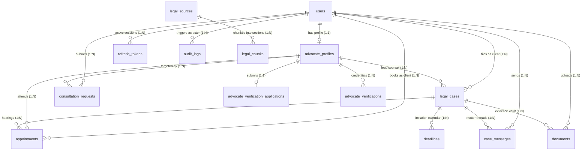

# Database Specification & Schema Reference — NyayaSetu (न्यायसेतु)

**Engine:** PostgreSQL 16+ (Local / Managed Supabase)  
**ORM:** SQLAlchemy 2.0 (Asyncio)  
**Driver:** Psycopg 3 (`psycopg[binary]>=3.2.0`, dialect: `postgresql+psycopg://`)  
**Geospatial Engine:** PostGIS (`geoalchemy2`)  
**Vector Engine:** pgvector (`pgvector.sqlalchemy`)  
**Migrations:** Alembic (`backend/alembic.ini`, `backend/migrations/`)  
**Test Engine:** SQLite in-memory (`aiosqlite`)  

---

## 1. Foundational Extensions

PostgreSQL extensions are enabled via forward migration `0001_enable_postgresql_extensions.py`:

```sql
CREATE EXTENSION IF NOT EXISTS "uuid-ossp";
CREATE EXTENSION IF NOT EXISTS "postgis";
CREATE EXTENSION IF NOT EXISTS "vector";
```

1. **`uuid-ossp`:** Native RFC 4122 v4 Universally Unique Identifiers for primary keys across all tables.
2. **`postgis`:** Spherical spatial calculations over advocate chamber coordinates in WGS84 (`SRID 4326`).
3. **`vector`:** Multi-dimensional vector storage and cosine distance similarity queries for Grounded Legal RAG.

---

## 2. Entity-Relationship Architecture



---

## 3. Database Models & Schema Definitions

All entity models inherit from `app.core.database.Base` and include audit timestamps from `TimestampMixin` (`created_at`, `updated_at`).

### 3.1 `users` Table
Stores core identity and role credentials.
* `id` (`UUID`, PK): Default `uuid.uuid4`.
* `email` (`VARCHAR(255)`, Unique, Indexed): Normalized lowercase email.
* `phone` (`VARCHAR(32)`, Unique, Indexed): E.164 formatted Indian phone number (e.g., `+919876543210`).
* `hashed_password` (`VARCHAR(255)`): Argon2id password hash.
* `full_name` (`VARCHAR(255)`): Citizen or advocate legal name.
* `role` (`VARCHAR(32)`, Indexed): `CITIZEN` | `ADVOCATE` | `ADMIN`.
* `is_active` (`BOOLEAN`): Default `true`.
* `is_verified` (`BOOLEAN`): Default `false` (phone OTP flag).
* `preferred_language` (`VARCHAR(8)`): `en`, `hi`, or `kn`.
* `created_at`, `updated_at` (`TIMESTAMPTZ`).

---

### 3.2 `refresh_tokens` Table
Tracks rotated JWT refresh sessions and prevents token reuse attacks.
* `id` (`UUID`, PK).
* `user_id` (`UUID`, FK `users.id` ON DELETE CASCADE, Indexed).
* `token_hash` (`VARCHAR(64)`, Indexed): SHA-256 fingerprint hash of the raw refresh token.
* `jti` (`VARCHAR(64)`, Unique, Indexed): Cryptographic UUID token identifier.
* `expires_at` (`TIMESTAMPTZ`, Indexed): Expiry timestamp (7 days).
* `revoked` (`BOOLEAN`, Indexed): Default `false`. Set to `true` upon rotation or logout.
* `revoked_at` (`TIMESTAMPTZ`, Nullable).
* `user_agent` (`VARCHAR(255)`, Nullable).
* `ip_address` (`VARCHAR(45)`, Nullable).

---

### 3.3 `advocate_profiles` Table
Stores professional Bar Council credentials, practice domains, and geographic coordinates.
* `id` (`UUID`, PK).
* `user_id` (`UUID`, FK `users.id` ON DELETE CASCADE, Unique, Indexed).
* `bar_council_id` (`VARCHAR(64)`, Unique, Indexed): Enrolment number (e.g., `D/1234/2006`, `KAR/5678/2012`).
* `bar_council_name` (`VARCHAR(128)`): State Bar Council (e.g., `Bar Council of Delhi`).
* `in_practice_years` (`INTEGER`): Active practice experience.
* `primary_practice` (`VARCHAR(64)`, Indexed): Primary statutory domain (e.g., `Trials & Disputes`, `Corporate & M&A`).
* `secondary_practices` (`ARRAY(VARCHAR(64))`): Secondary practice areas.
* `courts_of_practice` (`ARRAY(VARCHAR(128))`): Regular courts (e.g., `Supreme Court of India`, `Delhi High Court`).
* `languages` (`ARRAY(VARCHAR(32))`): Supported spoken/drafting languages.
* `bio` (`TEXT`, Nullable): Professional summary.
* `is_partner` (`BOOLEAN`): Default `false`.
* `hourly_rate_inr` (`NUMERIC(10,2)`, Nullable).
* `fixed_consultation_fee_inr` (`NUMERIC(10,2)`, Nullable).
* **`location` (`GEOGRAPHY(POINT, 4326)`, Nullable):** PostGIS geographic coordinate (WGS84).
* `city` (`VARCHAR(128)`, Indexed).
* `district` (`VARCHAR(128)`, Indexed, Nullable).

---

### 3.4 `advocate_verification_applications` & `advocate_verifications` Tables
Manages formal verification of Bar Council enrolments.
* **`advocate_verification_applications`:**
  * `id` (`UUID`, PK).
  * `advocate_id` (`UUID`, FK `advocate_profiles.id` ON DELETE CASCADE, Unique, Indexed).
  * `status` (`VARCHAR(32)`, Indexed): `PENDING` | `SUBMITTED` | `UNDER_REVIEW` | `NEEDS_MORE_INFO` | `VERIFIED` | `REJECTED`.
  * `bar_council_id` (`VARCHAR(64)`).
  * `enrollment_date` (`DATE`, Nullable).
  * `state_bar_council` (`VARCHAR(128)`).
  * `reviewed_by` (`UUID`, FK `users.id`, Nullable).
  * `reviewed_at` (`TIMESTAMPTZ`, Nullable).
  * `decision_reason` (`TEXT`, Nullable).
* **`advocate_verifications`:**
  * `id` (`UUID`, PK).
  * `advocate_id` (`UUID`, FK `advocate_profiles.id` ON DELETE CASCADE, Indexed).
  * `document_type` (`VARCHAR(64)`): `BAR_COUNCIL_ID` | `ENROLMENT_CERT` | `CERTIFICATE_OF_PRACTICE`.
  * `document_url` (`VARCHAR(512)`): Private storage path.
  * `verified_by_user_id` (`UUID`, FK `users.id`, Nullable).

---

### 3.5 `legal_cases` Table
Central matter docket tracking citizen grievances, milestones, and triage results.
* `id` (`UUID`, PK).
* `case_reference` (`VARCHAR(64)`, Unique, Indexed): Formatted docket (e.g., `NYA-2026-CS-4819`).
* `client_id` (`UUID`, FK `users.id` ON DELETE CASCADE, Indexed).
* `lead_advocate_id` (`UUID`, FK `advocate_profiles.id`, Nullable, Indexed).
* `title` (`VARCHAR(255)`): Matter title.
* `problem_description` (`TEXT`, Nullable): Citizen's factual grievance.
* `legal_issue_category` (`VARCHAR(128)`, Indexed): Domain classification.
* `state` (`VARCHAR(64)`, Nullable).
* `district` (`VARCHAR(64)`, Nullable).
* `relevant_court` (`VARCHAR(128)`, Nullable): Probable forum.
* `incident_date` (`DATE`, Nullable): Cause of action date.
* `preferred_language` (`VARCHAR(8)`): Default `en`.
* `urgency` (`VARCHAR(32)`): Urgency categorization.
* `supporting_info` (`TEXT`, Nullable).
* `adverse_parties` (`TEXT`, Nullable): Adverse entities for conflict clearance.
* `stage` (`VARCHAR(64)`, Indexed): `DRAFT` | `TRIAGED` | `ADVOCATE_MATCHED` | `CONSULTATION_SCHEDULED` | `PROCEEDING_ACTIVE` | `RESOLVED` | `CLOSED`.
* `conflict_status` (`VARCHAR(32)`): `PENDING` | `CLEARED` | `FLAGGED`.
* `triage_result` (`JSONB`, Nullable): Structured JSON output from deterministic triage engine.

---

### 3.6 `case_messages` Table
Privileged communication messages between clients and assigned advocates.
* `id` (`UUID`, PK).
* `case_id` (`UUID`, FK `legal_cases.id` ON DELETE CASCADE, Indexed).
* `sender_id` (`UUID`, FK `users.id`, Indexed).
* `message_body` (`TEXT`).
* `is_confidential` (`BOOLEAN`): Default `true`.
* `read_at` (`TIMESTAMPTZ`, Nullable).

---

### 3.7 `consultation_requests` Table
Litigant consultation inquiries directed to specific empanelled advocates.
* `id` (`UUID`, PK).
* `client_id` (`UUID`, FK `users.id`, Indexed).
* `advocate_id` (`UUID`, FK `advocate_profiles.id`, Indexed).
* `case_id` (`UUID`, FK `legal_cases.id`, Nullable, Indexed).
* `status` (`VARCHAR(32)`, Indexed): `PENDING` | `ACCEPTED` | `REJECTED` | `EXPIRED`.
* `message` (`TEXT`, Nullable).

---

### 3.8 `appointments` Table
Scheduled consultation sessions and hearings.
* `id` (`UUID`, PK).
* `booking_reference` (`VARCHAR(64)`, Unique, Indexed): Reference code (e.g., `NYA-BK-2026-1049`).
* `case_id` (`UUID`, FK `legal_cases.id`, Nullable, Indexed).
* `advocate_id` (`UUID`, FK `advocate_profiles.id` ON DELETE CASCADE, Indexed).
* `client_id` (`UUID`, FK `users.id` ON DELETE CASCADE, Indexed).
* `scheduled_start` (`TIMESTAMPTZ`, Indexed).
* `scheduled_end` (`TIMESTAMPTZ`, Indexed).
* `timezone` (`VARCHAR(64)`): Default `Asia/Kolkata`.
* `status` (`VARCHAR(32)`, Indexed): `PENDING_CONFIRMATION` | `CONFIRMED` | `CANCELLED` | `COMPLETED` | `REJECTED`.
* `mode` (`VARCHAR(32)`): `VIDEO` | `PHONE` | `IN_PERSON`.
* `meeting_link` (`VARCHAR(512)`, Nullable).
* `fee_inr` (`NUMERIC(10,2)`).
* `payment_status` (`VARCHAR(32)`): `PENDING` | `PAID` | `REFUNDED`.
* `client_notes` (`TEXT`, Nullable).
* `rejection_reason` (`TEXT`, Nullable).

---

### 3.9 `legal_sources` & `legal_chunks` Tables (pgvector Knowledge Base)
Statutory repository storing Indian Bare Acts, Gazette notifications, and court judgments.
* **`legal_sources`:**
  * `id` (`UUID`, PK).
  * `source_type` (`VARCHAR(64)`, Indexed): `BARE_ACT` | `COURT_JUDGMENT` | `GAZETTE_NOTIFICATION` | `LEGAL_AID_SCHEME`.
  * `title` (`VARCHAR(255)`, Indexed): E.g., `Negotiable Instruments Act 1881`.
  * `short_code` (`VARCHAR(64)`, Indexed, Nullable): E.g., `NI_ACT`, `CPA_2019`, `RERA`, `BNS`.
  * `citation` (`VARCHAR(255)`, Nullable): E.g., `Act No. 26 of 1881`.
  * `jurisdiction` (`VARCHAR(128)`, Indexed): Default `Supreme Court of India / Bharat Central`.
  * `court` (`VARCHAR(128)`, Nullable).
  * `act_or_judgment_identifier` (`VARCHAR(128)`, Nullable).
  * `publication_date` (`DATE`, Nullable).
  * `last_verified_date` (`DATE`, Nullable).
  * `document_version` (`VARCHAR(32)`): Default `1.0`.
  * `content_checksum` (`VARCHAR(64)`, Nullable): SHA-256 hash of verified source text.
  * `year` (`INTEGER`, Nullable).
  * `official_source_url` (`TEXT`, Nullable): Verified IndiaCode / e-Gazette URL.
  * `metadata_json` (`JSONB`, Nullable).
* **`legal_chunks`:**
  * `id` (`UUID`, PK).
  * `source_id` (`UUID`, FK `legal_sources.id` ON DELETE CASCADE, Indexed).
  * `section_number` (`VARCHAR(64)`, Indexed, Nullable): E.g., `Section 138`.
  * `clause_heading` (`VARCHAR(255)`, Nullable): Section title.
  * `chunk_text` (`TEXT`): Full statutory text of the provision.
  * `token_count` (`INTEGER`, Nullable).
  * `content_checksum` (`VARCHAR(64)`, Nullable): SHA-256 chunk hash.
  * **`embedding` (`VECTOR(768)`, Nullable):** 768-D dense vector embedding.
  * `metadata_json` (`JSONB`, Nullable).
  * *Composite Index:* `idx_legal_chunks_source_section` on `(source_id, section_number)`.

---

### 3.10 `documents` Table
Secure document vault tracking uploaded client evidence and legal filings.
* `id` (`UUID`, PK).
* `case_id` (`UUID`, FK `legal_cases.id` ON DELETE CASCADE, Indexed).
* `uploaded_by` (`UUID`, FK `users.id`, Indexed).
* `file_name` (`VARCHAR(255)`).
* `storage_path` (`VARCHAR(512)`): Private filesystem path outside web root.
* `file_size_bytes` (`INTEGER`).
* `mime_type` (`VARCHAR(128)`): Whitelisted MIME (`application/pdf`, images, docs).
* `sha256_checksum` (`VARCHAR(64)`): Byte stream integrity hash.
* `document_category` (`VARCHAR(64)`, Indexed): `EVIDENCE` | `NOTICE` | `PLEADINGS` | `ORDER`.
* `is_confidential` (`BOOLEAN`): Default `true`.

---

### 3.11 `deadlines` Table
Statutory limitation periods and court appearance dates.
* `id` (`UUID`, PK).
* `case_id` (`UUID`, FK `legal_cases.id` ON DELETE CASCADE, Indexed).
* `title` (`VARCHAR(255)`).
* `deadline_date` (`DATE`, Indexed).
* `deadline_type` (`VARCHAR(64)`, Indexed): `STATUTORY_LIMITATION` | `COURT_HEARING` | `FILING_DUE` | `NOTICE_REPLY`.
* `statutory_basis` (`VARCHAR(255)`, Nullable): E.g., `Section 138 NI Act 30-day notice`.
* `is_advocate_confirmed` (`BOOLEAN`): Default `false`. Requires empanelled counsel sign-off.
* `confirmed_by_advocate_id` (`UUID`, FK `advocate_profiles.id`, Nullable).
* `is_completed` (`BOOLEAN`): Default `false`.
* `completed_at` (`TIMESTAMPTZ`, Nullable).
* `remind_days_before` (`ARRAY(INTEGER)`): E.g., `[7, 3, 1]`.

---

### 3.12 `audit_logs` Table
Immutable security, consent, and query audit trail for DPDP compliance.
* `id` (`UUID`, PK).
* `actor_id` (`UUID`, FK `users.id`, Nullable, Indexed).
* `action` (`VARCHAR(128)`, Indexed): E.g., `USER_LOGIN`, `LEGAL_AI_QUERY_ANSWERED`, `DOCUMENT_UPLOADED`.
* `entity_type` (`VARCHAR(64)`, Indexed).
* `entity_id` (`VARCHAR(64)`, Nullable).
* `ip_address` (`VARCHAR(45)`, Nullable).
* `user_agent` (`VARCHAR(255)`, Nullable).
* `payload_snapshot` (`JSONB`, Nullable).
* `created_at` (`TIMESTAMPTZ`, Indexed).

---

## 4. Alembic Migration Process

### 4.1 Configuration
Defined in `backend/alembic.ini`:
```ini
[alembic]
script_location = migrations
prepend_sys_path = .
version_path_separator = os
```

### 4.2 Migration Execution Commands
Run from the `backend/` directory:

```bash
cd backend
source ../venv/bin/activate

# Apply all pending migrations to PostgreSQL
alembic upgrade head

# Roll back the single most recent migration
alembic downgrade -1

# Generate a new forward migration after editing SQLAlchemy models
alembic revision --autogenerate -m "add_new_feature_column"

# Inspect current database revision status
alembic current
alembic history --verbose
```

> [!CAUTION]
> **No Direct DDL Edits:** Never modify committed migration scripts in `backend/migrations/versions/`. Always create new forward migrations using `alembic revision --autogenerate`.
