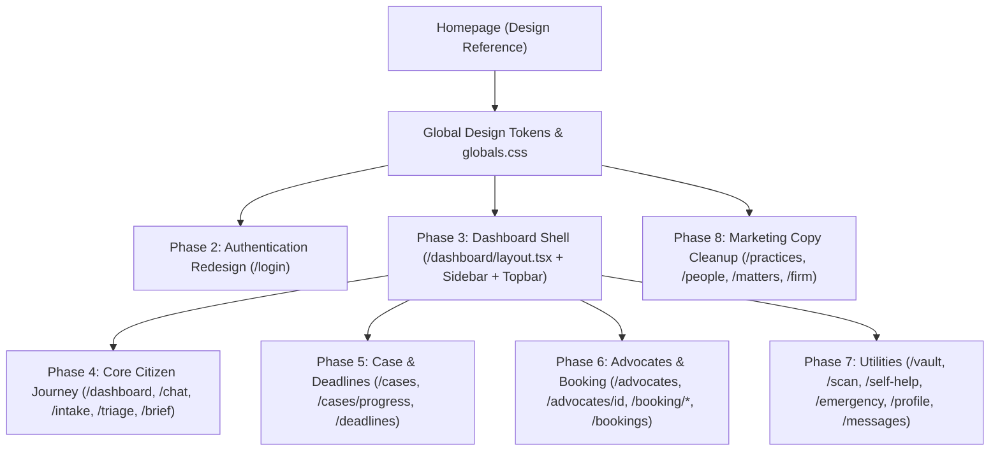

# NyayaSetu (न्यायसेतु) — Design Standardization Plan

**Date:** November 19, 2026  
**Auditor & Lead UI/UX Architect:** Antigravity AI Engine  
**Objective:** Standardize the entire NyayaSetu application (Auth + Dashboard Portal + Marketing Pages) using the exact visual design language of the existing Homepage.  
**Strict Directive:** DO NOT REDESIGN THE HOMEPAGE. The homepage is the canonical design reference.

---

## 1. Visual Anatomy of the Design Reference (Homepage)

The NyayaSetu homepage (`src/app/page.tsx`) represents an authoritative, classical editorial design system tailored for Indian legal technology. It balances classical legal publishing dignity with modern interactive responsiveness.

### 1.1 Color Palette & Surface Tokens

| Token | Hex Value | Semantic Role in Homepage |
| :--- | :--- | :--- |
| `--bg-primary` | `#f4efe6` / `#f3ece1` | Base canvas background (Warm Alabaster / Cream Paper) |
| `--bg-secondary` | `#ebe1d1` | Secondary sand surface (Subtle section fills, tab tracks, avatar rings) |
| `--bg-card` | `#fffaf2` | Card surface (Bright Warm White Alabaster for cards, inputs, dialogs) |
| `--text-primary` | `#2a1c12` | Primary typography & high-contrast buttons (Deep Espresso Roast) |
| `--text-secondary` | `#5b4a3b` | Body paragraph text & explanatory copy (Muted Umber) |
| `--text-muted` | `#85725f` | Micro-labels, stamp badges, captions & secondary meta (Tertiary Warm Gray) |
| `--accent-bronze` | `#9a6a35` | Primary brand accent, button hovers, active focus rings, stat indicators |
| `--accent-dark-bronze` | `#7c5226` | Active button press & dark accents (Deep Antique Bronze) |
| `--accent-gold` | `#d1a46a` | Subtitle highlights, dark container typography, hero decorative ring |
| `--bg-border` | `#e2d5c1` | Architectural 1px dividing lines & container borders (Muted Stone Border) |
| `--bg-border-hover` | `#cfbe9e` | Hover state for borders |
| `--bg-dark` | `#24180f` | Near-black espresso (Footer, dark contrast showcase panels) |
| `--bg-dark-card` | `#2f2116` | Charcoal espresso container surface |
| `--border-dark` | `#3f2c1f` | Dark container dividing lines |

### 1.2 Typography System

1. **Display & Headings:** `Gambetta` (Serif)
   - Classical, dignified, authoritative high-contrast serif.
   - Applied to **all** `h1`, `h2`, `h3`, `h4`, section headlines, card titles, and modal headers.
   - Features tight editorial line-height (`0.9` to `1.15`) and negative letter spacing (`-0.03em` to `-0.045em`).
   - Normal font weight (`font-weight: 400`) rather than heavy bold, relying on the serif letterforms for authority.

2. **Body & Controls:** `General Sans` (Sans-Serif)
   - Highly legible, neutral sans-serif.
   - Applied to body text (14px–16px, line-height `1.55`–`1.65`, `#5b4a3b`), form inputs, button labels, and table cells.

3. **Numerics & Micro-Labels:** `Inter` / System Monospace
   - Used for section numerals (`01`, `02`), reference codes (`NYA-BK-2026-9042`), statutory provisions (`Section 138`), phone numbers (`112`, `15100`), fee amounts (`₹2,499`), and stamp badges.
   - Uppercase tracking: `+0.12em` to `+0.14em`.

### 1.3 Geometry, Borders, and Radii
- **Crisp Square Corners:** All containers, cards, inputs, and buttons use `rounded-none` (0px) or `rounded-[2px]`.
- **Architectural Borders:** Consistent 1px solid border in `#e2d5c1`.
- **Restrained Shadows:** Minimal drop shadows with warm umber color cast (`shadow-[0_4px_24px_rgba(42,28,18,0.04)]` or `shadow-[0_8px_30px_rgba(42,28,18,0.06)]`). No heavy generic blur shadows.
- **Dividers:** Fine horizontal hairpins (`border-t border-[#e2d5c1]`).

### 1.4 Signature UI Patterns

1. **Compound Primary Button:**
   ```tsx
   <button className="group inline-flex items-center bg-[#2a1c12] text-[#fffaf2] hover:bg-[#9a6a35] transition-colors rounded-[2px] overflow-hidden">
     <span className="px-5 py-3 text-sm font-semibold tracking-tight">Action Title</span>
     <span className="flex items-center justify-center w-10 h-full py-3 border-l border-white/20 bg-white/10 group-hover:bg-white/20 transition-colors">
       <ArrowRight className="h-4 w-4" />
     </span>
   </button>
   ```

2. **Secondary Outline Button:**
   ```tsx
   <button className="inline-flex items-center px-5 py-3 border-[1.5px] border-[#2a1c12] text-[#2a1c12] hover:bg-[#2a1c12] hover:text-[#fffaf2] transition-colors text-sm font-semibold rounded-[2px]">
     Secondary Action
   </button>
   ```

3. **Stamp Badge (`stamp-badge`):**
   ```tsx
   <span className="inline-flex items-center px-2.5 py-0.5 text-[11px] font-medium font-sans uppercase tracking-[0.14em] border border-[#e2d5c1] bg-[#fffaf2]/80 text-[#85725f] rounded-none">
     STATUS / CATEGORY
   </span>
   ```

4. **Stat Metric Block:**
   ```tsx
   <div className="border-l-2 border-[#9a6a35] pl-5 space-y-1">
     <div className="font-serif text-[48px] leading-none text-[#2a1c12]">2,800+</div>
     <div className="text-sm font-sans font-medium text-[#705c49]">Verified advocates enrolled</div>
   </div>
   ```

5. **Form Field:**
   ```tsx
   <input className="w-full text-[13px] px-3.5 py-2.5 rounded-[2px] border border-[#e2d5c1] bg-[#fffaf2] text-[#2a1c12] placeholder:text-[#85725f]/60 focus:border-[#2a1c12] focus:outline-none focus:ring-1 focus:ring-[#9a6a35]" />
   ```

---

## 2. Root Cause Analysis: Why Login & Dashboard Look Disjointed

| Screen / Area | Current Divergent Pattern | Why It Fails | Homepage Reference Alignment Required |
| :--- | :--- | :--- | :--- |
| **Login (`/login`)** | Split-screen with black left column containing glassmorphic blurred bubbles (`bg-white/10 rounded-2xl`). Right column uses rounded-xl inputs, rounded-xl tab switcher, and hides global header/footer. | Looks like a mobile SaaS login screen from an unrelated template. Lacks judicial dignity. | Center-aligned editorial card on warm paper (`#f4efe6`), authentic monogram top bar, crisp square inputs, square role tabs, Gambetta display serif headings. |
| **Dashboard CSS (`dashboard.css`)** | Explicitly forces `.dashboard-scope { --font-display: "General Sans", "Inter"; }` and overrides `h1, h2, h3, h4` to sans-serif. | Strips the application of its signature Gambetta serif typography, erasing the legal platform identity. | Remove font override in `dashboard.css`. Let all headings inherit `Gambetta` serif with tight editorial tracking. |
| **Dashboard Primitives (`src/components/dashboard/ui.tsx`)** | Implements duplicate versions of `Button`, `Card`, `Badge`, `Input` using `rounded-2xl`, `rounded-xl`, `rounded-full`, and soft pastel tints (`bg-brand-soft`, `bg-mint`). | Clashes with the homepage's `rounded-none`/`rounded-[2px]` square architectural edges and warm paper palette. | Deprecate duplicate primitives. Use canonical components from `src/components/ui/` (`Button`, `Card`, `Badge`, `Input`, `Modal`). |
| **Dashboard Sidebar (`src/app/dashboard/layout.tsx`)** | Rounded-xl active links (`bg-brand-soft text-brand-dark rounded-xl`), pastel mint DLSA callout box, generic SaaS sidebar layout. | Inconsistent with homepage navigation aesthetic. | Square active links (`rounded-none border-l-2 border-[#9a6a35] bg-[#ebe1d1]/50 text-[#2a1c12]`), authentic monogram logo, editorial callout card. |
| **Dashboard Header Topbar** | Generic horizontal bar with pill-shaped language switcher and generic icon buttons. | Looks like an off-the-shelf admin template. | Architectural topbar with fine bottom border (`border-b border-[#e2d5c1]`), warm paper background, stamp badges. |
| **Dashboard Subpages (20 pages)** | Inconsistent mix of rounded cards, pill buttons, and pastel badges across chat, cases, triage, and booking. | Scattered visual inconsistency across the user journey. | Standardize every page to use square `Card`, `Gambetta` headers, `stamp-badge`, and compound primary buttons. |

---

## 3. Component Reusability & Standardization Strategy

### 3.1 Canonical Reusable Primitives (`src/components/ui/`)
The existing primitives in `src/components/ui/` **already implement the exact homepage design language**:
1. `Button` (`src/components/ui/button.tsx`): Already supports `rounded-none`, `variant="primary"` (`#2a1c12`), `variant="secondary"` (`#ebe1d1`), `variant="outline"`, and `variant="bronze"` (`#9a6a35`).
2. `Card`, `CardHeader`, `CardTitle`, `CardDescription`, `CardContent`, `CardFooter` (`src/components/ui/card.tsx`): Already implements `rounded-none`, `border border-[#e2d5c1]`, `bg-[#fffaf2]`, and `font-serif text-[22px]` titles.
3. `Badge` (`src/components/ui/badge.tsx`): Already implements `variant="stamp"` (`border border-[#e2d5c1] bg-[#fffaf2]/80 text-[#85725f] uppercase tracking-[0.14em] rounded-none`).
4. `Input`, `Textarea`, `Select` (`src/components/ui/input.tsx`): Already implement `rounded-none`, `border border-[#e2d5c1] bg-[#fffaf2] text-[#2a1c12] focus:border-[#9a6a35]`.
5. `Modal` (`src/components/ui/modal.tsx`): Already implements `rounded-none border border-[#e2d5c1] bg-[#fffaf2]`.
6. `Tabs` (`src/components/ui/tabs.tsx`): Already implements editorial tab underline styling.
7. `Accordion` (`src/components/ui/accordion.tsx`): Matches the homepage FAQ section with fine borders.

### 3.2 Action Plan for `src/components/dashboard/`
1. **Refactor `src/components/dashboard/ui.tsx`:** Rewire exports to wrap or directly re-export the canonical primitives from `src/components/ui/`. Any dashboard-specific variants (e.g. `tone="mint"`, `tone="warn"`) should map cleanly to the homepage's restrained stamp badge palette.
2. **Refactor `src/components/dashboard/shared.tsx`:** Standardize `PageHeader`, `StatCard`, `Disclaimer`, `AdvocateCard`, `CitationChip`, and `EmptyState` to use `Gambetta` serif titles, vertical bronze stat borders, and square card borders.
3. **Clean `dashboard.css`:** Delete the `--font-display` sans-serif heading override and remove pill radii classes (`.rounded-2xl`, `.rounded-xl`).

---

## 4. Page-by-Page Visual Update Roadmap



### Detailed Execution Matrix

| Phase | Target Route(s) | Specific Visual Updates | Reusable Components to Apply |
| :--- | :--- | :--- | :--- |
| **Phase 2** | `/login` | Replace split-screen with centered warm paper card (`#fffaf2`, `border border-[#e2d5c1]`, `rounded-[2px]`). Replace rounded-xl tabs with square role switcher (`Citizen` vs `Advocate`). Replace rounded OTP boxes with crisp square inputs. Apply `Gambetta` serif display to "Sign in to NyayaSetu". Format 3-step onboarding wizard with stamp badges and compound button. | `Card`, `Input`, `Badge` (variant="stamp"), `Button` (compound primary), `MonogramLogo` |
| **Phase 3** | `/dashboard/layout.tsx`, `dashboard.css` | 1. Remove sans-serif override in `dashboard.css` so headers inherit `Gambetta`.<br>2. Redesign Sidebar: Warm alabaster surface (`#fffaf2`), sharp border (`border-r border-[#e2d5c1]`), monogram header, active link with square border-left bronze accent (`border-l-2 border-[#9a6a35] bg-[#ebe1d1]/50 text-[#2a1c12]`).<br>3. Redesign Topbar: Thin border, editorial search input, clean language dropdown. | `SidebarItem`, `BrandLogo`, `LanguageSwitcher`, `Badge` |
| **Phase 4** | `/dashboard`, `/dashboard/chat`, `/dashboard/intake`, `/dashboard/triage`, `/dashboard/brief` | 1. `/dashboard`: Replace rounded stat cards with vertical bronze border blocks; style quick actions as crisp cards with serif titles.<br>2. `/dashboard/chat`: Style user messages in `#2a1c12` text `#fffaf2`, assistant in `#fffaf2` with `#e2d5c1` border, stamp citation chips, serif title.<br>3. `/dashboard/intake`: Square step indicator, square checkboxes.<br>4. `/dashboard/triage`: Square decision path cards, stamp confidence badge.<br>5. `/dashboard/brief`: Legal dossier styling with serif headings and architectural dividers. | `Card`, `Button`, `Badge`, `StatCard`, `CitationChip`, `Input`, `Textarea` |
| **Phase 5** | `/dashboard/cases`, `/dashboard/cases/[id]/progress`, `/dashboard/deadlines` | 1. `/cases`: Legal matter ledger dossier cards with category stamp badges and compound action buttons.<br>2. `/cases/[id]/progress`: Vertical milestone progression timeline styled with bronze accents and serif stage titles.<br>3. `/deadlines`: Clean calendar grid with square day cells, stamp limitation rule chips, and advocate confirmation review modal. | `Card`, `Badge` (stamp), `Button`, `Modal`, `Tabs` |
| **Phase 6** | `/dashboard/advocates`, `/dashboard/advocates/[id]`, `/dashboard/booking/*`, `/dashboard/bookings`, `/dashboard/feedback/*` | 1. `/advocates`: Advocate discovery cards styled with verification seals, fee tags, and language chips matching homepage `PartnerShowcase`.<br>2. `/advocates/[id]`: Authoritative dossier with Bar Council credentials, court admissions, and fee table.<br>3. `/booking/*`: Scheduler styled identically to the homepage `TransparencyPreview` scheduler card.<br>4. `/bookings`: Tabbed ledger with square action buttons. | `AdvocateCard`, `Card`, `Button`, `Badge`, `Tabs`, `Input` |
| **Phase 7** | `/dashboard/vault`, `/dashboard/scan`, `/dashboard/self-help`, `/dashboard/emergency`, `/dashboard/profile`, `/dashboard/messages` | 1. `/vault`: Document table with architectural lines, square upload button, and access log ledger.<br>2. `/scan`: Dropzone with fine dashed border, stage indicator, and extracted field list.<br>3. `/self-help`: Template editor and live document preview styled with crisp borders.<br>4. `/emergency`: Direct dial helpline tiles and constitutional rights cards with bronze accents.<br>5. `/profile`: DPDP Act 2023 consent ledger table with stamp badges.<br>6. `/messages`: Thread list and chat window in warm paper tones. | `Card`, `Button`, `Badge`, `Input`, `Modal`, `Select` |
| **Phase 8** | `/practices`, `/people`, `/matters`, `/firm`, `/insights` | Replace remaining Chicago/Illinois legacy copy ("LaSalle Street", "Ellery Kowal LLP", USD `$`) with the canonical Indian NyayaSetu identity established on the homepage. | Editorial prose, `Card`, `Badge`, `Button` |

---

## 5. Summary of Deliverables & Next Steps

Phase 1 audit is complete. **No code, database schemas, API routes, or visual styles have been modified.**  
The four comprehensive audit reports are generated and preserved:
1. `PROJECT_ARCHITECTURE_AUDIT.md` (System architecture, ORM models, API inventory, security)
2. `ROUTE_AND_PAGE_INVENTORY.md` (All 32 routes with components, API dependencies, and status)
3. `BACKEND_FEATURE_GAP_REPORT.md` (Implemented vs missing backend capabilities and integration roadmap)
4. `DESIGN_STANDARDIZATION_PLAN.md` (Exact blueprint to apply homepage visual language across all pages)

When you are ready to proceed to Phase 2 (Implementation), we can execute the standardization sequentially starting with the Authentication screen (`/login`) and the Dashboard shell (`/dashboard/layout.tsx`).
