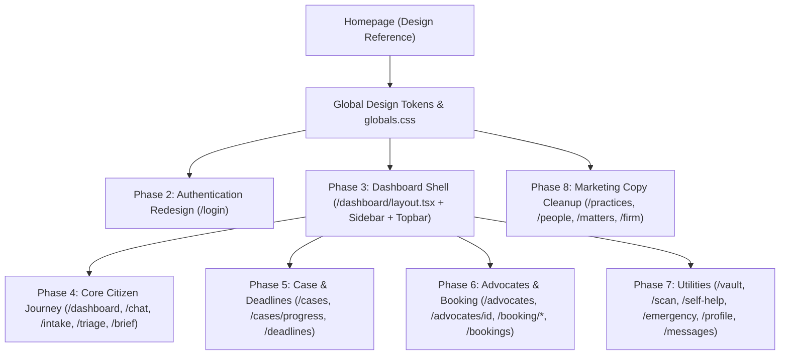

# NyayaSetu Frontend Reference

> Consolidated from: `docs/FRONTEND.md`, `docs/FRONTEND.md`, `docs/FRONTEND.md`, `frontend/README.md`, `frontend/AGENTS.md`.


---

## Frontend Guide

# Frontend

**Location:** `frontend/`
**Framework:** Next.js 16.4.5 (App Router), React 19.3, TypeScript 5
**Styling:** Tailwind CSS 4 with custom tokens in `src/app/globals.css`
**Motion / 3D:** Framer Motion 14, Three.js via `@react-three/fiber` and
`@react-three/drei`

> This is **Next.js 16**, not an older release. Before using an unfamiliar API,
> read the bundled docs under `frontend/node_modules/next/dist/docs/`. See
> `frontend/AGENTS.md` for the version warning.

## Run it

```bash
cd frontend
npm install
npm run dev
```

- URL: <http://localhost:3000>
- `predev` deletes `.next/dev/lock` and kills any process on port 3000.
- Production check: `npm run build`, then `npm run start`.

There are no frontend environment variables yet. The backend API is not consumed
by the frontend at the time of writing.

## Structure

```text
frontend/
├── public/
│   ├── model/…              Lady Justice GLB (legacy path)
│   └── models/lady-justice/ Lady Justice GLB (current path)
├── scripts/predev.js        Port/lock cleanup
├── src/
│   ├── app/                 App Router routes
│   ├── components/
│   │   ├── 3d/              Three.js canvas and loader
│   │   ├── layout/          Container, section, navbar, footer, back-to-top
│   │   ├── sections/        Home-page and shared marketing sections
│   │   └── ui/              Button, input, modal, tabs, accordion, badge, card
│   ├── data/                Static content arrays
│   ├── lib/utils.ts         `cn()` class merge helper
│   └── types/index.ts       Content and form types
├── next.config.ts
├── package.json
└── tsconfig.json
```

## Routes

| Route | Rendering | Purpose |
| --- | --- | --- |
| `/` | Server composition | Hero, about, practices slider, transparency, contract annotator, matters preview, partners, testimonials, insights, FAQ, conflict intake |
| `/login` | Client | Dual-role authentication (Citizen OTP + Advocate Bar Enrolment) and 3-step citizen onboarding (language, disclaimer, DPDP consent) |
| `/dashboard` | Client | Citizen & Advocate portal home: problem intake router, stat cards, active case tracker, urgency deadlines, quick action tiles |
| `/dashboard/chat` | Client | AI legal assistant with Indian statutory citations (BNS, CPC, NI Act, etc.) and direct next actions |
| `/dashboard/intake` | Client | Structured matter intake: urgency, complexity, income, and user goal |
| `/dashboard/triage` | Client | Deterministic triage result: emergency, legal aid, self-help, or advocate path |
| `/dashboard/brief` | Client | Reviewable case brief with citations, timeline, and share controls |
| `/dashboard/cases` | Client | Case file manager: timeline view, procedural hearings, case dates, and new matter intake |
| `/dashboard/cases/[caseId]/progress` | Client | Case progress timeline, hearing dates, pending steps, and notifications |
| `/dashboard/deadlines` | Client | Limitation and court compliance tracker with statutory rule references and completion toggles |
| `/dashboard/advocates` | Client | Bar-verified advocate directory with practice filters and consultation slot booking |
| `/dashboard/advocates/[id]` | Client | Advocate profile with verified details, practice areas, fees, and booking CTA |
| `/dashboard/booking/[advocateId]` | Client | Slot selection, mode, consent confirmation, and mock checkout |
| `/dashboard/booking/confirmation/[bookingId]` | Client | Booking confirmation, .ics download, and next steps |
| `/dashboard/self-help` | Client | Interactive legal notice generator (Tenancy, Cheque Dishonour, Consumer Grievance) with live print preview |
| `/dashboard/vault` | Client | Encrypted document repository with time-limited DPDP consent sharing and access audit logs |
| `/dashboard/scan` | Client | OCR legal notice analyzer: entity extraction, risk score, and recommended legal remedies |
| `/dashboard/bookings` | Client | Scheduled video and chamber consultation management |
| `/dashboard/feedback/[bookingId]` | Client | Verified post-consultation rating and feedback |
| `/dashboard/messages` | Client | Secure direct advocate communication threads with simulated instant replies |
| `/dashboard/emergency` | Client | 24/7 statutory helplines (112, 181, 15100 DLSA) and situational constitutional rights guides |
| `/dashboard/profile` | Client | User details, language preference, and DPDP Act 2023 consent ledger (grant/revoke/erase) |
| `/practices` | Client | Anchor navigation, practice detail cards, consultation modal |
| `/people` | Client | Advocate directory, filters/search, vCard download |
| `/matters` | Client | Matter ledger with category/search filters |
| `/insights` | Client | Guide index, category tabs, search, newsletter form |
| `/insights/[slug]` | Server with `generateStaticParams`-style lookup from static data | Guide detail |
| `/firm` | Server/client sections | Story, timeline, commitments, client profiles, pro bono |
| `/contact` | Client | Four-step conflict-check intake simulation |
| `/privacy` | Server | Privacy notice |
| `/disclaimer` | Server | Legal notices |
| `not-found` | Server | Custom 404 |
| `sitemap.ts` | Metadata route | Static + article URLs |
| `layout.tsx` | Root layout | AuthProvider wrapper, metadata, fonts, conditional navbar/footer, back-to-top |

## Key components

### Layout

- `src/components/layout/navbar.tsx` — primary navigation with dropdown.
- `src/components/layout/footer.tsx` — footer links and legal copy.
- `src/components/layout/container.tsx` — width variants (`md`, `lg`, `xl`).
- `src/components/layout/section.tsx` — consistent section spacing.
- `src/components/layout/back-to-top.tsx` — scroll control.

### Home sections

- `hero-section.tsx` — headline, language/advocate social proof, CTAs, 3D scene.
- `about-strip.tsx` — metrics and positioning.
- `practices-slider.tsx` — practice carousel.
- `transparency-preview.tsx` — fee/transparency messaging.
- `contract-annotator.tsx` — interactive clause annotations (client-side only,
  no AI call).
- `matters-preview.tsx` — selected outcomes.
- `partner-showcase.tsx` — client institutions.
- `client-quotes.tsx` — testimonials.
- `latest-insights.tsx` — recent guides.
- `faq-section.tsx` — accordion.
- `conflict-intake-section.tsx` — home-page conflict-check form (simulated).

### UI primitives

`button.tsx`, `input.tsx` (`Input`, `Textarea`, `Select`), `modal.tsx`,
`quick-consultation-modal.tsx`, `tabs.tsx`, `accordion.tsx`, `badge.tsx`,
`card.tsx`.

### Dashboard portal

The authenticated portal is self-contained under `src/app/dashboard/`. It uses a
dashboard-only shell (`layout.tsx`), scoped CSS (`dashboard.css`, nested under
`.dashboard-scope`), UI primitives in `src/components/dashboard/`, and mock
services in `src/services/dashboard/`. Ported screens keep the reference
structure and English copy; only the palette is mapped to the warm-paper tokens
in `globals.css`. `src/lib/dashboard-utils.ts` provides `dh()`, which maps a
reference route such as `/cases` to `/dashboard/cases`.

### 3D

`src/components/3d/lady-justice-canvas.tsx` is dynamically imported with
`ssr: false` from the hero. It loads the Lady Justice GLB and textures from
`public/models/lady-justice/`. Do not make the hero a fully client component just
to host the canvas; the existing `dynamic()` boundary is intentional.

## Data layer

All content currently comes from `src/data/`:

| File | Export | Consumers |
| --- | --- | --- |
| `practices.ts` | `practices` | Home slider, `/practices` |
| `lawyers.ts` | `partners`, `teamRoster` | `/people`, CTAs |
| `matters.ts` | `matters` | Home preview, `/matters` |
| `articles.ts` | `articles` | `/insights`, `/insights/[slug]`, sitemap |
| `faqs.ts` | `faqs` | Home FAQ |
| `testimonials.ts` | `testimonials` | Home quotes |
| `fixed-fees.ts` | `fixedFees` | Transparency/fee UI |
| `firm.ts` | `firmTimeline`, `writtenCommitments`, `clientProfiles`, `proBonoDetails` | `/firm` |
| `partners.ts` | `clientInstitutions` | Home partner showcase |
| `navigation.ts` | `navigationLinks` | Navbar/footer |
| `mock-citizen-data.ts` | `demoUser`, `notifications`, language labels | Auth context, dashboard shell |
| `dashboard-mock-data.ts` | Ported reference seed data | Dashboard mock services |

Types live in `src/types/index.ts`. Dashboard-specific ported types live in
`src/types/dashboard.ts`.

### Static vs API content

The backend seed content was manually aligned with most of these arrays, but the
frontend does not fetch it. Until integration is complete:

- Changing content may require edits in **both** `frontend/src/data/` and
  `backend/src/db/seed-data/`.
- The backend is the better long-term source of truth.
- See [`CONTENT.md`](CONTENT.md) for the current mismatches and legacy copy.

## API integration plan

The backend contract is documented in [`API.md`](API.md).

### 1. Add an API base URL

Create `frontend/.env.local`:

```dotenv
NEXT_PUBLIC_API_URL=http://localhost:8000
```

Use a server-only variable if the client never calls the API directly. Note: `next.config.ts` automatically proxies `/api/v1/:path*` to `http://localhost:8000/api/v1/:path*`.

### 2. Add a typed client

Suggested `src/lib/api.ts`:

```ts
const API_BASE_URL =
  process.env.NEXT_PUBLIC_API_URL ?? "http://localhost:8000";

type ApiEnvelope<T> = {
  data: T;
  meta?: {
    page: number;
    limit: number;
    total: number;
    totalPages: number;
    hasNextPage: boolean;
    hasPreviousPage: boolean;
  };
};

export async function apiGet<T>(
  path: string,
  init?: RequestInit,
): Promise<ApiEnvelope<T>> {
  const response = await fetch(`${API_BASE_URL}/api/v1${path}`, {
    ...init,
    headers: { Accept: "application/json", ...init?.headers },
  });

  const body = await response.json();

  if (!response.ok) {
    throw new Error(body?.error?.message ?? "Request failed");
  }

  return body as ApiEnvelope<T>;
}
```

Add Next.js caching/revalidation deliberately, for example:

```ts
const { data: practices } = await apiGet<Practice[]>("/practices", {
  next: { revalidate: 300 },
});
```

### 3. Migration order

1. `/api/v1/site` → navbar/footer/contact/site shell.
2. `/api/v1/practices` → home slider and `/practices`.
3. `/api/v1/advocates` → `/people`.
4. `/api/v1/matters` + `/matters/categories` → `/matters`.
5. `/api/v1/insights` + `/insights/categories` → `/insights` and detail.
6. `/api/v1/catalog` → FAQ, testimonials, fixed fees.
7. `POST /api/v1/intake` → `/contact`, home conflict section, quick consultation
   modal.
8. `POST /api/v1/newsletter` → `/insights` subscribe form.

### 4. Intake form mapping

The current forms collect data that maps to the intake API with small changes:

| UI field | API field |
| --- | --- |
| Full name | `fullName` |
| Company/entity | `companyName` (stored in `metadata`) |
| Email | `email` |
| Phone | `phone` |
| Role/title | `role` (stored in `metadata`) |
| Practice group | `practiceArea` |
| Adverse parties | `adverseParties` |
| Urgency | `urgency` (`upcoming-30d` → `standard-30d`, `none-yet` → `exploratory`) |
| Matter description | `matterSummary` |
| Preferred date/time | `preferredDate`, `preferredTime` (consultation only) |
| Consent checkbox | `consentAcknowledged: true` |
| Form type | `kind` (`legal-assessment`, `conflict-check`, `consultation`) |

The home conflict form currently uses a `none-yet` urgency and a simulated
`setTimeout`. Replace the timeout with a `POST /api/v1/intake` call and display
the returned `reference` and `nextStep`.

Do not send privileged or highly sensitive material before a conflict clearance;
the UI copy already warns about this. Keep the warning.

### 5. Error and loading states

- Keep the existing step validation; add server-side field errors from the
  `validation_error` `details` array.
- Show the `requestId` in support copy when a request fails.
- Disable the submit button while in flight; prevent duplicate submissions.
- Respect `429` with a retry message instead of a generic failure.
- For newsletter, treat `202` as success and keep the form idempotent.

## Styling and design system

- Palette tokens are inline hex values: paper `#f3ece1` / `#f4efe6`, surface
  `#fffaf2`, border `#e2d5c1`, ink `#2a1c12`, muted `#5b4a3b`, accent gold
  `#9a6a35`, error `#9e2a2b`.
- Display type is a serif (Gambetta via Fontshare); body is General Sans. The
  stylesheet is loaded in `layout.tsx`.
- Labels often use uppercase mono with wide tracking.
- Borders are square and thin; shadows are restrained.
- Framer Motion is used for entrance transitions and step changes. Keep duration
  short and avoid gratuitous motion.
- Tailwind 4 is wired through `@tailwindcss/turbopack` in `next.config.ts`.

## Next.js config notes

`next.config.ts` enables:

- `cacheComponents: true`
- `partialPrefetching: true`
- Remote images from `images.unsplash.com` and `framerusercontent.com`
- Tailwind CSS via Turbopack rules

If you add a new remote image host, update `images.remotePatterns`. Do not disable
the image optimizer to work around a missing host.

## Forms and client state

- Forms are local React state with hand-written validation.
- No form library, schema resolver, or shared validation package is used.
- The `/contact` form is a four-step state machine (`1 | 2 | 3 | 4`).
- The home conflict form and quick consultation modal each simulate a submission
  with `setTimeout`.
- `/people` generates a vCard string in the browser.
- `/insights` filters locally and simulates newsletter subscription.

There is no global state manager and no React Query/SWR. Server components plus
`fetch` caching should be preferred over adding a client data library for public
content.

## Known frontend debt

| Item | Detail |
| --- | --- |
| Legacy brand copy | Multiple pages still say Ellery Kowal LLP / Chicago / Illinois |
| Legacy sitemap host | `src/app/sitemap.ts` uses `https://ellery-visuvate.framer.website` |
| Package name | `frontend/package.json` name is `ellery-app` |
| CSS comment | `src/app/globals.css` references Ellery Kowal tokens |
| Fixed fees | USD amounts and legacy firm packages |
| Mixed data | Some arrays are India-focused; some firm/articles copy is US-focused |
| No API usage | All content is static; all writes are simulated |
| No tests | No unit, component, or E2E suite |
| Duplicate 3D assets | `public/model/` and `public/models/` both exist |
| Newsletter copy | Mentions a "partner distribution list" and quarterly briefing |

See [`CONTENT.md`](CONTENT.md) for the full register and remediation order.

## Verification

```bash
cd frontend
npm run lint
npm run build
```

The production build is the best check for App Router, metadata, image, and
server/client boundary issues. If the build fails on remote images, verify the
host is in `next.config.ts`.

## Related docs

- [`API.md`](API.md) — request/response contract
- [`ARCHITECTURE.md`](ARCHITECTURE.md) — system context
- [`CONTENT.md`](CONTENT.md) — copy and compliance rules
- [`DEVELOPMENT.md`](DEVELOPMENT.md) — setup and troubleshooting


---

## Route and Page Inventory

# NyayaSetu (न्यायसेतु) — Route and Page Inventory

**Date of Audit:** November 19, 2026  
**Total Routes Audited:** 32 (11 Public/Marketing + 1 Auth + 20 Authenticated Dashboard Portal)  
**Status:** Audit Complete · Zero Code Modifications (Phase 1)

---

## 1. Inventory Summary Matrix

| # | Route | Purpose | Key Components | Backend API Dependencies | Functional Status |
| :--- | :--- | :--- | :--- | :--- | :--- |
| 1 | `/` | Main Homepage & Platform Overview | `HeroSection`, `LadyJusticeCanvas`, `AboutStrip`, `PracticesSlider`, `TransparencyPreview`, `ContractAnnotator`, `MattersPreview`, `PartnerShowcase`, `ClientQuotes`, `LatestInsights`, `FaqSection`, `ConflictIntakeSection` | None (Static composition) | **Fully Functional** (Client + Server) |
| 2 | `/practices` | Practice Areas Directory & Timelines | `Container`, `Badge`, `Button`, `QuickConsultationModal`, `practices` static data | `/api/v1/matching/advocates` | **Functional** (Static + Modal) |
| 3 | `/people` | Empanelled Advocates & Partners Directory | `Container`, `Badge`, `Button`, `partners` data, vCard exporter | `/api/v1/matching/advocates` | **Functional** (Static + Search/Filter) |
| 4 | `/matters` | Precedents & Court Representative Matters Ledger | `Container`, `Badge`, `Button`, `matters` static data | `/api/v1/cases` (Precedents) | **Functional** (Static + Filter) |
| 5 | `/insights` | Legal Guides, Articles & Newsletter Form | `Container`, `Badge`, `Button`, `articles` data, Newsletter input | `/api/v1/legal/admin/sources` | **Functional** (Static + Filter) |
| 6 | `/insights/[slug]` | Individual Legal Guide Article Reading View | `Container`, `Badge`, `Button`, article markdown renderer | None (SSG lookup) | **Fully Functional** (Server SSG) |
| 7 | `/firm` | Story, Heritage, Written Commitments & Pro Bono | `Container`, `Badge`, `Button`, `firmTimeline`, `writtenCommitments` | None | **Fully Functional** (Static) |
| 8 | `/contact` | Conflict-Check Inquiry & Consultation Intake | `Container`, `Badge`, `Button`, 4-step conflict wizard | `/api/v1/cases`, `/api/v1/triage/assess` | **Functional** (Client Simulation) |
| 9 | `/privacy` | DPDP Act 2023 Compliance & Privacy Notice | `Container`, legal policy text | None | **Fully Functional** (Static) |
| 10 | `/disclaimer` | Bar Council of India Regulatory Disclosures | `Container`, regulatory policy text | None | **Fully Functional** (Static) |
| 11 | `/not-found` | Custom 404 Page | `Container`, `Button` | None | **Fully Functional** |
| 12 | `/login` | Dual-Role Login & 3-Step Citizen Onboarding | Role Tabs, Mobile Input, 6-digit OTP, Onboarding wizard, `useAuth` | `/api/v1/auth/login`, `/api/v1/auth/register`, `/api/v1/auth/refresh` | **Functional** (Local Simulation / Disconnected) |
| 13 | `/dashboard` | Citizen & Advocate Central Portal Home | `Sidebar`, `LanguageSwitcher`, `StatCard`, Quick Action tiles, `getDashboardSummary` | `/api/v1/cases`, `/api/v1/deadlines`, `/api/v1/appointments` | **Functional** (Local Simulation / Disconnected) |
| 14 | `/dashboard/chat` | AI Legal Assistant with Statutory Citations | Chat window, message bubbles, `CitationChip`, `streamAnswer` | `/api/v1/legal/ask` | **Functional** (Local Simulation / Disconnected) |
| 15 | `/dashboard/intake` | Structured 5-Step Case Matter Intake Wizard | Multi-step form, document selector, `classifyIntake` | `/api/v1/cases`, `/api/v1/triage/assess` | **Functional** (Local Simulation / Disconnected) |
| 16 | `/dashboard/triage` | Deterministic Legal Triage Assessment | Triage path selector, income calculator, DLSA cards, `runTriage` | `/api/v1/cases/{id}/triage`, `/api/v1/triage/assess` | **Functional** (Local Simulation / Disconnected) |
| 17 | `/dashboard/brief` | Reviewable Case Brief with DPDP Sharing | Section editor, document chips, consent box, `saveConsent` | `/api/v1/cases/{id}`, `/api/v1/documents/cases/{id}` | **Functional** (Local Simulation / Disconnected) |
| 18 | `/dashboard/cases` | Case Files & Matter Tracker Directory | `PageHeader`, `Card`, `Badge`, `Button`, cases filter, `cases` data | `/api/v1/cases` | **Functional** (Local Simulation / Disconnected) |
| 19 | `/dashboard/cases/[caseId]/progress` | Individual Case Procedural Milestone Tracker | Milestone timeline, hearing countdown, procedural stage badges | `/api/v1/cases/{id}`, `/api/v1/deadlines/cases/{id}` | **Functional** (Local Simulation / Disconnected) |
| 20 | `/dashboard/deadlines` | Limitation Act & Court Compliance Calendar | List/calendar view, urgency chips, confirm modal, `listDeadlines` | `/api/v1/deadlines` | **Functional** (Local Simulation / Disconnected) |
| 21 | `/dashboard/advocates` | Verified Advocate Discovery & Matching | Filter sidebar, advocate cards, verification seals, `matchAdvocates` | `/api/v1/matching/cases/{id}/advocates`, `/api/v1/matching/advocates` | **Functional** (Local Simulation / Disconnected) |
| 22 | `/dashboard/advocates/[id]` | Verified Advocate Profile & Credentials View | Profile banner, bar ID badge, fee table, booking CTA | `/api/v1/matching/advocates`, `/api/v1/admin/advocates/{id}` | **Functional** (Local Simulation / Disconnected) |
| 23 | `/dashboard/booking/[advocateId]` | Consultation Appointment Slot Booking | Date picker, time slot pills, mode selector, fee checkout, `bookSlot` | `/api/v1/appointments` | **Functional** (Local Simulation / Disconnected) |
| 24 | `/dashboard/booking/confirmation/[bookingId]` | Booking Confirmation & .ics Export | Reference code badge, meeting URL tile, .ics export generator | `/api/v1/appointments/{id}` | **Functional** (Local Simulation / Disconnected) |
| 25 | `/dashboard/bookings` | Scheduled Consultation Management | `Tabs`, `Badge`, `Button`, `EmptyState`, `listBookings` | `/api/v1/appointments` | **Functional** (Local Simulation / Disconnected) |
| 26 | `/dashboard/feedback/[bookingId]` | Post-Consultation Rating & Review | Star rating selector, feedback text area, submit button | Needs backend feedback endpoint (Gap) | **Functional** (Client State Only) |
| 27 | `/dashboard/self-help` | Interactive Legal Notice Generator | Template tabs, field inputs, live print preview, `printHtml` | None (Client-side HTML generator) | **Fully Functional** |
| 28 | `/dashboard/vault` | Encrypted Case Document Repository | Document table, upload modal, share modal, access log, `signedUrl` | `/api/v1/documents/*` | **Functional** (Local Simulation / Disconnected) |
| 29 | `/dashboard/scan` | Notice OCR Analyzer & Plain-English Explainer | Dropzone, OCR stage progress, dates/amounts list, `runOcr` | Needs backend OCR pipeline (Gap) | **Functional** (Client Simulation) |
| 30 | `/dashboard/messages` | Direct Advocate Communication Threads | Thread sidebar, chat window, attachment modal, report/block | Needs P2P message thread API (Gap) | **Functional** (Client Simulation) |
| 31 | `/dashboard/emergency` | 24/7 Low-Bandwidth Helplines & Rights | Direct dial cards (112, 181, 15100), constitutional rights tabs | None (Offline-first by design) | **Fully Functional** |
| 32 | `/dashboard/profile` | Profile, Language & DPDP Consent Ledger | Profile form, language selector modal, consent table, export CTA | `/api/v1/auth/me`, `/api/v1/users/{id}` | **Functional** (Local Simulation / Disconnected) |

---

## 2. Detailed Route Dossiers

### 2.1 Public / Marketing Routes (Design Benchmark)
All public marketing routes (`/`, `/practices`, `/people`, `/matters`, `/insights`, `/firm`, `/contact`) share the classical editorial layout wrapped in `src/app/layout.tsx`.
- **Top Navigation (`Navbar`):** Transparent cream background `#f4efe6/95`, justice monogram scale SVG, serif wordmark "NyayaSetu BHARAT", dot-activated links, and a sharp primary CTA button.
- **Footer (`Footer`):** Deep espresso background `#24180f`, gold typography `#d1a46a`, Bar Council disclaimer, and structured column sitemap.
- **Visual Polish:** High. Employs classical typography (`Gambetta` display serif), warm paper backgrounds (`#f4efe6`, `#f3ece1`), crisp square borders (`rounded-none` / `rounded-[2px]`), and antique bronze accents (`#9a6a35`).

### 2.2 Authentication Screen (`/login`)
- **Visual Divergence:** Splits screen into an espresso left sidebar with glassmorphic cards (`bg-white/10 rounded-2xl`) and a right container with rounded-xl inputs, rounded-xl role switcher tabs, and rounded buttons.
- **State & Logic:** Employs client-side phone number validation, simulated 30-second OTP timer, and a 3-step onboarding wizard. Stores mock token in `localStorage`.
- **Backend Coupling:** Zero. The FastAPI backend has `/api/v1/auth/login` and `/api/v1/auth/register`, but `/login` does not call them.

### 2.3 Dashboard Shell & Layout (`/dashboard/layout.tsx`)
- **Visual Divergence:** Introduces `dashboard.css`, which overrides display typography from `Gambetta` (serif) to `General Sans`/`Inter` (sans-serif), injects `shadow-card`, rounded pill badges (`rounded-full`), and rounded buttons (`rounded-xl`).
- **Sidebar Navigation:** Contains 3 navigation groups (`Main`, `Get help`, `Account`) with 11 links. Active links use pastel brand tints (`bg-brand-soft text-brand-dark rounded-xl`) instead of the homepage's crisp square active states with dot indicators.
- **Top Header Bar:** Contains search input, language switcher dropdown, and notification badge button.

### 2.4 Dashboard Feature Pages (`/dashboard/*`)
- **Triage & Intake (`/intake`, `/triage`, `/brief`):** Implements an exhaustive legal intake questionnaire, deterministic decision engine, and case brief generator. The logic is robust, but the visual components use rounded SaaS pills.
- **Advocate Discovery & Booking (`/advocates`, `/advocates/[id]`, `/booking/*`, `/bookings`):** Simulates advocate matching and appointment booking with conflict checking. It faithfully mimics the backend's logic, but does not fetch from `/api/v1/matching/advocates` or post to `/api/v1/appointments`.
- **Vault & Scanner (`/vault`, `/scan`):** Simulates encrypted document management and OCR extraction. The document vault features a consent-sharing modal and access log ledger.
- **Statutory Deadlines (`/deadlines`):** Contains both list and monthly calendar views, displaying limitation rules (e.g. Section 138 NI Act, Order VIII Rule 1 CPC).
- **Self-Help Suite (`/self-help`):** An outstanding, fully working client-side legal notice drafting suite with live printable previews.
- **Emergency Rights (`/emergency`):** An offline-first, low-bandwidth emergency directory with one-tap dialing and constitutional rights summaries.


---

## Design Standardization Plan

# NyayaSetu (न्यायसेतु) — Design Standardization Plan

**Date:** November 19, 2026  
**Auditor & Lead UI/UX Architect:** Antigravity AI Engine  
**Objective:** Standardize the entire NyayaSetu application (Auth + Dashboard Portal + Marketing Pages) using the exact visual design language of the existing Homepage.  
**Strict Directive:** DO NOT REDESIGN THE HOMEPAGE. The homepage is the canonical design reference.

---

## 1. Visual Anatomy of the Design Reference (Homepage)

The NyayaSetu homepage (`src/app/page.tsx`) represents an authoritative, classical editorial design system tailored for Indian legal technology. It balances classical legal publishing dignity with modern interactive responsiveness.

### 1.1 Color Palette & Surface Tokens

| Token | Hex Value | Semantic Role in Homepage |
| :--- | :--- | :--- |
| `--bg-primary` | `#f4efe6` / `#f3ece1` | Base canvas background (Warm Alabaster / Cream Paper) |
| `--bg-secondary` | `#ebe1d1` | Secondary sand surface (Subtle section fills, tab tracks, avatar rings) |
| `--bg-card` | `#fffaf2` | Card surface (Bright Warm White Alabaster for cards, inputs, dialogs) |
| `--text-primary` | `#2a1c12` | Primary typography & high-contrast buttons (Deep Espresso Roast) |
| `--text-secondary` | `#5b4a3b` | Body paragraph text & explanatory copy (Muted Umber) |
| `--text-muted` | `#85725f` | Micro-labels, stamp badges, captions & secondary meta (Tertiary Warm Gray) |
| `--accent-bronze` | `#9a6a35` | Primary brand accent, button hovers, active focus rings, stat indicators |
| `--accent-dark-bronze` | `#7c5226` | Active button press & dark accents (Deep Antique Bronze) |
| `--accent-gold` | `#d1a46a` | Subtitle highlights, dark container typography, hero decorative ring |
| `--bg-border` | `#e2d5c1` | Architectural 1px dividing lines & container borders (Muted Stone Border) |
| `--bg-border-hover` | `#cfbe9e` | Hover state for borders |
| `--bg-dark` | `#24180f` | Near-black espresso (Footer, dark contrast showcase panels) |
| `--bg-dark-card` | `#2f2116` | Charcoal espresso container surface |
| `--border-dark` | `#3f2c1f` | Dark container dividing lines |

### 1.2 Typography System

1. **Display & Headings:** `Gambetta` (Serif)
   - Classical, dignified, authoritative high-contrast serif.
   - Applied to **all** `h1`, `h2`, `h3`, `h4`, section headlines, card titles, and modal headers.
   - Features tight editorial line-height (`0.9` to `1.15`) and negative letter spacing (`-0.03em` to `-0.045em`).
   - Normal font weight (`font-weight: 400`) rather than heavy bold, relying on the serif letterforms for authority.

2. **Body & Controls:** `General Sans` (Sans-Serif)
   - Highly legible, neutral sans-serif.
   - Applied to body text (14px–16px, line-height `1.55`–`1.65`, `#5b4a3b`), form inputs, button labels, and table cells.

3. **Numerics & Micro-Labels:** `Inter` / System Monospace
   - Used for section numerals (`01`, `02`), reference codes (`NYA-BK-2026-9042`), statutory provisions (`Section 138`), phone numbers (`112`, `15100`), fee amounts (`₹2,499`), and stamp badges.
   - Uppercase tracking: `+0.12em` to `+0.14em`.

### 1.3 Geometry, Borders, and Radii
- **Crisp Square Corners:** All containers, cards, inputs, and buttons use `rounded-none` (0px) or `rounded-[2px]`.
- **Architectural Borders:** Consistent 1px solid border in `#e2d5c1`.
- **Restrained Shadows:** Minimal drop shadows with warm umber color cast (`shadow-[0_4px_24px_rgba(42,28,18,0.04)]` or `shadow-[0_8px_30px_rgba(42,28,18,0.06)]`). No heavy generic blur shadows.
- **Dividers:** Fine horizontal hairpins (`border-t border-[#e2d5c1]`).

### 1.4 Signature UI Patterns

1. **Compound Primary Button:**
   ```tsx
   <button className="group inline-flex items-center bg-[#2a1c12] text-[#fffaf2] hover:bg-[#9a6a35] transition-colors rounded-[2px] overflow-hidden">
     <span className="px-5 py-3 text-sm font-semibold tracking-tight">Action Title</span>
     <span className="flex items-center justify-center w-10 h-full py-3 border-l border-white/20 bg-white/10 group-hover:bg-white/20 transition-colors">
       <ArrowRight className="h-4 w-4" />
     </span>
   </button>
   ```

2. **Secondary Outline Button:**
   ```tsx
   <button className="inline-flex items-center px-5 py-3 border-[1.5px] border-[#2a1c12] text-[#2a1c12] hover:bg-[#2a1c12] hover:text-[#fffaf2] transition-colors text-sm font-semibold rounded-[2px]">
     Secondary Action
   </button>
   ```

3. **Stamp Badge (`stamp-badge`):**
   ```tsx
   <span className="inline-flex items-center px-2.5 py-0.5 text-[11px] font-medium font-sans uppercase tracking-[0.14em] border border-[#e2d5c1] bg-[#fffaf2]/80 text-[#85725f] rounded-none">
     STATUS / CATEGORY
   </span>
   ```

4. **Stat Metric Block:**
   ```tsx
   <div className="border-l-2 border-[#9a6a35] pl-5 space-y-1">
     <div className="font-serif text-[48px] leading-none text-[#2a1c12]">2,800+</div>
     <div className="text-sm font-sans font-medium text-[#705c49]">Verified advocates enrolled</div>
   </div>
   ```

5. **Form Field:**
   ```tsx
   <input className="w-full text-[13px] px-3.5 py-2.5 rounded-[2px] border border-[#e2d5c1] bg-[#fffaf2] text-[#2a1c12] placeholder:text-[#85725f]/60 focus:border-[#2a1c12] focus:outline-none focus:ring-1 focus:ring-[#9a6a35]" />
   ```

---

## 2. Root Cause Analysis: Why Login & Dashboard Look Disjointed

| Screen / Area | Current Divergent Pattern | Why It Fails | Homepage Reference Alignment Required |
| :--- | :--- | :--- | :--- |
| **Login (`/login`)** | Split-screen with black left column containing glassmorphic blurred bubbles (`bg-white/10 rounded-2xl`). Right column uses rounded-xl inputs, rounded-xl tab switcher, and hides global header/footer. | Looks like a mobile SaaS login screen from an unrelated template. Lacks judicial dignity. | Center-aligned editorial card on warm paper (`#f4efe6`), authentic monogram top bar, crisp square inputs, square role tabs, Gambetta display serif headings. |
| **Dashboard CSS (`dashboard.css`)** | Explicitly forces `.dashboard-scope { --font-display: "General Sans", "Inter"; }` and overrides `h1, h2, h3, h4` to sans-serif. | Strips the application of its signature Gambetta serif typography, erasing the legal platform identity. | Remove font override in `dashboard.css`. Let all headings inherit `Gambetta` serif with tight editorial tracking. |
| **Dashboard Primitives (`src/components/dashboard/ui.tsx`)** | Implements duplicate versions of `Button`, `Card`, `Badge`, `Input` using `rounded-2xl`, `rounded-xl`, `rounded-full`, and soft pastel tints (`bg-brand-soft`, `bg-mint`). | Clashes with the homepage's `rounded-none`/`rounded-[2px]` square architectural edges and warm paper palette. | Deprecate duplicate primitives. Use canonical components from `src/components/ui/` (`Button`, `Card`, `Badge`, `Input`, `Modal`). |
| **Dashboard Sidebar (`src/app/dashboard/layout.tsx`)** | Rounded-xl active links (`bg-brand-soft text-brand-dark rounded-xl`), pastel mint DLSA callout box, generic SaaS sidebar layout. | Inconsistent with homepage navigation aesthetic. | Square active links (`rounded-none border-l-2 border-[#9a6a35] bg-[#ebe1d1]/50 text-[#2a1c12]`), authentic monogram logo, editorial callout card. |
| **Dashboard Header Topbar** | Generic horizontal bar with pill-shaped language switcher and generic icon buttons. | Looks like an off-the-shelf admin template. | Architectural topbar with fine bottom border (`border-b border-[#e2d5c1]`), warm paper background, stamp badges. |
| **Dashboard Subpages (20 pages)** | Inconsistent mix of rounded cards, pill buttons, and pastel badges across chat, cases, triage, and booking. | Scattered visual inconsistency across the user journey. | Standardize every page to use square `Card`, `Gambetta` headers, `stamp-badge`, and compound primary buttons. |

---

## 3. Component Reusability & Standardization Strategy

### 3.1 Canonical Reusable Primitives (`src/components/ui/`)
The existing primitives in `src/components/ui/` **already implement the exact homepage design language**:
1. `Button` (`src/components/ui/button.tsx`): Already supports `rounded-none`, `variant="primary"` (`#2a1c12`), `variant="secondary"` (`#ebe1d1`), `variant="outline"`, and `variant="bronze"` (`#9a6a35`).
2. `Card`, `CardHeader`, `CardTitle`, `CardDescription`, `CardContent`, `CardFooter` (`src/components/ui/card.tsx`): Already implements `rounded-none`, `border border-[#e2d5c1]`, `bg-[#fffaf2]`, and `font-serif text-[22px]` titles.
3. `Badge` (`src/components/ui/badge.tsx`): Already implements `variant="stamp"` (`border border-[#e2d5c1] bg-[#fffaf2]/80 text-[#85725f] uppercase tracking-[0.14em] rounded-none`).
4. `Input`, `Textarea`, `Select` (`src/components/ui/input.tsx`): Already implement `rounded-none`, `border border-[#e2d5c1] bg-[#fffaf2] text-[#2a1c12] focus:border-[#9a6a35]`.
5. `Modal` (`src/components/ui/modal.tsx`): Already implements `rounded-none border border-[#e2d5c1] bg-[#fffaf2]`.
6. `Tabs` (`src/components/ui/tabs.tsx`): Already implements editorial tab underline styling.
7. `Accordion` (`src/components/ui/accordion.tsx`): Matches the homepage FAQ section with fine borders.

### 3.2 Action Plan for `src/components/dashboard/`
1. **Refactor `src/components/dashboard/ui.tsx`:** Rewire exports to wrap or directly re-export the canonical primitives from `src/components/ui/`. Any dashboard-specific variants (e.g. `tone="mint"`, `tone="warn"`) should map cleanly to the homepage's restrained stamp badge palette.
2. **Refactor `src/components/dashboard/shared.tsx`:** Standardize `PageHeader`, `StatCard`, `Disclaimer`, `AdvocateCard`, `CitationChip`, and `EmptyState` to use `Gambetta` serif titles, vertical bronze stat borders, and square card borders.
3. **Clean `dashboard.css`:** Delete the `--font-display` sans-serif heading override and remove pill radii classes (`.rounded-2xl`, `.rounded-xl`).

---

## 4. Page-by-Page Visual Update Roadmap



### Detailed Execution Matrix

| Phase | Target Route(s) | Specific Visual Updates | Reusable Components to Apply |
| :--- | :--- | :--- | :--- |
| **Phase 2** | `/login` | Replace split-screen with centered warm paper card (`#fffaf2`, `border border-[#e2d5c1]`, `rounded-[2px]`). Replace rounded-xl tabs with square role switcher (`Citizen` vs `Advocate`). Replace rounded OTP boxes with crisp square inputs. Apply `Gambetta` serif display to "Sign in to NyayaSetu". Format 3-step onboarding wizard with stamp badges and compound button. | `Card`, `Input`, `Badge` (variant="stamp"), `Button` (compound primary), `MonogramLogo` |
| **Phase 3** | `/dashboard/layout.tsx`, `dashboard.css` | 1. Remove sans-serif override in `dashboard.css` so headers inherit `Gambetta`.<br>2. Redesign Sidebar: Warm alabaster surface (`#fffaf2`), sharp border (`border-r border-[#e2d5c1]`), monogram header, active link with square border-left bronze accent (`border-l-2 border-[#9a6a35] bg-[#ebe1d1]/50 text-[#2a1c12]`).<br>3. Redesign Topbar: Thin border, editorial search input, clean language dropdown. | `SidebarItem`, `BrandLogo`, `LanguageSwitcher`, `Badge` |
| **Phase 4** | `/dashboard`, `/dashboard/chat`, `/dashboard/intake`, `/dashboard/triage`, `/dashboard/brief` | 1. `/dashboard`: Replace rounded stat cards with vertical bronze border blocks; style quick actions as crisp cards with serif titles.<br>2. `/dashboard/chat`: Style user messages in `#2a1c12` text `#fffaf2`, assistant in `#fffaf2` with `#e2d5c1` border, stamp citation chips, serif title.<br>3. `/dashboard/intake`: Square step indicator, square checkboxes.<br>4. `/dashboard/triage`: Square decision path cards, stamp confidence badge.<br>5. `/dashboard/brief`: Legal dossier styling with serif headings and architectural dividers. | `Card`, `Button`, `Badge`, `StatCard`, `CitationChip`, `Input`, `Textarea` |
| **Phase 5** | `/dashboard/cases`, `/dashboard/cases/[id]/progress`, `/dashboard/deadlines` | 1. `/cases`: Legal matter ledger dossier cards with category stamp badges and compound action buttons.<br>2. `/cases/[id]/progress`: Vertical milestone progression timeline styled with bronze accents and serif stage titles.<br>3. `/deadlines`: Clean calendar grid with square day cells, stamp limitation rule chips, and advocate confirmation review modal. | `Card`, `Badge` (stamp), `Button`, `Modal`, `Tabs` |
| **Phase 6** | `/dashboard/advocates`, `/dashboard/advocates/[id]`, `/dashboard/booking/*`, `/dashboard/bookings`, `/dashboard/feedback/*` | 1. `/advocates`: Advocate discovery cards styled with verification seals, fee tags, and language chips matching homepage `PartnerShowcase`.<br>2. `/advocates/[id]`: Authoritative dossier with Bar Council credentials, court admissions, and fee table.<br>3. `/booking/*`: Scheduler styled identically to the homepage `TransparencyPreview` scheduler card.<br>4. `/bookings`: Tabbed ledger with square action buttons. | `AdvocateCard`, `Card`, `Button`, `Badge`, `Tabs`, `Input` |
| **Phase 7** | `/dashboard/vault`, `/dashboard/scan`, `/dashboard/self-help`, `/dashboard/emergency`, `/dashboard/profile`, `/dashboard/messages` | 1. `/vault`: Document table with architectural lines, square upload button, and access log ledger.<br>2. `/scan`: Dropzone with fine dashed border, stage indicator, and extracted field list.<br>3. `/self-help`: Template editor and live document preview styled with crisp borders.<br>4. `/emergency`: Direct dial helpline tiles and constitutional rights cards with bronze accents.<br>5. `/profile`: DPDP Act 2023 consent ledger table with stamp badges.<br>6. `/messages`: Thread list and chat window in warm paper tones. | `Card`, `Button`, `Badge`, `Input`, `Modal`, `Select` |
| **Phase 8** | `/practices`, `/people`, `/matters`, `/firm`, `/insights` | Replace remaining Chicago/Illinois legacy copy ("LaSalle Street", "Ellery Kowal LLP", USD `$`) with the canonical Indian NyayaSetu identity established on the homepage. | Editorial prose, `Card`, `Badge`, `Button` |

---

## 5. Summary of Deliverables & Next Steps

Phase 1 audit is complete. **No code, database schemas, API routes, or visual styles have been modified.**  
The four comprehensive audit reports are generated and preserved:
1. `PROJECT_ARCHITECTURE_AUDIT.md` (System architecture, ORM models, API inventory, security)
2. `ROUTE_AND_PAGE_INVENTORY.md` (All 32 routes with components, API dependencies, and status)
3. `BACKEND_FEATURE_GAP_REPORT.md` (Implemented vs missing backend capabilities and integration roadmap)
4. `DESIGN_STANDARDIZATION_PLAN.md` (Exact blueprint to apply homepage visual language across all pages)

When you are ready to proceed to Phase 2 (Implementation), we can execute the standardization sequentially starting with the Authentication screen (`/login`) and the Dashboard shell (`/dashboard/layout.tsx`).


---

## Frontend README

# NyayaSetu frontend

Next.js 16 marketing site, advocate directory, representative matters, legal
guides, and intake UI for NyayaSetu.

> **Status:** the frontend still reads static content from `src/data/` and all
> form submissions are simulated. The backend API exists and is documented in
> [`../docs/API.md`](../docs/API.md); wiring it up is the next milestone.

## Stack

| Concern | Choice |
| --- | --- |
| Framework | Next.js 16.4.5 (App Router) |
| UI | React 19.3 |
| Language | TypeScript 5 |
| Styling | Tailwind CSS 4 + custom tokens |
| Motion | Framer Motion 14 |
| 3D | Three.js, `@react-three/fiber`, `@react-three/drei` |
| Icons | `lucide-react` |
| Utilities | `clsx`, `tailwind-merge` |

## Quick start

```bash
cd frontend
npm install
npm run dev
```

Open <http://localhost:3000>.

`predev` deletes `.next/dev/lock` and kills any process listening on port 3000.
This is intentional and avoids Next.js lock/port failures. Do not run two
frontend dev servers on the same machine.

To run against the backend, start the API first:

```bash
cd ../backend
source ../venv/bin/activate
alembic upgrade head
python run.py          # http://localhost:8000
```

Requests to `/api/v1/:path*` are automatically proxied to `http://localhost:8000` via Next.js rewrites in `next.config.ts`. If running on a different port, set `BACKEND_API_URL` in `frontend/.env.local`.

## Scripts

| Script | Description |
| --- | --- |
| `npm run predev` | Clear stale Next lock and port 3000 |
| `npm run dev` | Next.js dev server |
| `npm run build` | Production build |
| `npm run build:webpack` | Build with the webpack pipeline |
| `npm run start` | Serve the production build |
| `npm run lint` | ESLint |

## Routes

| Route | Purpose |
| --- | --- |
| `/` | Home: hero, about, practices, transparency, contract demo, matters, partners, testimonials, insights, FAQ, conflict intake |
| `/practices` | Practice areas with anchors and consultation modal |
| `/people` | Advocate directory, search/filter, vCard download |
| `/matters` | Representative matters ledger |
| `/insights` | Legal guide index, filters, newsletter form |
| `/insights/[slug]` | Guide detail |
| `/firm` | Story, timeline, commitments, client profiles |
| `/contact` | Four-step conflict-check intake |
| `/privacy` | Privacy notice |
| `/disclaimer` | Legal notices |

## Structure

```text
frontend/
├── public/
│   ├── model/…                 Legacy Lady Justice asset path
│   └── models/lady-justice/    Current 3D asset path
├── scripts/predev.js
├── src/
│   ├── app/                    App Router pages, layout, sitemap, 404
│   ├── components/
│   │   ├── 3d/                 Three.js canvas and loader
│   │   ├── layout/             Container, section, navbar, footer
│   │   ├── sections/           Marketing and intake sections
│   │   └── ui/                 Buttons, inputs, modal, tabs, badge, card
│   ├── data/                   Static content arrays
│   ├── lib/utils.ts            `cn()` helper
│   └── types/index.ts          Content and form types
├── next.config.ts
└── package.json
```

## Content and forms

- Static content lives in `src/data/`; types live in `src/types/index.ts`.
- The backend seed data was manually aligned with most arrays, but the two can
  drift. Update both until the API migration is complete.
- Intake forms, the quick consultation modal, and newsletter subscription all
  simulate success with local state.
- The contract annotator is an interactive UI demo, not an AI call.

## API integration

Start with [`../docs/FRONTEND.md`](../docs/FRONTEND.md), which includes:

- A suggested typed `apiGet` helper.
- Endpoint-to-page mapping.
- Form field to intake payload mapping.
- Caching and error-handling guidance.
- Migration order and exit criteria.

Do not delete static data until every consumer of that data is served by the API.

## Next.js 16 note

This project uses Next.js 16, which has breaking changes relative to older
releases. Before using an unfamiliar API, read the bundled docs under
`node_modules/next/dist/docs/` (or the path referenced by `AGENTS.md`). The
`AGENTS.md` block is regenerated by `next dev`; keep it in commits.

## Verification

```bash
npm run lint
npm run build
```

There is no frontend test suite yet. The production build catches most App Router,
metadata, image-domain, and server/client boundary errors.

## Known debt

- Mixed NyayaSetu and legacy "Ellery Kowal LLP" Chicago/Illinois copy.
- USD fixed-fee packages.
- Legacy sitemap base URL.
- Package name `ellery-app`.
- No API usage and no automated tests.
- Duplicate 3D asset folders.

See [`../docs/CONTENT.md`](../docs/CONTENT.md) for the full register.

## Related docs

- [`../README.md`](../README.md) — repository overview
- [`../AGENTS.md`](../AGENTS.md) — repository agent rules
- [`AGENTS.md`](AGENTS.md) — frontend agent rules
- [`../docs/ARCHITECTURE.md`](../docs/ARCHITECTURE.md)
- [`../docs/FRONTEND.md`](../docs/FRONTEND.md)
- [`../docs/API.md`](../docs/API.md)
- [`../docs/DEVELOPMENT.md`](../docs/DEVELOPMENT.md)


---

## Frontend AGENTS Notes

<!-- BEGIN:nextjs-agent-rules -->

## This is NOT the Next.js you know

This version has breaking changes — APIs, conventions, and file structure may all differ from your training data. Read the relevant guide in `node_modules/next/dist/docs/` (resolved from this file's directory; in monorepos the `next` package may not be visible from the repo root) before writing any code. Heed deprecation notices.

This block is written and re-added by `next dev` — verify at `node_modules/next/dist/server/lib/generate-agent-files.js`. Removing it from a diff only re-creates the uncommitted change; committing it with your work keeps the tree clean.

<!-- END:nextjs-agent-rules -->

## Project-specific guidance

This is the NyayaSetu frontend, not a generic Next.js starter. Read the
repository-level [`../AGENTS.md`](../AGENTS.md) and
[`../docs/FRONTEND.md`](../docs/FRONTEND.md) before changing pages or data.

### What this app is

A public India-focused legal platform: marketing pages, an advocate directory, a
representative matter ledger, legal guides, and intake forms. Content is still
static in `src/data/`; form submissions are simulated.

### Commands

```bash
npm install
npm run dev      # predev clears port 3000 / stale lock, then Next.js on :3000
npm run lint
npm run build
npm run start
```

### Rules

- Preserve the visual system: warm paper palette, serif display type, mono
  labels, thin square borders, restrained motion. Tokens are inline hex values
  and in `src/app/globals.css`.
- `scripts/predev.js` intentionally kills whatever listens on port 3000. Do not
  remove it without replacing the behavior.
- Prefer server components for content. Use `"use client"` only for state,
  effects, or browser APIs.
- Keep the `dynamic(() => import(...), { ssr: false })` boundary around the 3D
  scene. Do not make the whole hero client-side just for Three.js.
- Static data is the current source of truth. If you migrate a page to the API,
  keep the static array until the API path is verified, then remove it and all
  its imports.
- Add remote image hosts to `next.config.ts` `images.remotePatterns` rather than
  disabling optimization.
- Do not add a client-side data library for public content that can be fetched
  on the server.
- `next dev` regenerates the block at the top of this file. Keep that block in
  commits; append project guidance below it.

### Content and compliance

- Canonical identity: NyayaSetu (न्यायसेतु), India, established 2026.
- Do not add or extend Chicago/Illinois "Ellery Kowal LLP" copy. It is legacy
  template content tracked in `../docs/CONTENT.md`.
- Never remove the "not legal advice", "no advocate-client relationship", or BCI
  non-solicitation notices.
- Do not invent advocates, bar enrollments, case results, offices, phone
  numbers, or fees.
- Fixed-fee data is currently USD legacy content. Do not present it as approved
  India pricing.
- Keep claim language factual and non-comparative.

### API integration

- Contract: [`../docs/API.md`](../docs/API.md).
- Add `NEXT_PUBLIC_API_URL` (or a server-only equivalent) before wiring calls.
- Map form fields exactly as described in `../docs/FRONTEND.md`; normalize
  `upcoming-30d` → `standard-30d` and `none-yet` → `exploratory`.
- Treat `202` from newsletter as success and `201` from intake as created.
- Surface `error.details` for validation failures and `requestId` for support.
- Handle `429` explicitly.
- Never send privileged material before conflict clearance; keep the warning.

### Verification

```bash
npm run lint
npm run build
```

There is no test suite yet. If you add one, document the command here and in
`../docs/DEVELOPMENT.md`.
