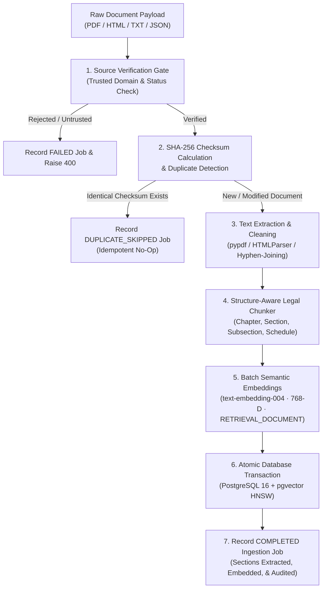

# NyayaSetu (न्यायसेतु) — Legal Document Ingestion Pipeline Specification

**Specification & Operational Manual:** Reliable Indian Statutory & Precedent Ingestion Architecture  
**Effective Date:** November 21, 2026  
**Target Infrastructure:** FastAPI 0.115 · SQLAlchemy 2.0 (Asyncio) · PostgreSQL 16 · pgvector · Google GenAI (`text-embedding-004`)  
**Document Status:** Production Operational Standard  

---

## 1. Executive Summary & Core Objective

NyayaSetu requires an automated, grounded, and tamper-evident document ingestion pipeline capable of transforming raw official Indian legal documents (Bare Acts, central gazettes, judicial decisions, and legal aid schemes) into structured, semantically searchable vector chunks.

### Core Invariants:
1. **Zero Hallucination / Zero Fabrication:** Documents must originate exclusively from verified, official government portals or gazettes. Unaccredited sources are strictly rejected.
2. **Structural Integrity:** Legal provisions must **never** be sliced arbitrarily at naive token or character boundaries. Every chunk preserves its legislative identity (Act title, chapter, section number, clause heading, subsections, provisos, explanations, and schedules).
3. **Deterministic Idempotency:** Duplicate submissions with identical SHA-256 digests are identified immediately and skipped without creating duplicate database rows or calling external embedding APIs.
4. **Graceful Reprocessing & Version Tracking:** When an existing statute is amended or updated, its section chunks are atomically replaced within a database transaction, preserving source foreign keys and logging version history.
5. **Production Error Transparency:** Ingestion failures (syntax errors, invalid PDF encodings, network timeouts, unverified URLs) are captured in `legal_ingestion_jobs` with sanitized error messages that never expose secrets or credentials.

---

## 2. Pipeline Architecture & Flow



---

## 3. Detailed Ingestion Pipeline Stages

### Stage 1: Official Source Verification Gate
Before reading file content, the pipeline validates the metadata:
- **Verification Status:** If `source_metadata.verification_status == "REJECTED"`, the ingestion immediately aborts with `ValueError`.
- **Accredited Domains:** When an `official_source_url` is supplied, its host domain is checked against the accredited government whitelist:
  * `indiacode.nic.in` (India Code Digital Repository)
  * `egazette.gov.in` / `gazetteofindia.nic.in` (Official Gazette of India)
  * `mha.gov.in` (Ministry of Home Affairs - Criminal Sanhitas)
  * `meity.gov.in` (Ministry of Electronics and Information Technology)
  * `morth.nic.in` (Ministry of Road Transport and Highways - Motor Vehicles)
  * `nalsa.gov.in` (National Legal Services Authority)
  * `sci.gov.in` / `main.sci.gov.in` (Supreme Court of India)
  * `ecourts.gov.in` / `judgments.ecourts.gov.in` (e-Courts Repository)
  * `labour.gov.in` (Ministry of Labour and Employment)
  * `ipindia.gov.in` / `legislative.gov.in` (Intellectual Property / Legislative Dept)

### Stage 2: Cryptographic Checksum & Duplicate Detection
- The raw byte stream or text is hashed using standard SHA-256:
  $$\text{Checksum} = \text{SHA256}(\text{RawContent})$$
- The database is queried for any existing `LegalSource` with matching `content_checksum` or matching `(short_code, document_version)`.
- **Idempotent Skip:** If an identical source with active chunks exists and `force_reprocess=False`, an ingestion job record is generated with `status="DUPLICATE_SKIPPED"` and the existing record is returned without re-embedding.

### Stage 3: Text Extraction & Normalization
Implemented in [`backend/app/modules/legal_knowledge/document_parser.py`](file:///Users/yashodhan/Documents/Projects/NyayaSetu/backend/app/modules/legal_knowledge/document_parser.py):
- **PDF Extraction:** Uses `pypdf.PdfReader` to extract pages, strips Gazette headers/footers (`THE GAZETTE OF INDIA`, `PUBLISHED BY AUTHORITY`, page numbers), and eliminates soft hyphenation across lines (e.g., converting `compen-\nsation` to `compensation`).
- **HTML Extraction:** Custom `_LegalHTMLStripper` subclassing `html.parser.HTMLParser` discards `<script>`, `<style>`, `<nav>`, `<header>`, and `<footer>` tags, preserving paragraph tags as clear line breaks.
- **Text Normalization:**
  * Replaces smart quotes (`“`, `”`, `‘`, `’`) and em-dashes (`—`, `–`).
  * Normalizes non-breaking spaces (`\xa0`) to regular spaces.
  * Consolidates excessive consecutive blank lines while preserving double newlines between statutory provisions.
  * **Invariant:** Never alters legislative words, spellings, or numbering.

### Stage 4: Structure-Aware Statutory Chunking
Implemented in [`backend/app/modules/legal_knowledge/legal_chunker.py`](file:///Users/yashodhan/Documents/Projects/NyayaSetu/backend/app/modules/legal_knowledge/legal_chunker.py):
- **Chapter & Part Tracking:** Recognizes patterns like `CHAPTER XVII: OF PENALTIES IN CASE OF DISHONOUR OF CERTAIN CHEQUES` and persists current chapter context into chunk metadata.
- **Section Boundary Detection:** Matches standard Indian statutory formats:
  * `Section 138. Dishonour of cheque for insufficiency...`
  * `Section 25F - Conditions precedent to retrenchment...`
  * `Article 54. For specific performance of a contract...`
- **Schedule Boundary Detection:** Recognizes `THE FIRST SCHEDULE`, `SCHEDULE I`, etc.
- **Subsection Detection:** Scans for legislative clauses (`(1)`, `(2)`, `(a)`, `(b)`, `(i)`, `(ii)`).
- **Long Section Protection:** If a statutory section exceeds 4,500 characters, it is split along subsection boundaries rather than character cuts. Each sub-chunk retains the parent section number and heading to prevent orphan context.
- **Preserved Attributes on Every Chunk:**
  * Act Title (e.g., `The Negotiable Instruments Act, 1881`)
  * Chapter (e.g., `CHAPTER XVII`)
  * Section Number (e.g., `Section 138`)
  * Clause Heading (e.g., `Dishonour of cheque for insufficiency, etc., of funds in the account`)
  * Subsections (e.g., `["(a)", "(b)", "(c)"]`)
  * Clean Statutory Text (verbatim including provisos and explanations)
  * Jurisdiction (e.g., `Union of India`)
  * Document Version (e.g., `2026.1`)
  * Content Checksum (SHA-256 of the chunk text)

### Stage 5: Dense Semantic Embeddings & Batching
Implemented in [`backend/app/modules/legal_assistant/embedding_provider.py`](file:///Users/yashodhan/Documents/Projects/NyayaSetu/backend/app/modules/legal_assistant/embedding_provider.py):
- Uses active `GeminiEmbeddingProvider` (`text-embedding-004`) with asymmetric task type:
  $$\text{task\_type} = \text{"RETRIEVAL\_DOCUMENT"}$$
- Chunks are submitted in configurable batches (`batch_size=50`) to optimize throughput and stay within rate limits.
- Validates vector dimensions ($768$ dimensions). If any dimension mismatch or NaN/Inf is returned, transaction rolls back immediately.
- **Production Guard:** If `settings.is_production` is True and a mock provider is configured, ingestion fails fast with `RuntimeError`.

### Stage 6: Atomic Database Persistence & Job Logging
- In an atomic transaction:
  1. Inserts or updates the `LegalSource` entity (`verification_status="VERIFIED"`, `ingestion_status="COMPLETED"`).
  2. Inserts all `LegalChunk` records linked by `source_id`.
  3. Inserts or updates the `LegalIngestionJob` record with `status="COMPLETED"`, extracted metrics, and execution metadata.
- If an exception occurs:
  1. Database transaction is rolled back.
  2. Sanitized error details (with any API keys or credentials redacted) are recorded in `legal_ingestion_jobs` with `status="FAILED"`.

---

## 4. Database Schema & Migration Specification

### Alembic Migration: `0010_legal_document_ingestion_pipeline`

#### `legal_sources` Table Additions
| Column | Type | Constraints / Defaults | Purpose |
|---|---|---|---|
| `verification_status` | `VARCHAR(32)` | NOT NULL, default `'VERIFIED'`, Indexed | Tracks `VERIFIED`, `PENDING_VERIFICATION`, or `REJECTED` |
| `ingestion_status` | `VARCHAR(32)` | NOT NULL, default `'COMPLETED'`, Indexed | Tracks `PENDING`, `PROCESSING`, `COMPLETED`, `FAILED` |
| `raw_content_path` | `VARCHAR(512)` | Nullable | File path to stored raw PDF/HTML artifact |

#### `legal_chunks` Table Additions
| Column | Type | Constraints / Defaults | Purpose |
|---|---|---|---|
| `embedding_status` | `VARCHAR(32)` | NOT NULL, default `'COMPLETED'`, Indexed | Tracks `PENDING`, `COMPLETED`, `FAILED` |

#### `legal_ingestion_jobs` Table (New)
| Column | Type | Constraints / Defaults | Purpose |
|---|---|---|---|
| `id` | `UUID` | Primary Key, Indexed | Unique job execution identifier |
| `source_id` | `UUID` | Foreign Key (`legal_sources.id`, ON DELETE SET NULL), Indexed | Reference to ingested legal source |
| `source_title` | `VARCHAR(255)` | NOT NULL, Indexed | Act or judgment title |
| `file_format` | `VARCHAR(32)` | NOT NULL | `PDF`, `HTML`, `TXT`, `JSON` |
| `status` | `VARCHAR(32)` | NOT NULL, default `'PENDING'`, Indexed | `PENDING`, `PROCESSING`, `COMPLETED`, `FAILED`, `DUPLICATE_SKIPPED` |
| `content_checksum` | `VARCHAR(64)` | Nullable, Indexed | SHA-256 digest of input document |
| `chunks_extracted` | `INTEGER` | NOT NULL, default `0` | Count of statutory sections parsed |
| `chunks_embedded` | `INTEGER` | NOT NULL, default `0` | Count of vectors generated |
| `error_message` | `TEXT` | Nullable | Sanitized error stack trace on failure |
| `details_json` | `JSONB` / `JSON` | Nullable, default `{}` | Version details, reprocess flags, execution stats |
| `created_at` | `TIMESTAMP WITH TIME ZONE` | NOT NULL, server_default `now()` | Ingestion start timestamp |
| `updated_at` | `TIMESTAMP WITH TIME ZONE` | NOT NULL, server_default `now()` | Ingestion finish timestamp |

---

## 5. Operational Commands & CLI Tool

NyayaSetu provides a unified CLI tool at [`backend/scripts/ingest_legal_document.py`](file:///Users/yashodhan/Documents/Projects/NyayaSetu/backend/scripts/ingest_legal_document.py).

### Command Reference

```bash
cd backend
source ../venv/bin/activate

# 1. Display Help & Options
python scripts/ingest_legal_document.py --help

# 2. Ingest a Single PDF Bare Act (e.g., from India Code)
python scripts/ingest_legal_document.py \
  --file /path/to/CommercialCourtsAct2015.pdf \
  --title "The Commercial Courts Act, 2015" \
  --short-code "CCA_2015" \
  --citation "Act No. 4 of 2016" \
  --jurisdiction "Union of India" \
  --official-url "https://www.indiacode.nic.in/handle/123456789/2157" \
  --version "1.0"

# 3. Ingest an HTML Gazette Document
python scripts/ingest_legal_document.py \
  --file /path/to/notification.html \
  --title "Consumer Protection E-Commerce Rules, 2020" \
  --short-code "CPA_ECOM_2020" \
  --official-url "https://egazette.gov.in/..."

# 4. Force Reprocessing of an Amended Document (Replace Chunks & Track Version)
python scripts/ingest_legal_document.py \
  --file /path/to/amended_act.txt \
  --title "The Specific Relief Act, 1963" \
  --short-code "SRA_1963" \
  --version "2.0" \
  --force

# 5. Idempotently Seed the Curated 20-Statute Baseline Corpus
python scripts/ingest_legal_document.py --seed

# 6. Re-Embed All Existing Chunks (e.g., When Switching Models)
python scripts/ingest_legal_document.py --reembed
```

---

## 6. Admin REST API Endpoints

Mounted under `/api/v1/legal-knowledge` (requires `ADMIN` role):

### 1. Ingest Raw Text / HTML (`POST /api/v1/legal-knowledge/ingest/text`)
```http
POST /api/v1/legal-knowledge/ingest/text HTTP/1.1
Host: localhost:8000
Authorization: Bearer <ADMIN_JWT_TOKEN>
Content-Type: application/json

{
  "title": "The Commercial Courts Act, 2015",
  "short_code": "CCA_2015",
  "citation": "Act No. 4 of 2016",
  "jurisdiction": "Union of India",
  "official_source_url": "https://www.indiacode.nic.in/handle/123456789/2157",
  "document_version": "1.0",
  "file_format": "TXT",
  "content_text": "Section 12A. Pre-Institution Mediation and Settlement...\nSection 13. Appeals from decrees of Commercial Courts...",
  "force_reprocess": false
}
```

### 2. Ingest Document File (`POST /api/v1/legal-knowledge/ingest/file`)
Multipart form-data endpoint accepting PDF, HTML, or TXT file uploads.

### 3. List Ingestion Jobs & Run Logs (`GET /api/v1/legal-knowledge/jobs`)
```http
GET /api/v1/legal-knowledge/jobs?status=COMPLETED&limit=20 HTTP/1.1
Authorization: Bearer <ADMIN_JWT_TOKEN>
```
Returns extraction counts, checksums, timestamps, and error traces.

### 4. List Verified Legal Sources (`GET /api/v1/legal-knowledge/sources`)
Public endpoint listing all verified statutes, citations, chunk counts, and official URLs.

---

## 7. Verification & Test Suite

The pipeline is tested in [`backend/tests/test_legal_document_ingestion.py`](file:///Users/yashodhan/Documents/Projects/NyayaSetu/backend/tests/test_legal_document_ingestion.py):
* `test_document_parser_clean_legal_text`: Hyphenated line break repair and whitespace cleanup.
* `test_document_parser_html_extraction`: Tag stripping and paragraph extraction.
* `test_legal_chunker_preserves_chapters_sections_and_subsections`: Validates chunking along chapter, section, and clause heading boundaries.
* `test_legal_chunker_handles_schedules`: Validates Schedule chunking.
* `test_pipeline_ingest_document_successful`: End-to-end ingestion and pgvector storage.
* `test_pipeline_idempotent_duplicate_detection`: Submitting identical content records `DUPLICATE_SKIPPED`.
* `test_pipeline_reprocess_on_document_modification`: Atomic chunk replacement and version history logging.
* `test_pipeline_rejects_untrusted_source_url`: Rejection of non-accredited domains.
* `test_pipeline_rejects_explicitly_rejected_verification_status`: Rejection of unverified sources.
* `test_admin_api_ingest_text`: Admin text ingestion API test.
* `test_admin_api_list_ingestion_jobs`: Admin jobs listing API test.
* `test_public_api_list_sources`: Public source list API test.

Execution command:
```bash
pytest backend/tests/test_legal_document_ingestion.py -v
```
