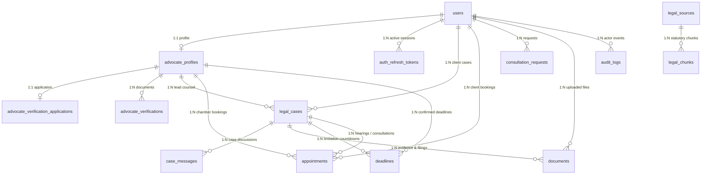

# NyayaSetu (न्यायसेतु) — Project Architecture Audit

**Date of Audit:** November 19, 2026  
**Auditor:** Senior Principal Systems Architect & Legal Technology Specialist  
**Repository State:** Dual-stack legal platform (Next.js 16 Frontend + FastAPI/PostgreSQL Backend)  
**Status:** Audit Complete · Zero Code Modifications (Phase 1)

---

## 1. Executive Summary

NyayaSetu is an Indian legal platform bridging citizens, MSMEs, and verified advocates across District Courts, High Courts, and the Supreme Court of India. The project consists of two distinct components:

1. **Frontend (`frontend/`):** A Next.js 16.4.5 (App Router, React 19.3, Tailwind CSS 4) web application. It features a public-facing editorial marketing site, a dual-role authentication screen, and a 20-route authenticated client portal (`/dashboard/*`). Currently, the frontend operates entirely on client-side static arrays (`src/data/`) and browser-local mock service layers (`src/services/dashboard/`), with no live API calls to the backend.
2. **Backend (`backend/`):** A modular monolith built on Python 3.12, FastAPI, Pydantic v2, SQLAlchemy 2 (async), Alembic, and PostgreSQL with PostGIS (`geoalchemy2`) and pgvector (`pgvector.sqlalchemy`). It features 12 core database entities, 8 migrations, 79 passing automated tests, Argon2id/JWT authentication, a private encrypted document vault, an objective advocate matching engine, and a Retrieval-Augmented Generation (RAG) assistant grounded in curated Indian Bare Acts.

### Key Finding on Visual Architecture
The application currently exhibits a **visual split**:
- **The Homepage (`/`) and marketing pages:** Implement a bespoke, dignified, editorial design system inspired by classical legal publishing—warm paper tones (`#f4efe6`, `#f3ece1`, `#fffaf2`), deep espresso roast typography (`#2a1c12`), muted umber accents (`#5b4a3b`), antique bronze highlights (`#9a6a35`), crisp square borders (`rounded-none` / `rounded-[2px]`), serif display typography (`Gambetta`), and stamp badges.
- **The Login screen (`/login`) and Dashboard portal (`/dashboard/*`):** Diverge into a generic modern SaaS aesthetic with rounded pill containers (`rounded-2xl`, `rounded-xl`), sans-serif display typography (forced via `dashboard.css`), soft pastel colored chips, and mobile-first container styling that clashes with the homepage's authoritative judicial aesthetic.

---

## 2. Frontend Architecture

### 2.1 Technology Stack & Dependencies
* **Framework:** Next.js 16.4.5 (App Router, Server Components + Client Boundary islands)
* **Runtime:** Node.js (NodeNext) / React 19.3.0
* **Language:** TypeScript 5
* **Styling:** Tailwind CSS 4 (`@import "tailwindcss";` in `src/app/globals.css`)
* **Motion & Animation:** Framer Motion 14
* **3D Visuals:** Three.js via `@react-three/fiber` (v9) and `@react-three/drei` (v10) hosting the Lady Justice GLB canvas (`src/components/3d/lady-justice-canvas.tsx`)
* **Icons:** `lucide-react`
* **Utilities:** `clsx`, `tailwind-merge` in `src/lib/utils.ts`

### 2.2 Directory Layout
```text
frontend/
├── public/
│   └── models/lady-justice/       # Lady Justice 3D asset & PBR textures
├── src/
│   ├── app/                       # App Router routes & layouts
│   │   ├── layout.tsx             # Root layout with fonts, metadata, Navbar/Footer
│   │   ├── globals.css            # Root design tokens & typography scale
│   │   ├── page.tsx               # Homepage (Design Reference)
│   │   ├── login/page.tsx         # Login & 3-step citizen onboarding
│   │   ├── dashboard/             # Authenticated legal portal
│   │   │   ├── layout.tsx         # Portal shell (Sidebar, Topbar, Language switcher)
│   │   │   ├── dashboard.css      # Scoped CSS overrides for .dashboard-scope
│   │   │   └── [subroutes]/       # 20 feature subpages
│   │   ├── practices/             # Practice areas directory
│   │   ├── people/                # Advocates directory
│   │   ├── matters/               # Representative matters ledger
│   │   ├── insights/              # Legal guides and articles
│   │   ├── firm/                  # Firm background, timeline & pro bono
│   │   ├── contact/               # Conflict check intake form
│   │   ├── privacy/ & disclaimer/ # Legal compliance disclosures
│   │   └── not-found.tsx          # Custom 404
│   ├── components/
│   │   ├── 3d/                    # Three.js canvas & WebGL loaders
│   │   ├── layout/                # Container, Section, Navbar, Footer, BackToTop
│   │   ├── sections/              # Homepage marketing section blocks
│   │   ├── ui/                    # Editorial UI primitives (Button, Card, Badge, Input, etc.)
│   │   └── dashboard/             # Dashboard-specific UI primitives (Button, Card, Badge, Modal, etc.)
│   ├── data/                      # Static mock data arrays (practices, lawyers, matters, faqs)
│   ├── lib/                       # Utilities, auth-context, dashboard-ui-context, time helpers
│   ├── services/dashboard/        # Mock service adapters (auth, chat, intake, triage, bookings, etc.)
│   └── types/                     # Shared TypeScript interfaces & types
```

### 2.3 State Management & Client Services
The frontend does **not** make HTTP requests to the backend. It uses React Context and mock service abstractions:
1. `AuthContext` (`src/lib/auth-context.tsx`): Stores authenticated state (`demoUser`), active role (`citizen` or `advocate`), selected language (`en`, `hi`, `mr`, `ta`, `te`, `bn`), and onboarding completion in browser `localStorage`.
2. `DashboardUIContext` (`src/lib/dashboard-ui-context.tsx`): Manages toast notifications and accessibility toggles.
3. `services/dashboard/*`: 10 mock service modules (`auth.ts`, `chat.ts`, `intake.ts`, `triage.ts`, `advocates.ts`, `deadlines.ts`, `documents.ts`, `bookings.ts`, `messages.ts`, `consent.ts`). They simulate asynchronous network latency with `setTimeout` and operate on in-memory mock data.

---

## 3. Backend Architecture

### 3.1 Technology Stack & Engine
* **Runtime:** Python 3.12
* **Framework:** FastAPI 0.115.14
* **Schema Validation & Settings:** Pydantic v2 & Pydantic-Settings
* **ORM:** SQLAlchemy 2.0.58 (Strict Async Mode using `async_sessionmaker`)
* **Driver:** `psycopg` (Psycopg 3 with native async connection pooling)
* **Migrations:** Alembic 1.14.x
* **Extensions:**
  - `postgis` / `geoalchemy2` (Spatial indexing for advocate chamber locations)
  - `vector` / `pgvector` (Dense semantic embeddings for legal statutes)
  - `uuid-ossp` (Native RFC 4122 UUID generation)
* **Security:** `argon2-cffi` (Argon2id password hashing), `PyJWT` (HMAC-SHA256 tokens)
* **Testing:** Pytest 8.4.2 + `pytest-asyncio` + `httpx` (79 automated tests passing against in-memory SQLite with full PostgreSQL static SQL generation)

### 3.2 Directory Structure
```text
backend/
├── alembic.ini                    # Migration engine configuration
├── app/
│   ├── main.py                    # Application factory, CORS, exception handlers, lifecycle
│   ├── core/
│   │   ├── config.py              # Centralized Pydantic BaseSettings
│   │   ├── database.py            # Async engine, sessionmaker, Base model, health probe
│   │   ├── errors.py              # Unified AppException hierarchy & HTTP formatters
│   │   ├── logging.py             # Structured logging configuration
│   │   ├── models.py              # Consolidated ORM registry for Base.metadata
│   │   └── security.py            # Argon2 hashing & JWT encoding/decoding
│   ├── api/v1/
│   │   ├── health.py              # Health check with database latency diagnostic
│   │   └── router.py              # Central v1 router mounting all 12 domain routers
│   ├── modules/
│   │   ├── auth/                  # Register, Login, Refresh, Logout, /me
│   │   ├── users/                 # User entity & profile management
│   │   ├── advocates/             # Bar Council profile & verification state machine
│   │   ├── cases/                 # Case intake, dossier, and case messages
│   │   ├── triage/                # Rule-based case triage engine
│   │   ├── matching/              # PostGIS multi-factor advocate matching engine
│   │   ├── legal_knowledge/       # Curated Bare Acts & chunks storage
│   │   ├── legal_assistant/       # RAG retrieval, Gemini/Mock LLM, Citation validator
│   │   ├── documents/             # Private vault storage, SHA-256 integrity, 15-min JWT tokens
│   │   ├── appointments/          # Consultation booking & overlapping conflict prevention
│   │   ├── deadlines/             # Statutory limitation tracking & advocate confirmation
│   │   └── admin/                 # Verification queue & audit log ledger
│   └── shared/                    # Shared pagination and response schemas
├── migrations/
│   ├── env.py                     # Alembic async environment
│   └── versions/                  # 8 sequential migration scripts (0001 to 0008)
├── storage/vault/                 # Private document repository outside web root
├── tests/                         # Pytest integration test suite
└── docs/                          # API contract, schema, and development logs
```

---

## 4. Database Models & Schema Specification

The backend data model comprises **12 core entities** mapped declaratively via SQLAlchemy 2:



### Model Summary Table

| Model Name | Table Name | Primary Key | Key Fields & Constraints | Purpose |
| :--- | :--- | :--- | :--- | :--- |
| **User** | `users` | `UUIDv4` | `email` (UQ), `phone` (UQ), `password_hash`, `role` (`CITIZEN`, `ADVOCATE`, `ADMIN`), `preferred_language` | Core identity & RBAC authorization |
| **RefreshToken** | `auth_refresh_tokens` | `UUIDv4` | `user_id` (FK), `token_hash` (UQ), `is_revoked`, `expires_at` | Refresh token rotation and revocation |
| **AdvocateProfile** | `advocate_profiles` | `UUIDv4` | `user_id` (FK, UQ), `bar_council_id` (UQ), `platform_verification_status`, `location` (`Geography(Point, 4326)`), `fixed_consultation_fee_inr` | Verified legal practitioner directory & PostGIS matching |
| **AdvocateVerificationApplication** | `advocate_verification_applications` | `UUIDv4` | `advocate_id` (FK, UQ), `enrollment_number`, `state_bar_council`, `platform_verification_status`, `decision_reason` | State Bar Council credential verification workflow |
| **AdvocateVerification** | `advocate_verifications` | `UUIDv4` | `advocate_id` (FK), `application_id` (FK), `verification_type` (Enum: `ENROLLMENT_CERTIFICATE`, `BAR_ID_CARD`, etc.), `file_path`, `checksum_sha256` | Uploaded advocate credential documents |
| **LegalCase** | `legal_cases` | `UUIDv4` | `case_reference` (UQ), `client_id` (FK), `lead_advocate_id` (FK), `legal_issue_category`, `urgency`, `triage_result` (JSONB) | Client case files and matter tracking |
| **CaseMessage** | `case_messages` | `UUIDv4` | `case_id` (FK), `sender_id` (FK), `message_body`, `is_internal_note` | Privileged case communications |
| **ConsultationRequest** | `consultation_requests` | `UUIDv4` | `case_id` (FK), `client_id` (FK), `advocate_id` (FK), `status` (`PENDING`, `ACCEPTED`, `DECLINED`) | Pre-appointment outreach request |
| **Appointment** | `appointments` | `UUIDv4` | `booking_reference` (UQ), `case_id` (FK), `advocate_id` (FK), `client_id` (FK), `scheduled_start`, `scheduled_end`, `status`, `timezone` | Calendar booking with conflict prevention |
| **LegalSource** | `legal_sources` | `UUIDv4` | `title`, `source_type` (`BARE_ACT`, `COURT_JUDGMENT`), `act_or_judgment_identifier`, `content_checksum` | Official, tamper-proof legal sources |
| **LegalChunk** | `legal_chunks` | `UUIDv4` | `source_id` (FK), `section_number`, `chunk_text`, `embedding` (`Vector(768)`), `content_checksum` | Granular sections with dense vector embeddings |
| **Document** | `documents` | `UUIDv4` | `case_id` (FK), `uploader_id` (FK), `file_name`, `storage_path`, `checksum_sha256`, `is_confidential` | Case files stored in private vault |
| **Deadline** | `deadlines` | `UUIDv4` | `case_id` (FK), `due_date`, `deadline_type`, `is_advocate_confirmed`, `confirmed_by_advocate_id` (FK), `reminders_json` | Statutory limitation & court deadline tracking |
| **AuditLog** | `audit_logs` | `UUIDv4` | `actor_id` (FK), `action`, `entity_type`, `entity_id`, `ip_address`, `payload_snapshot` (JSONB) | DPDP Act 2023 & BCI compliance trail |

---

## 5. API Endpoint Inventory

The FastAPI backend exposes 45 versioned endpoints under `/api/v1/`:

| Module | Method | Path | Auth / Role | Description |
| :--- | :--- | :--- | :--- | :--- |
| **Health** | `GET` | `/api/v1/health` | Public | System & database health probe |
| **Auth** | `POST` | `/api/v1/auth/register` | Public | Citizen registration |
| **Auth** | `POST` | `/api/v1/auth/register/advocate` | Public | Advocate registration |
| **Auth** | `POST` | `/api/v1/auth/login` | Public | Email/password login with JWT generation |
| **Auth** | `POST` | `/api/v1/auth/refresh` | Public | Refresh token rotation |
| **Auth** | `POST` | `/api/v1/auth/logout` | Authenticated | Token revocation |
| **Auth** | `GET` | `/api/v1/auth/me` | Authenticated | Current user profile |
| **Advocates** | `POST` | `/api/v1/advocates/apply` | Advocate | Submit bar credential application |
| **Advocates** | `GET` | `/api/v1/advocates/me` | Advocate | Advocate's own profile |
| **Advocates** | `POST` | `/api/v1/advocates/me/verification` | Advocate | Submit verification details |
| **Advocates** | `GET` | `/api/v1/advocates/me/verification` | Advocate | Application status & requirements |
| **Advocates** | `POST` | `/api/v1/advocates/me/verification/documents` | Advocate | Upload certificate / Bar ID |
| **Advocates** | `GET` | `/api/v1/advocates/me/verification/documents/{id}/download` | Advocate | Download uploaded certificate |
| **Admin** | `GET` | `/api/v1/admin/advocates/pending` | Admin | Pending advocate applications |
| **Admin** | `GET` | `/api/v1/admin/advocates/{id}` | Admin | Advocate application dossier |
| **Admin** | `PATCH` | `/api/v1/admin/advocates/{id}/verification` | Admin | Legacy status update |
| **Admin** | `GET` | `/api/v1/admin/advocate-verifications` | Admin | Filterable verification queue |
| **Admin** | `GET` | `/api/v1/admin/advocate-verifications/{id}` | Admin | Detailed verification application |
| **Admin** | `POST` | `/api/v1/admin/advocate-verifications/{id}/decision` | Admin | Approve / Reject verification |
| **Admin** | `POST` | `/api/v1/admin/advocate-verifications/{id}/request-info` | Admin | Request additional certificates (AIBE/COP) |
| **Admin** | `GET` | `/api/v1/admin/advocate-verifications/documents/{id}/download` | Admin | Admin document inspection |
| **Cases** | `POST` | `/api/v1/cases` | Authenticated | Submit case intake matter |
| **Cases** | `GET` | `/api/v1/cases` | Authenticated | List user cases / advocate matters |
| **Cases** | `GET` | `/api/v1/cases/{case_id}` | Authenticated | Get case file |
| **Cases** | `PATCH` | `/api/v1/cases/{case_id}` | Authenticated | Update case matter |
| **Cases** | `POST` | `/api/v1/cases/{case_id}/triage` | Authenticated | Run triage on existing case |
| **Triage** | `POST` | `/api/v1/triage/assess` | Public / Auth | Deterministic preliminary triage assessment |
| **Matching** | `GET` | `/api/v1/matching/cases/{case_id}/advocates` | Case Owner / Admin | Match verified advocates to case |
| **Matching** | `POST` | `/api/v1/matching/consultation-requests` | Citizen | Create consultation outreach |
| **Matching** | `GET` | `/api/v1/matching/consultation-requests` | Authenticated | List consultation requests |
| **Matching** | `GET` | `/api/v1/matching/advocates` | Public / Auth | Search verified advocates with PostGIS filter |
| **Legal AI** | `POST` | `/api/v1/legal/ask` | Public / Auth | RAG legal question answering with citations |
| **Legal AI** | `POST` | `/api/v1/legal/admin/sources` | Admin | Register legal source |
| **Legal AI** | `POST` | `/api/v1/legal/admin/sources/{id}/chunks` | Admin | Ingest and embed legal chunk |
| **Legal AI** | `POST` | `/api/v1/legal/admin/seed` | Admin | Seed curated Bare Acts dataset |
| **Legal AI** | `GET` | `/api/v1/legal/admin/sources` | Admin | List legal sources & chunk counts |
| **Documents** | `POST` | `/api/v1/documents/cases/{case_id}/upload` | Case Owner / Admin | Upload document to private vault |
| **Documents** | `GET` | `/api/v1/documents/cases/{case_id}` | Case Owner / Admin | List documents in case vault |
| **Documents** | `GET` | `/api/v1/documents/{document_id}` | Case Owner / Admin | Document metadata & checksum |
| **Documents** | `GET` | `/api/v1/documents/{document_id}/access-token` | Case Owner / Admin | Issue 15-minute signed download JWT |
| **Documents** | `GET` | `/api/v1/documents/{document_id}/download` | Token / Auth | Secure binary download streaming |
| **Appointments** | `POST` | `/api/v1/appointments` | Citizen / Admin | Book consultation with conflict check |
| **Appointments** | `GET` | `/api/v1/appointments` | Authenticated | List appointments (role-scoped) |
| **Appointments** | `GET` | `/api/v1/appointments/{id}` | Authenticated | Get appointment details |
| **Appointments** | `PATCH` | `/api/v1/appointments/{id}/status` | Advocate / Admin | Confirm or reject consultation |
| **Deadlines** | `POST` | `/api/v1/deadlines` | Case Owner / Admin | Register statutory deadline |
| **Deadlines** | `GET` | `/api/v1/deadlines` | Authenticated | List user deadlines |
| **Deadlines** | `GET` | `/api/v1/deadlines/cases/{case_id}` | Case Owner / Admin | List deadlines for a case |
| **Deadlines** | `GET` | `/api/v1/deadlines/{id}` | Case Owner / Admin | Get deadline record |
| **Deadlines** | `PATCH` | `/api/v1/deadlines/{id}/confirm` | Advocate / Admin | Advocate limitation review & confirmation |
| **Deadlines** | `PATCH` | `/api/v1/deadlines/{id}/complete` | Case Owner / Admin | Mark deadline completed |

---

## 6. Authentication and Role Permissions

NyayaSetu implements a three-tier role hierarchy:
1. `CITIZEN`: Can file cases, run preliminary triage, view matched verified advocates, upload case evidence to their private vault, request consultations, and track deadlines.
2. `ADVOCATE`: Can apply for platform verification, upload bar credentials, view assigned cases, accept/reject consultations, review and confirm statutory limitation periods, and access client documents shared under consent.
3. `ADMIN`: System supervisor. Can inspect the advocate verification queue, approve/reject credentials with audit reasons, request supplemental evidence (AIBE/COP), inspect compliance audit logs, and seed statutory Bare Acts.

### Security Guarantees
- Passwords hashed with `Argon2id` (memory cost 65536 KiB, time cost 3 iterations).
- Access tokens expire in 30 minutes; refresh tokens expire in 7 days and are rotated on every use.
- The `ADMIN` role cannot be self-assigned during registration; any attempt returns `403 Forbidden`.
- Documents in `backend/storage/vault/` cannot be accessed via static public URLs; downloads require either an active bearer token or a 15-minute temporary JWT download token.

---

## 7. Existing Working Functionality Assessment

| Subsystem | Backend Implementation | Frontend Implementation | Integration Status |
| :--- | :--- | :--- | :--- |
| **User Authentication** | Fully functional (Argon2id + JWT + refresh rotation) | Simulated (Phone OTP with hardcoded `123456`, localStorage) | **Disconnected** |
| **Advocate Verification** | Fully functional (4-stage admin review workflow + docs) | Hardcoded static advocate list (`lawyers.ts`, `dashboard-mock-data.ts`) | **Disconnected** |
| **Case Intake & Triage** | Fully functional (`/api/v1/cases`, `/api/v1/triage/assess`) | Client-side questionnaire & local rule evaluator | **Disconnected** |
| **Advocate Matching** | Fully functional (5-factor engine + PostGIS coordinates) | Client-side sorting over 4 static mock advocates | **Disconnected** |
| **Legal AI Assistant** | Fully functional (RAG + Bare Acts + Citation Validator) | Client-side simulation with static canned responses | **Disconnected** |
| **Document Vault** | Fully functional (Private vault + SHA-256 + 15m JWT) | Client-side file table with mock links | **Disconnected** |
| **Consultation Booking** | Fully functional (Conflict detection + lifecycle) | Client-side slot selector & mock checkout | **Disconnected** |
| **Limitation Deadlines** | Fully functional (Advocate confirmation + audit logs) | Client-side list & calendar view | **Disconnected** |
| **Audit Logs** | Fully functional (`audit_logs` table) | Displayed on profile page from local mock array | **Disconnected** |
| **3D Lady Justice Hero** | N/A (Frontend Only) | Fully functional (Three.js canvas + GLB loader) | **Working on Frontend** |
| **Legal Notice Generator** | N/A (Frontend Only) | Fully functional (In-browser HTML print preview) | **Working on Frontend** |
