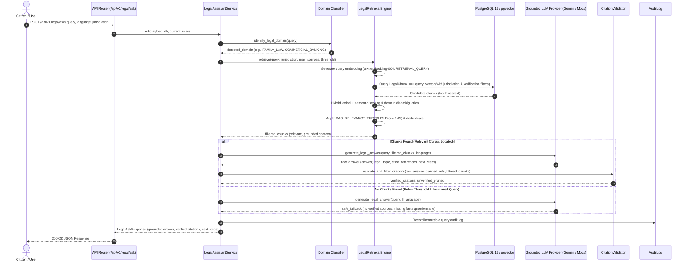

# NyayaSetu (न्यायसेतु) — Grounded RAG Retrieval Architecture & Design

**Specification Document:** Hybrid Semantic-Lexical Statutory Retrieval & Grounded Synthesis  
**Effective Date:** November 21, 2026  
**Infrastructure Stack:** FastAPI 0.115 · PostgreSQL 16 · pgvector · Google GenAI (`text-embedding-004` & `gemini-2.5-flash`)  
**Compliance Standard:** Supreme Court of India · India Code · BCI Rule 36 · Limitation Act 1963  

---

## 1. Executive Summary & Core Objective

NyayaSetu provides Indian citizens and empanelled advocates with an AI-assisted legal assessment engine. In high-stakes legal technology, hallucination, fabricated section numbers, and out-of-context legal advice are unacceptable.

The NyayaSetu Grounded Retrieval-Augmented Generation (RAG) pipeline guarantees:
1. **Grounded Legal Synthesis:** The model generates legal explanations derived **strictly** from verified statutory sections and precedents present in the retrieved context.
2. **Deterministic Citation Traceability:** Every returned citation maps directly to an indexed, checksummed statutory provision with its official government URL (India Code, Gazette of India, NALSA).
3. **Cross-Statute Section Disambiguation:** Indian law contains identical section numbers across distinct Acts (e.g., Section 12 of the *Protection of Women from Domestic Violence Act, 2005* vs Section 12 of the *Legal Services Authorities Act, 1987* vs Section 12 of the *Commercial Courts Act, 2015*). The retrieval engine disambiguates query intent to prevent cross-statute section collisions.
4. **Noise & Vector Nearest-Neighbor Rejection:** High-dimensional vector search naturally identifies mathematical "nearest neighbors" even for completely unrelated queries (e.g., questions about maritime salvage or astrophysics). The engine enforces strict composite relevance thresholds to discard spurious vector matches.
5. **Clear No-Source Fallback:** If the curated legal knowledge base does not contain sufficient statutory coverage, the system explicitly informs the citizen, asks for relevant missing facts, and suggests consulting an empanelled advocate.

---

## 2. End-to-End Retrieval & Synthesis Flow



---

## 3. Detailed Retrieval Architecture

### 3.1 Step 1: Legal Domain Classification & Taxonomy
The engine classifies user intent against 10 core legal practice domains:

| Domain Key | Target Statutes | Characteristic Concept Keywords |
|---|---|---|
| `FAMILY_LAW` | `PWDVA_2005`, `HMA_1955`, `HSA_1956` | Domestic violence, divorce, mutual consent, cruelty, maintenance, alimony, custody, coparcenary, daughter, shared household |
| `CRIMINAL_LAW` | `BNS_2023`, `BNSS_2023`, `BSA_2023` | FIR, bail, anticipatory bail, police, undertrial, cheating, breach of trust, electronic evidence, Section 482, Section 318 |
| `COMMERCIAL_BANKING` | `NI_ACT`, `ICA_1872` | Cheque dishonour, bounce, Section 138, statutory notice, contract, breach, damages, penalty, agreement |
| `CONSUMER_PROTECTION` | `CPA_2019` | Defective goods, deficient service, warranty, refund, e-Daakhil, District Commission, product liability, Section 35 |
| `CYBER_LAW` | `IT_ACT_2000`, `DPDPA_2023` | Phishing, identity theft, cheating by personation, data privacy, Data Principal, consent withdrawal, Section 66C, Section 66D |
| `MOTOR_VEHICLES` | `MV_ACT_1988` | Road accident, MACT, Claims Tribunal, grievous hurt, no-fault compensation, Section 164, Section 166 |
| `PROPERTY_CIVIL` | `RERA_2016`, `TPA_1882`, `LIMITATION_1963` | Sale deed, possession delay, builder, lease, tenancy termination notice, limitation period, Article 54, Section 5 condonation |
| `LEGAL_AID` | `NALSA_1987` | Free legal aid entitlement, Section 12, Lok Adalat compromise award, Section 21 finality, court fee refund |
| `LABOUR_EMPLOYMENT` | `IDA_1947`, `PGA_1972` | Workman retrenchment, 15 days compensation, Section 25F, gratuity eligibility, continuous service 5 years |
| `INTELLECTUAL_PROPERTY` | `COPYRIGHT_1957`, `TRADEMARKS_1999` | Copyright infringement, fair dealing Section 52, trademark infringement, deceptively similar mark Section 29 |

### 3.2 Step 2: Cross-Statute Section Collision Resolution
In Indian law, common section numbers (`Section 12`, `Section 5`, `Section 10`, `Section 14`, `Section 18`) appear across dozens of unrelated Acts.
* **The Problem:** A query such as *"What relief can I get under Section 12 for domestic violence?"* could naively match Section 12 of NALSA (legal aid criteria) or Section 12 of Commercial Courts Act.
* **The Solution:** The retriever computes a **domain alignment factor**:
  * If the candidate chunk's statute belongs to the detected query domain, it receives a $+0.60$ section match boost.
  * If the candidate chunk's statute belongs to an unaligned domain, the section match boost is dampened to $+0.05$.
  * Consequently, PWDVA Section 12 ranks top, and NALSA Section 12 is filtered out.

### 3.3 Step 3: Dense Semantic Vector Search with pgvector
* **Model:** Google Gemini `text-embedding-004` natively generating 768-dimensional normalized float vectors.
* **Asymmetric Task Types:**
  * Query embedding: `task_type="RETRIEVAL_QUERY"`
  * Document embedding: `task_type="RETRIEVAL_DOCUMENT"`
* **Database Search:** Uses native PostgreSQL HNSW index with cosine distance operator (`<=>`):
  ```sql
  SELECT lc.*, ls.title, ls.jurisdiction, ls.official_source_url
  FROM legal_chunks lc
  JOIN legal_sources ls ON lc.source_id = ls.id
  WHERE ls.verification_status != 'REJECTED'
    AND (ls.jurisdiction ILIKE :jurisdiction OR ls.jurisdiction = 'Union of India')
  ORDER BY lc.embedding <=> :query_vector
  LIMIT 20;
  ```

### 3.4 Step 4: Hybrid Lexical + Semantic Ranking
Cosine distance alone does not prioritize statutory numbers or technical legal definitions. NyayaSetu applies hybrid linear combination scoring:

$$S_{\text{composite}} = (\alpha \cdot S_{\text{semantic}}) + (\beta \cdot S_{\text{lexical}})$$

* $\alpha = 0.70$ (`RAG_SEMANTIC_WEIGHT`)
* $\beta = 0.30$ (`RAG_LEXICAL_WEIGHT`)
* $S_{\text{semantic}} = \text{cosine\_similarity}(v_{\text{query}}, v_{\text{chunk}}) \in [0, 1]$
* $S_{\text{lexical}}$ combines:
  * Exact Section Match with domain alignment ($+0.40$ to $+0.60$)
  * Explicit Act short code / title mention ($+0.45$)
  * Domain taxonomy alignment ($+0.25$)
  * Clause heading token overlap ($+0.15$)

### 3.5 Step 5: Relevance Thresholding & Vector Artifact Rejection
* **Threshold Constant:** `settings.RAG_RELEVANCE_THRESHOLD = 0.45`
* **Nearest-Neighbor Noise Filter:** If $S_{\text{semantic}} < 0.28$ and there is no exact section or Act title lexical hit, the candidate chunk is discarded as irrelevant vector noise.
* **Deduplication:** Multiple chunks representing the exact same statutory section or identical content are deduplicated, preserving only the highest-scoring chunk.

---

## 4. Grounded Synthesis & Citation Validation

### 4.1 Citation Item Schema
Returned citations provide the frontend with structured source references:
```json
{
  "source_title": "The Negotiable Instruments Act, 1881",
  "source_type": "BARE_ACT",
  "act_or_judgment_identifier": "Act No. 26 of 1881",
  "section_or_paragraph": "Section 138",
  "clause_heading": "Dishonour of cheque for insufficiency, etc., of funds in the account",
  "official_source_url": "https://www.indiacode.nic.in/handle/123456789/2189",
  "jurisdiction": "Union of India",
  "document_version": "2026.1",
  "relevant_text": "Where any cheque drawn by a person on an account maintained by him with a banker for payment of any amount of money to another person...",
  "content_checksum": "a8f3b2c1...",
  "is_verified_in_corpus": true
}
```

### 4.2 CitationValidator Execution
Implemented in [`backend/app/modules/legal_assistant/citation_validator.py`](file:///Users/yashodhan/Documents/Projects/NyayaSetu/backend/app/modules/legal_assistant/citation_validator.py):
1. Verifies that every section cited in the answer text exists in the retrieved context chunks.
2. Cross-checks claimed citations against authentic `content_checksum` and `official_source_url`.
3. If an ungrounded or hallucinated section is detected, it is stripped from `citations` and recorded in `unverified_citations_detected`.

---

## 5. Safe No-Source Protocol & Applicability Disclaimers

### 5.1 No-Source Fallback Protocol
When `retrieved_chunks` is empty or no chunk satisfies the relevance threshold:
1. `sources_found` is set to `False`.
2. `citations` is returned as empty list `[]`.
3. The answer states clearly:
   *"No verified legal sources found in the knowledge base addressing this specific query. The available legal knowledge base does not contain sufficient verified statutory information to address this specific legal question reliably."*
4. Prompts the citizen for essential missing facts:
   * State or territorial jurisdiction where the dispute arose.
   * Specific Act, transaction type, or date of incident.
   * Copy of notices, agreements, or court orders received.
5. Recommends consulting an empanelled, verified advocate for formal representation.

### 5.2 Legal Nuance & Applicability Disclaimer
High similarity between a user query and a statutory section does not establish that the section is applicable law for the user's specific case. 
Every assessment includes the platform disclaimer:
> *"NyayaSetu AI Legal Assistant provides informational guidance derived strictly from official Indian Bare Acts and published judicial precedents. A high semantic similarity score does not prove that a statutory provision applies to your specific situation. This information does not constitute formal legal advice or create an advocate-client relationship. Litigants should consult an empanelled, verified advocate for matter-specific representation."*

---

## 6. Verification & Automated Test Coverage

The advanced RAG pipeline is tested in [`backend/tests/test_rag_pipeline_advanced.py`](file:///Users/yashodhan/Documents/Projects/NyayaSetu/backend/tests/test_rag_pipeline_advanced.py):

| Test Identifier | Test Coverage | Expected Assertion |
|---|---|---|
| `test_disambiguation_section_12_domestic_violence_vs_legal_aid` | Section 12 collision between PWDVA and NALSA | PWDVA ranked #1 for DV; NALSA ranked #1 for legal aid |
| `test_multi_statute_retrieval_contract_and_limitation` | Contract breach with delay | Retrieves both Indian Contract Act and Limitation Act |
| `test_no_corpus_coverage_safe_fallback` | Uncovered query (outer space salvage) | `sources_found == False`, 0 citations, missing facts prompt |
| `test_fabricated_or_invalid_section_numbers` | Querying Section 9999 NI Act | Section 9999 never present in verified citations |
| `test_citation_traceability_and_rich_metadata` | Citation schema completeness | URL from indiacode.nic.in, relevant text snippet, checksum verified |
| `test_rejected_source_filtered_from_retrieval` | Sources with `verification_status="REJECTED"` | Never returned in candidate chunks |
| `test_relevance_threshold_filters_out_poor_matches` | Unrelated query (astrophysics dark matter) | 0 chunks returned; nearest-neighbor noise rejected |

Execution command:
```bash
pytest backend/tests/test_rag_pipeline_advanced.py -v
```
